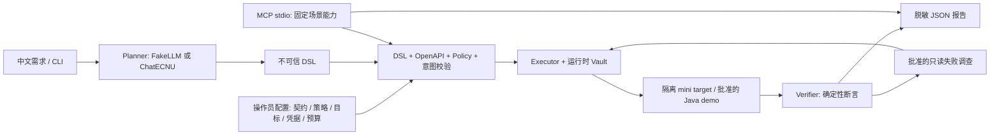
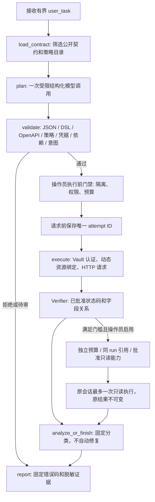

# AgentTest

[](https://github.com/mofengyan595/agenttest/actions/workflows/ci.yml)

**受控的 AI API 测试平台：LLM 规划，人工策略授权，确定性执行与断言。**

2026-10-23增量：[批准负例、分组预算与第三项目复用](docs/trusted-testing-delivery.md)。
阶段1–4工程及新12×3冻结脚手架已实现；离线门禁在第8位置触发输入预算限制，真实排期尚未启动，
整个Goal未完成。[完整失败与分母](docs/trusted-testing-results.md) · [接入成本](docs/trusted-testing-approved-projects.md) ·
[简历/面试边界](docs/trusted-testing-resume-interview.md)。

2026-10-20新里程碑：[自然语言入口与项目配置复用](docs/nl-entry.md)。
阶段1–5新增`goal --project ... --user-task ... --preview`、三层套件、工具协议适配、有界上下文、
SQLite任务服务及`/tasks`工作台。受支持需求的约束从原文与批准关系派生，无需逐题手写完整TaskContract；
旧入口与默认离线流程保持可用。原真实三轮36/36完成：完整计划23/36、完整任务15/36、故障检出8/9；
首次新需求通过并导出无模型pytest。全部DEVELOPMENT_ONLY/UNREVIEWED，独立人审0；追加重试不替换首次成绩。
[三层演示](docs/nl-entry-delivery.md) · [实际价值与失败](docs/nl-entry-value-report.md) · [简历材料](docs/nl-entry-resume-interview.md) · [逐项核对](docs/nl-entry-completion-audit.md)。

[证据可靠性与模型价值](docs/evidence-value-report.md) · [交付导航与五分钟演示](docs/goal-delivery-guide.md) · [简历和面试材料](docs/goal-resume-interview.md)。

2026-10-19 自然语言可靠性增量：公开资源/认证/角色/状态策略关系、生成前联合约束、
独立可信症状与模型建议分层已实现；[根因与边界](docs/nl-reliability-20261019.md)。
新排期72位置已完成并冷核对：**产品29/36对31/36，模型结论9/18对8/18**；
正常17/18对18/18的差异来自首基线超时，不能据此证明正常规划更稳定；主动弃权未改善。
[完整结果与归因限制](docs/nl-validation-completed.md) · [原顺序后段](docs/nl-validation-resumption.md)，超时Token仍未知。
[开发结果与候选选择](docs/nl-development-results.md) · [首请求停止记录](docs/nl-validation-results.md) ·
[可复制CLI→pytest使用路径](docs/nl-usage-guide.md)：新需求首次5步PASS，1次模型/3080 Token，
已导出[NU01无模型回归资产](examples/regressions/NU01)。独立人审、节时与通用泛化仍未验证。

2026-10-18 历史增量：固定计划三组各三轮，严格结论旧模型19/36、候选29/36、零模型规则36/36。
候选支持类结论24/24，但证据不足的正确弃权5/12低于旧模型9/12；单独自然语言端到端仅1/6。
因此未达到完整可靠性目标，未证明相对确定性调查的额外价值；失败、成本与冷复核均保留。
[固定协议](docs/evidence-comparison-protocol.md) / [108位置完整结果](docs/demo-evidence/evidence-validation-results.json) / [6题端到端](docs/demo-evidence/evidence-e2e-results.json)。
本轮219次模型、171,524 Token全已知，无真实第三方业务访问或数据库写入，独立人审与人工效率仍未验证。

上一轮2026-10-18 Goal 已实现引用诊断、有界反馈、待审配置和本地追踪；24 条开发任务各三轮全部执行。
配对故障检出 24/24，健康业务通过 27/30，严格模型结论审计 11/24；124 次模型、145,284 Token。
固定 pytest 本轮更稳定，未证明人工节时；正式独立人审尚未完成。[完整统计](docs/demo-evidence/paired-live-summary.json)保留失败、两段排期及原 12/24 评分。

[有界只读反馈](docs/bounded-feedback.md)：显式能力文件启用 LangGraph 调查或结束循环，
每 run 最多两次只读调查、四次模型（含规划和结论）；原业务判定与证据结论分别保留。
本地 Fake／Mock 验收通过；全新三题真实模型业务故障检出 3/3、调查结论 2/3，
10 次请求／8,647 Token，漏诊和先前规划拒绝保留。[真实结果](docs/demo-evidence/feedback-typed-live-summary.json)。

用户用中文描述测试目标，模型输出不可信 DSL；通过契约、策略、资源依赖和意图检查后，已有 Executor 执行 HTTP，生成脱敏报告。支持显式启用的有界只读反馈调查及旧单轮模式、MCP stdio 工具封装。默认演示和测试无需 API Key、Docker 或外网。

[统一验收与五分钟演示](docs/unified-acceptance.md)：一条离线命令复现项目预检、原演示、课程／工单、复杂 JSON、固定 pytest 与归档复核，并集中说明支持范围、历史真实证据和未验证部分。

[收尾审查与冻结范围](docs/final-review-20261017.md)：修复交付入口超时回收未确认后仍继续执行的问题，保留失败与未执行位置。后续优先维护可复现缺陷和依赖兼容，新功能另立里程碑。

新里程碑[陌生 PocketBase 认证与写入实测](docs/pocketbase-acceptance-20261017.md)：两个授权隔离实例的六条固定基线均完成，六条任务各三轮真实模型 **16/18 完成、68,800 Token**；两次跨账号读取任务因参数格式错误在请求前拒绝，失败保留。覆盖动态 ID、创建／修改回读、权限拒绝和删除后查询；[脱敏汇总](docs/demo-evidence/pocketbase-live-summary.json)与数据库只读核对分开记录，仍为未独立审核的小样本开发证据。

[通用参数名约束](docs/argument-slots-20261017.md)按接口和位置限定模型参数，并在本地重验，合法的 body 字段仍支持。三条新合成任务已留下七份完整真实模型记录，六份任务完成、一份引用校验拒绝；另有一个中断位置和一个未启动位置，已知 10,603 Token、总用量未知。[脱敏统计](docs/demo-evidence/argument-slots-live-summary.json)保留完整分母，旧 PocketBase 失败不改。

后续[引用字段约束](docs/reference-selectors-20261018.md)限制引用候选并核对先前来源，三条新任务真实九次完成 **7/9、12,614 Token**。嵌套与数组索引各 3/3，根响应 1/3；两次绑定拒绝均零业务请求，[失败与统计](docs/demo-evidence/reference-selectors-live-summary.json)原样保留。业务仍为 Mock，原授权、断言和旧未知用量不变。

**本地 Web Console**：React + TypeScript + Vite，支持目标草稿、OpenAPI 导入、历史筛选、四层校验、步骤证据、只读调查和模型统计。默认保留只读报告路径；操作员显式启用任务服务后，可在`/tasks`对注册项目发起受控测试。[安装、启动、架构、安全边界与真实截图](docs/web-console.md)。

**新增离线 OpenAPI 候选发现**：复用契约、Schema 子集与 Policy Registry，发现正常输入、静态负例、批准资源/角色关系，输出稳定 JSON 与明确分母的静态覆盖。所有候选待审，不执行 HTTP 或调用模型。[算法、模型、真实输出与安全边界](docs/candidate-discovery.md)。

**Agent Eval v2**：独立 Schema、确定性意图评分、完整分母、配对缺陷、来源与冻结审计，以及 Candidate Discovery A/B。27 个 C 系列草案全部待人工审核，默认只做离线开发验证；不改历史 T/B 成绩。[设计、评分公式、CLI 与实验边界](docs/agent-eval-v2.md)。

未审核 AI 开发样本的真实模型小规模 A/B 使用[独立开发诊断入口](docs/development-ab.md)，先准备和 Mock 验收，真实调用另行授权；正式 Eval v2 门禁保持不变。

新增[自然语言异步批量测试闭环](docs/batch-natural-language.md)：受控中文需求 → 批准 CSV fixture → 资源绑定 → 有界等待 SUCCEEDED → 结果条数断言。已在 `0e684b2` 上完成一次真实 ecnu-plus 规划，进程内 mini target 五步 PASS；2,765 Token，同计划两项离线故障均被断言发现。数据为 DEVELOPMENT_ONLY / UNREVIEWED，尚无完整 Eval v2 意图分数。[真实五步 Demo 与静态脱敏证据](docs/batch-demo.md)。

新增[受控目标组合与离线评分](docs/composed-workflows.md)：同一完整目录支持一致性、权限、批处理及其组合，复用原执行引擎；独立开发协议保存 CSV、轮询和断言模板证据，可封印归档后重新评分。12 条开发草案全部 UNREVIEWED；[真实模型补验](docs/real-model-coverage-20261014.md)正常任务仅 2/7 完成，组合规划仍有缺口，正式 Eval v2 门禁不变。

[组合任务规划评测](docs/composed-planning.md)提供独立的 Fake／Mock／受控真实调用入口、调用与 Token 预算、失败归档和审核模板。默认离线；该受控真实入口须新任务独立审核、干净代码和单独额度授权。本轮另行授权的开发诊断保持 UNREVIEWED，不满足独立评测资格。

随后[组合约束修复](docs/composed-constraints-20261014.md)补充跨字段 Schema 与安全诊断，并澄清必要登录；相关离线回归 267 项通过。首题超时后，剩余五题在 60 秒等待配置下各真实调用一次：正常任务 2/3 完成，三目标排序仍失败；两条不支持需求由系统挡住，模型主动正确拒绝为 0/2。原始超时与旧 2/7 成绩保留，不能将当前结果描述为组合规划全部修复。

新增[可信偏序与模型前任务检查](docs/composed-order-20261014.md)后，相关离线回归 328 项通过；十条新开发任务取得六次真实调用，正常任务 5/6 完成，两条三目标换序通过，四条不支持需求在模型前拦截。单批处理仍有 JSON body／multipart 参数冲突，失败记录保留；局部开发证据不代表任意项目可靠性。

新增[跨项目可迁移性验收](docs/portability.md)：通用 JSON 规划提示、操作员 TaskContract 和独立工单目标，复用原 Workflow／Executor／Verifier。课程与工单的接口、响应及认证不同；同一通用提示的四条真实模型任务均通过，默认验收仍为 Fake／Mock。自建两域的小样本不代表陌生第三方项目可靠性。

后续[组合参数约束](docs/composed-arguments-20261014.md)限制上传与其他步骤的批准参数槽位。四条新任务真实完成 3/4，三条批处理通过；角色互换因重复登录被原意图门禁拦截。旧失败保留，仍是未独立审核的开发证据。

[陌生 Petclinic 只读实测](docs/petclinic-readonly-20261015.md)已在授权的临时 H2 实例完成：两条任务各真实调用模型一次，均通过，合计 1,708 Token；同一 GET 接口覆盖正常读取与 404。使用人工限定契约，原导出文档的校验失败保留；该次试验未覆盖第三方鉴权、写入和复杂链路。[配置样例](examples/portability/petclinic/provenance.json)可复用，目标已关闭。

后续[登录复用与第三方跨接口验收](docs/authentication-portability-20261015.md)明确每角色一次登录，并增加显式匿名资源依赖。四条新组合任务真实模型 4/4 通过；两条 Petclinic「列表 → 动态 ID → 详情」真实模型 2/2 通过，六次共 14,449 Token、零重试。旧失败保留，该批为单轮开发证据，第三方鉴权与写入未验证。

新增[三轮稳定性记录与离线复现](docs/stability-20261016.md)：四条新开发任务各真实生成三次，课程组合 3/3、工单关闭 2/3、两条 Petclinic 链路各 3/3，共 22,578 Token。一次工单计划多加列表查询、选错读取策略，在执行前被拒绝，零业务请求；失败原样保留。已确认公开目录缺少两种读取策略的用途区分，下一步在新任务上改进，不把十二次重复调用当作十二条独立新题。

后续[策略用途与预置鉴权](docs/planning-metadata-20261016.md)补充可选公开用途，并明确预置 Bearer 无需登录。四条新开发题各两轮真实模型 **8/8 通过、16,475 Token**，含隐藏策略名的状态核对及课程权限链；旧 2/3 保留，未放宽断言或门禁。新增离线复现命令，结果仍非独立评测或任意项目可靠性承诺。

新增[第二业务域配对故障验证](docs/ticket-faults-20261016.md)：三条新工单任务各真实生成一次，再以同计划对比正常与故障目标；**3 次真实调用、6,710 Token**，三个正常对照通过，主题错误／越权泄漏／关闭无效均被指定断言检出。故障由确定性断言发现，不声称模型自主诊断；九次执行不冒充九次真实生成。

新增[固定 pytest 回归导出](docs/regression-export.md)：完整通过的普通 JSON 计划经来源核对后，由固定可信模板导出，后续无需模型；目标、凭据和策略由操作员提供。三个离线样例正常通过，注入三种故障后均按原断言失败。支持 `agent --export-regression` 和 `export-pytest`，旧报告缺少来源摘要时不导出。

新增[项目接入配置与离线预检](docs/project-inputs.md)：`agent --project` 集中引用四份操作员配置，`check-project` 在零模型／HTTP 调用下定位缺文件、版本冲突和凭据问题。课程、工单与 Petclinic 提供配置样例，原意图、策略和执行门禁继续生效。

新增[通用 JSON 字面量](docs/json-literals-20261017.md)：通用入口支持有限小数、嵌套对象和数组 body，保留可选字段、空容器及显式 null；请求与响应比较递归区分布尔、整数等类型。新增三个合成开发任务及离线配对故障验收，仍由原策略和意图门禁决定是否执行。

首版文本格式三次真实调用均被校验拒绝，原 **0/3** 保留；改用结构化节点后，新两题各真实调用一次，均完成，两个正常对照通过、两种故障被指定断言检出，**5,173 Token**。业务目标仍为一次性 Mock，小样本不代表陌生项目可靠性。

项目导读：[架构、权限边界与面试说明](docs/project-technical-summary.md) · [CourseInsight 接口差异、接入阻塞与下一步取舍](docs/engineering-review-20261013.md)。当前 mini 场景保持无 Candidate 增量的 A 默认；开发 A/B 两组均 2/2，B 增加用量但未观察到质量收益，压缩原型仅留作私有离线证据。

**RAG 决策：No-Go，默认保持 No-RAG。** [首次离线评估](docs/rag-necessity-20261013.md)包含 12 条开发问题、27 份文档；BM25 过滤后 Recall@3/@5 为 37.50%/63.89%，预算内 Top 5 证据召回为 52.78%。后续授权的[本地语义检索试验](docs/rag-semantic-trial-20261013.md)实际运行了固定 ONNX 模型：C 过滤后为 41.67%/55.56%，预算内 @5 为 51.39%，请求字节为 A 的 2.57 倍。标签未独立审核，语料有限，8 份文档截断且原生分词一致性未验证；没有真实模型规划或端到端 RAG 收益。参考层只在独立实验中显式开启，检索证据不授予执行权限，不接入默认运行时。[技术选型与功能冻结边界](docs/project-technical-summary.md#rag-技术选型记录no-go)。

```powershell
.\.venv\Scripts\python.exe scripts/evaluate_v2.py validate
.\.venv\Scripts\python.exe scripts/evaluate_v2.py run --development --source manual --output runs/eval-v2-manual
```

最新[审查整改与回归记录](docs/review-remediation.md)：报告单写者/版本冲突与路径防护、13 条隔离分页 E2E、本地 API 边界、历史数值二次脱敏及发现器边界。服务仅允许回环部署，禁用代理头；公开统计字段需要操作员独立指定可信策略文件，不能信任报告自报公开资格。

```powershell
.\.venv\Scripts\python.exe -m agenttest discover --contract tests/fixtures/discovery/openapi-3.1.yaml --policies tests/fixtures/discovery/policies.json --target tests/fixtures/discovery/target.json --exclude-operation excludedOp --output runs/discovery/example.discovery.json
```

示例实际发现 19 项（正常 7、静态负例 11、未支持待审 1），Operation 1/2、Scenario 8/9；执行数、模型与 HTTP 调用均为 0。输出必须是新的 `.discovery.json` 文件。候选数量与静态覆盖不代表缺陷检出率。

```powershell
# 根目录：先生成隔离离线报告，使用现有 .venv 与 agent/mcp 可选依赖
.\.venv\Scripts\python.exe -m agenttest showcase --case all --runs-dir runs/web-console
$env:AGENTTEST_RUNS_DIR = 'runs/web-console'
.\.venv\Scripts\python.exe -m uvicorn agenttest.main:app --host 127.0.0.1 --port 8000 --no-proxy-headers
# 另一终端：Node.js 22.12+；Linux 使用 .venv/bin/python 与 export AGENTTEST_RUNS_DIR
Set-Location web
npm ci
npm run dev
# http://127.0.0.1:5173；npm run build 构建，npm run preview 预览，npm test 测试
```

工作台上传/粘贴 JSON 或 YAML → 查看真实摘要；草稿可本地下载，注册项目的执行入口见`/tasks`。运行 CLI 演示 → 历史页刷新 → 点击 Run ID → 展开断言、HTTP 尝试与调查。默认同源 Vite Proxy，不放宽 CORS；API 地址通过 `web/.env.local` 配置。禁止填写密码/JWT/模型 Key；详情不提供原始 HTTP 正文。没有生产认证或任意目标入口。

已实际跑通 **中文需求 → 学校 ecnu-plus → 安全校验 → CourseInsight Java 登录/创建/查询 → 14 项断言 PASS**。这是独立项目；不修改 CourseInsight 业务代码，不在生产或真实用户数据上测试。

## 快速复现

Python **3.11**；首次安装需要包源或预先缓存的依赖，安装后默认测试与演示离线。沿用已有 `.venv`，不要复制其他机器的虚拟环境。

```powershell
git clone https://github.com/mofengyan595/agenttest.git
Set-Location agenttest
# 基础环境：确定性执行、契约解析、正常/故障 demo
.\scripts\setup_env.ps1
# 完整演示：增加冻结的 LangGraph / MCP 可选依赖
.\scripts\setup_env.ps1 -Agent
.\.venv\Scripts\python.exe -m agenttest showcase --case all
```

Linux：`bash scripts/setup_env.sh --agent`，将后续命令的 `.\.venv\Scripts\python.exe` 换成 `.venv/bin/python`。已有环境手动安装：

```powershell
.\.venv\Scripts\python.exe -m pip install -r requirements-agent.lock
.\.venv\Scripts\python.exe -m pip install --no-build-isolation --no-deps -e '.[dev,agent,mcp]'
```

完整演示的成功表示**正常场景通过、故障被正确检出**，不是把故障报告改为 PASS。输出 run_id、报告位置、请求数和一次创建检查；MCP 子进程的报告也保留在演示目录。仅基础依赖时选 `normal` 或 `fault`。

需要统一验收时，运行 `.\.venv\Scripts\python.exe scripts/check_delivery.py --output runs/delivery-new`，它已包含完整演示；每次使用新的输出目录，详见[检查内容与结果说明](docs/unified-acceptance.md)。

| 命令参数 | 演示内容 | 预期原业务结果 |
| --- | --- | --- |
| `showcase --case normal` | 双角色、课程、归属拒绝、CSV、异步轮询及结果 | PASS，8 步 / 9 请求 |
| `showcase --case fault` | 一次性目标返回错误课程名称 | ASSERTION_FAILED，4 步 / 4 请求 |
| `showcase --case investigation` | 归属故障后批准的 GET 调查 | ASSERTION_FAILED 保留，1 次调查 |
| `showcase --case java-mock` | FakeLLM + Java 格式 MockTransport | PASS，3 请求 / 14 断言；不是 Java 实测 |
| `showcase --case mcp` | 真正 SDK stdio 客户端、发现/校验/执行/查询/拒绝 | PASS；同 ID 缓存、不重放 |
| `showcase --case all` | 上述五种演示，零学校/真实 Java 请求 | `verified: true` |

```powershell
.\.venv\Scripts\python.exe -m agenttest report <run_id> --runs-dir runs/showcase
.\.venv\Scripts\python.exe -m pytest -q
.\.venv\Scripts\python.exe -m ruff check .
.\.venv\Scripts\python.exe -m pip check
```

MCP 报告使用输出中的 `reports_root` 和 invocation 子目录；标准客户端通过 `read_report` 查询。原 `demo` / `investigation-demo` 命令在检出业务故障时仍返回退出码 1；统一 `showcase` 在符合预期时返回 0。

## 架构





图中的调查环路仅表示受限 GET 复用执行器，不返回计划节点、不重放写入。MCP 当前执行固定 mini 场景；不能授权任意模型计划或 Java 写入。

技术栈：Python 3.11、FastAPI、Pydantic、HTTPX、OpenAPI validator、pytest / Ruff；可选 LangGraph **1.2.14**、官方 MCP Python SDK **2.3.0 / MCPServer**。模型适配使用 HTTPX 实现兼容 Chat Completions，按学校协议发送结构化输出，不需要 OpenAI SDK 或官方 OpenAI 账号。

## 任务满足与固定计划

自然语言入口默认必须通过确定性意图检查；mini 使用既有受控中文规则，Java 使用锁定 fixture 的校验器，其他目标须由操作员提供 intent_validator，否则 NEEDS_REVIEW、零 HTTP。`plan_valid` 表示 DSL/契约/策略通过，`intent_verified` 表示受控需求覆盖；只有业务 PASS 且图完整结束，`task_satisfied` 才为 true。

`run` 仍执行操作员固定计划；`workflow` 省略 `--user-task` 使用固定方案，显式给需求就启用意图门禁。直接使用 Workflow 的固定样本须设置 `task_mode="operator_plan"`，且使用固定 FakeLLM。此类 PASS 的 `task_satisfied=null`，不能宣称自然语言目标已满足；`agent` 不自动降级。

已收窄识别任务的候选策略/角色、补充认证前置元数据并精简 mini Prompt；早期离线改进记录见[工程升级](docs/engineering-upgrade.md)，后续开发 A/B 和 batch 真实证据见[项目说明](docs/project-technical-summary.md)。不同实验不能用作单一改动的因果证明。

## 真实 Java + AI：显式、一次性入口

需要现有 CourseInsight 独立源码、JDK 17、Maven 离线缓存及隔离 demo Docker 依赖。源码/配置有变化时预检会拒绝，必须人工审查；不会降级连接未知环境。凭据由本地 demo 配置进入 Vault，不发送给模型。**当前适配审核固定 `430c23e`，CourseInsight main 已为 `fbaf08f`，现有预检会因版本不符拒绝；下面真实入口是既有使用方式，不能直接用于当前版本。** Java batch 尚未适配，详见[只读审查](docs/engineering-review-20261013.md)。

本地 `.env` 配置 `OPENAI_API_KEY`、`OPENAI_BASE_URL`、`AGENTTEST_MODEL`；学校 Base URL 使用学校官方地址，当前验证模型 `ecnu-plus`。**不要提交 `.env` 或在终端打印 Key**。[配置与协议](docs/model-configuration.md)。

```powershell
# 只读预检，不启动业务测试、不调用模型
.\.venv\Scripts\python.exe scripts/run_courseinsight_ai.py --source 'D:\Desktop\project\courseinsight-cloud'
# 生成本地 fixture 供操作员审阅；不请求 HTTP
.\.venv\Scripts\python.exe scripts/run_courseinsight_ai.py --prepare runs/my-java-fixture.json
# 仅在明确批准新增数据库课程后执行；源码工作区须干净
.\.venv\Scripts\python.exe scripts/run_courseinsight_ai.py --source 'D:\Desktop\project\courseinsight-cloud' --fixture runs/my-java-fixture.json --model-env .env --real --execute
```

默认需求明确 admin、课程名称、教师、登录/创建/查询和 ID/code/name/teacherName 一致性。`--prepare --task '...'` 支持同一受控中文范围，开放式目标进入 NEEDS_REVIEW；唯一课程代码由操作员生成，模型不能更改。JSON fixture 属于操作员配置，不是模型授权。

目标固定 `127.0.0.1:18080` / `courseinsight_demo`。脚本启动并关闭自有 Java 进程，执行前重新检查隔离；最多 1 次模型调用 / 22,048 Token、一次创建，不自动重试。持久化 claim 后同 fixture 不可恢复重放。记录留在数据库，清理由操作员决定，不删除卷。再次执行意味着**新的真实写入，必须重新批准**。

实际已完成的 run `60076fbe920048e9acd6219f35fb85e3`：200/201/200，14 断言 PASS；模型 1 次 / **1,794 Token** / 21,891 ms。详见 [真实证据](docs/stage4a-results.json) 和 [阶段 4 评测](docs/stage4-evaluation.md)。Java 三步人工计划 [3A 旧记录](docs/stage3a-courseinsight.md) 原样保留；本轮没有 Java 跨用户、MCP 写入或失败调查。

## 缺陷注入与独立评测

所有故障仅在一次性 mini target 内存中注入，匹配正常对照。六类机制：归属校验缺失、名称不一致、ID 不一致、错误状态码、异步终态错误、结果条数错误。复用可信断言，不靠改预期“检出”。

```powershell
# 新输出目录；不覆盖历史记录；均无模型或外网
.\.venv\Scripts\python.exe scripts/evaluate_defects.py --baseline manual --output runs/my-manual
.\.venv\Scripts\python.exe scripts/evaluate_defects.py --baseline fake --output runs/my-fake
# 可选真实学校评测：显式开启，最多四次、90000 Token 总预算、串行无重试
.\.venv\Scripts\python.exe scripts/evaluate_defects.py --baseline real --real --model-env .env --output runs/my-real
```

不建议反复使用已评测任务调参。B01–B04 是独立于旧 T01–T18 的开发者构造样本，未冒称逐条人工审核；两条支持任务和两条越权目标覆盖不同机制。

| 真实证据 | 结果及边界 |
| --- | --- |
| 2A 首轮 / 第二轮人工审核任务 | 13/18 / 16/18 端到端；原数据保留，不再调参 |
| 4A Java + 真实模型 | 1 次真实完整链路通过，不能代表复杂业务覆盖 |
| 4B 新任务真实模型 | 有效计划、策略、意图、端到端均 **1/2**；另 2/2 越权任务安全拦截 |
| 4B 真实计划缺陷检出 | 已执行 **3/3**；整体覆盖 **3/4**，归属任务规划失败未执行；误报 0/3，执行漏报 0/3 |
| 4B 人工执行机制对照 | 六类缺陷 **6/6**，误报 0/6、漏报 0/6；两类异步是固定 DSL，不是 LLM 规划成绩 |
| 本轮学校实际消耗 | Java 1 次 + mini 4 次 = **5 次 / 7,290 Token**；无自动重试 |

B02 的 `DSL_AUTHENTICATION_ORDER` 零请求；B03/B04 的 `INTENT_UNSUPPORTED_OBJECTIVE` 零请求。模型并未主动拒绝所有非法意图，安全由程序门禁保证。固定 FakeLLM 仅链路基线，人工计划读取标注；小样本不证明广泛泛化能力。完整结果、失败分类和延迟在 [4B 原始脱敏记录](docs/stage4b-results.json)。

## MCP 与只读调查

```powershell
.\.venv\Scripts\python.exe -m agenttest.mcp_server
# 真正 SDK 客户端子进程验收，无 HTTP 监听、Key 或 Java 写入
.\.venv\Scripts\python.exe scripts/smoke_mcp_stdio.py
```

| 工具 | 范围 |
| --- | --- |
| `list_tests` | 批准的 mini 场景与操作目录 |
| `get_contract` | 经过筛选的公共契约 |
| `validate_plan` | 只校验，不产生执行授权 |
| `run_scenario` | 批准场景 ID + 唯一 invocation_id；不能传任意 DSL/URL/凭据 |
| `read_report` | 同 Server 命名空间内脱敏报告 |

默认最多 3 run / 100 tool call；单 run 8 步 / 10 HTTP / 30 秒。同 invocation_id 只读缓存；中断不恢复写入，重启不会重放。客户端不能放大预算；Server 进程级总预算不跨重启持久累计。[完整工具与客户端配置](docs/mcp-guide.md)。

调查默认关闭，预算全部为零。显式 `InvestigationConfig`、`ReadOnlyCapabilityRegistry`、FakeAnalyzer 最多选择一次批准 GET，使用同 run、已验证资源和已有认证；不重新登录/创建，不接受 URL/Header/ID/断言，不改原结果。GET 本身不是安全证明，推进状态的 getBatch 不批准。[2B 边界与验收](docs/stage2b-readonly-design.md)。

## 安全、报告与支持边界

- TargetConfig、Policy Registry、Vault、只读能力和预算均来自操作员；模型不能自报 reviewed/source 获得授权。策略必须匹配操作、角色、业务场景和资源来源。
- 固定 IP / localhost、白名单和隔离写入；不使用契约 servers 选目标，所有重定向阻断，关闭环境代理；不执行模型生成的 Python/Shell。
- 请求 Schema 校验字段、严格基本类型、required、enum、对象/数组、长度及数值边界；不支持的组合、正则和未知 format 明确待审，**不是完整 JSON Schema / Bean Validation 实现**。Java 输入额外采用 UTF-16 长度和非空安全子集。
- 基础 PlannerDraft 使用标量参数和资源引用，通用 GenericPlannerDraft 另支持有限小数、封闭对象／数组 body；独立 batch profile 支持批准 fixture/poll 策略 ID，并有一次真实 mini Smoke 证据。模型不控制上传内容或轮询参数；Java batch 与通用 CSV 规划未支持。中文意图识别是封闭语法和规则，不是通用语义推理。
- Vault 只对批准登录操作读取凭据；JWT 与步骤状态仅在 run 内存中存在，结束销毁。认证响应不可当业务参数引用，不支持跨 run、恢复请求或自动修复。
- 报告记录 run/step/attempt ID、契约/计划/策略摘要、状态/字节数/摘要/延迟、固定诊断及预算；不保存原始模型、HTTP 正文或敏感认证。数值密码、验证码、身份字段、自定义敏感字段及已知秘密也脱敏。

| 分类 | 含义 |
| --- | --- |
| PASS | 当前批准策略全部满足，不能自动证明开放式需求满足 |
| ASSERTION_FAILED | 可信断言与业务响应不符，仍需调查定位 |
| TEST_INFRA_ERROR | 超时、预算、隔离门禁或传输等环境问题 |
| TOOL_ERROR | 非法计划、依赖绑定或工具错误 |
| NEEDS_REVIEW | 无批准策略、未支持约束或不可靠的意图 |

可选 FastAPI API：`GET /health`、`POST /api/spec/summary`（JSON/YAML）、`GET /api/runs/{run_id}`，新增有界只读 `GET /api/runs`（分页、Outcome 筛选和时间排序）；`python -m uvicorn agenttest.main:app --host 127.0.0.1 --port 8000`。没有任意目标执行 API，离线不依赖 Swagger 的 CDN 页面。

## 项目结构与交付资料

```text
src/agenttest/
  contracts.py, request_validation.py  # 契约与约束
  dsl.py, policies.py, intent.py       # 不可信计划 / 可信策略 / 意图
  llm_planner.py, workflow.py          # 结构化模型与 LangGraph
  batch_*.py                          # 独立 batch 草稿、意图、可信 fixture 与诊断
  executor.py, credentials.py         # 唯一 HTTP 执行器及运行时 Vault
  verifier.py, report.py              # 确定性断言与脱敏证据
  investigation*.py                   # 受控只读调查
  courseinsight*.py                   # Java 适配及隔离预检
  mcp_service.py, mcp_server.py        # 能力边界与 SDK stdio
  defect_evaluation.py, showcase.py   # 独立评测与统一离线演示
  discovery*.py, eval_v2/              # 静态候选发现与独立审核/评分门禁
examples/                            # 操作员配置、可信策略及合成任务
scripts/                             # 安装、明确启用的实测与回环检查
web/                                 # 独立 React/TypeScript 控制台与前端测试
tests/                               # 默认离线回归，禁止意外网络
docs/                                # 各阶段原始评测与技术说明
```

[面试技术说明](docs/project-technical-summary.md) · [进度和各模块 SHA](docs/progress.md) · [2A 原始首次结果](docs/stage2a-evaluation.md) · [2A 第二轮结果](docs/stage2a-round2-evaluation.md) · [阶段 4 数据与方法](docs/stage4-evaluation.md)

阶段 4A–5 冻结代码四组 CI 已通过：完整 agent **561 项**，base **436 通过 / 15 可选跳过**；当时新增 52 项，原有 31 个测试文件保留。[历史验收统计](docs/delivery-results.json)。后续 Web / 候选发现的当前验收见 [进度](docs/progress.md)，不将历史 CI 冒充新代码结果。

Windows/Linux × base/agent 四组 Actions 保留；pytest、Ruff、pip check、真实回环 HTTP、Fake 自然语言/调查和 MCP stdio 自动验证。CI **不调用学校模型、Docker 或真实 Java 写入**。本机完整结果与最终 CI 在进度文档记录；仅基础安装会明确跳过可选 Agent/MCP 测试。

独立 Web Actions 固定 Node 22 主版本，使用 package-lock 执行 npm ci、typecheck、test、build 和隔离浏览器 E2E。业务基线 `0e684b2` 的 Python 四组与 Web 两组 CI 均已通过。`cd web` 后 `npm run test:e2e` 会自动生成一次性离线报告并启动回环服务，不依赖用户历史 runs；需要 agent 可选依赖及本机 Edge/Playwright Chromium。本轮收尾不重跑本地 Web，新的提交另行接受同 SHA CI 检查。

RAG 归档提交 `e394dfb` 的 [Python 四组 CI](https://github.com/mofengyan595/agenttest/actions/runs/38367571712)与 [Web 双平台 CI](https://github.com/mofengyan595/agenttest/actions/runs/38367571716)也全部成功；这些是该 SHA 的验收，不替代后续提交的检查。本地演示与受控研究范围具备功能冻结条件，Java 最新版本适配、正式独立评测和生产能力仍未验收，见[冻结判断](docs/project-technical-summary.md#功能冻结判断)。

当前交付是本地研究/工程演示项目，适合如实写入实习简历。已支持固定可信模板导出普通 JSON 的 pytest 回归；未实现生产审批、多租户、真实 LLM 失败调查或跨服务回滚。运行时保持 No-RAG，无多 Agent、Kubernetes 或新数据库。已有轻量本地 Web Console；文件权限和人工审阅仍是配置的信任根，真实 Java 只验证一个受控场景。公开仓库只保留审核后的脱敏展示副本与明确标注的开发实验，原始运行记录、私有任务、候选压缩原型和凭据继续留在忽略目录。
