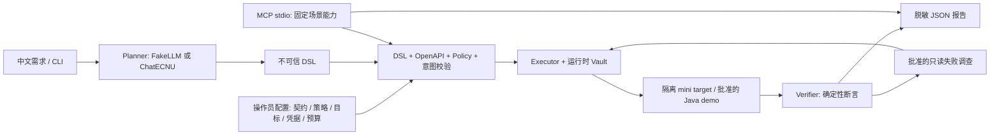
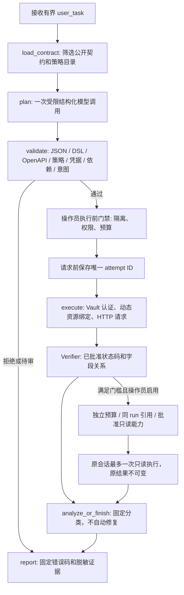

# AgentTest

[](https://github.com/mofengyan595/agenttest/actions/workflows/ci.yml)

**受控的 AI API 测试平台：LLM 规划，人工策略授权，确定性执行与断言。**

用户用中文描述测试目标，模型输出不可信 DSL；通过契约、策略、资源依赖和意图检查后，已有 Executor 执行 HTTP，生成脱敏报告。支持失败后的单次只读调查和 MCP stdio 工具封装。默认演示和测试无需 API Key、Docker 或外网。

已实际跑通 **中文需求 → 学校 ecnu-plus → 安全校验 → CourseInsight Java 登录/创建/查询 → 14 项断言 PASS**。这是独立项目；不修改 CourseInsight 业务代码，不在生产或真实用户数据上测试。

## 快速复现

Python **3.11**；首次安装需要包源或预先缓存的依赖，安装后默认测试与演示离线。沿用已有 `.venv`，不要复制其他机器的虚拟环境。

```powershell
git clone https://github.com/mofengyan595/agenttest.git
Set-Location agenttest
# 基础环境：确定性执行、契约解析、正常/故障 demo
.\scripts\setup_env.ps1
# 完整演示：增加冻结的 LangGraph / MCP 可选依赖
.\scripts\setup_env.ps1 -Agent
.\.venv\Scripts\python.exe -m agenttest showcase --case all
```

Linux：`bash scripts/setup_env.sh --agent`，将后续命令的 `.\.venv\Scripts\python.exe` 换成 `.venv/bin/python`。已有环境手动安装：

```powershell
.\.venv\Scripts\python.exe -m pip install -r requirements-agent.lock
.\.venv\Scripts\python.exe -m pip install --no-build-isolation --no-deps -e '.[dev,agent,mcp]'
```

完整演示的成功表示**正常场景通过、故障被正确检出**，不是把故障报告改为 PASS。输出 run_id、报告位置、请求数和一次创建检查；MCP 子进程的报告也保留在演示目录。仅基础依赖时选 `normal` 或 `fault`。

| 命令参数 | 演示内容 | 预期原业务结果 |
| --- | --- | --- |
| `showcase --case normal` | 双角色、课程、归属拒绝、CSV、异步轮询及结果 | PASS，8 步 / 9 请求 |
| `showcase --case fault` | 一次性目标返回错误课程名称 | ASSERTION_FAILED，4 步 / 4 请求 |
| `showcase --case investigation` | 归属故障后批准的 GET 调查 | ASSERTION_FAILED 保留，1 次调查 |
| `showcase --case java-mock` | FakeLLM + Java 格式 MockTransport | PASS，3 请求 / 14 断言；不是 Java 实测 |
| `showcase --case mcp` | 真正 SDK stdio 客户端、发现/校验/执行/查询/拒绝 | PASS；同 ID 缓存、不重放 |
| `showcase --case all` | 上述五种演示，零学校/真实 Java 请求 | `verified: true` |

```powershell
.\.venv\Scripts\python.exe -m agenttest report <run_id> --runs-dir runs/showcase
.\.venv\Scripts\python.exe -m pytest -q
.\.venv\Scripts\python.exe -m ruff check .
.\.venv\Scripts\python.exe -m pip check
```

MCP 报告使用输出中的 `reports_root` 和 invocation 子目录；标准客户端通过 `read_report` 查询。原 `demo` / `investigation-demo` 命令在检出业务故障时仍返回退出码 1；统一 `showcase` 在符合预期时返回 0。

## 架构





图中的调查环路仅表示受限 GET 复用执行器，不返回计划节点、不重放写入。MCP 当前执行固定 mini 场景；不能授权任意模型计划或 Java 写入。

技术栈：Python 3.11、FastAPI、Pydantic、HTTPX、OpenAPI validator、pytest / Ruff；可选 LangGraph **1.2.14**、官方 MCP Python SDK **2.3.0 / MCPServer**。模型适配使用 HTTPX 实现兼容 Chat Completions，按学校协议发送结构化输出，不需要 OpenAI SDK 或官方 OpenAI 账号。

## 任务满足与固定计划

自然语言入口默认必须通过确定性意图检查；mini 使用既有受控中文规则，Java 使用锁定 fixture 的校验器，其他目标须由操作员提供 intent_validator，否则 NEEDS_REVIEW、零 HTTP。`plan_valid` 表示 DSL/契约/策略通过，`intent_verified` 表示受控需求覆盖；只有业务 PASS 且图完整结束，`task_satisfied` 才为 true。

`run` 仍执行操作员固定计划；`workflow` 省略 `--user-task` 使用固定方案，显式给需求就启用意图门禁。直接使用 Workflow 的固定样本须设置 `task_mode="operator_plan"`，且使用固定 FakeLLM。此类 PASS 的 `task_satisfied=null`，不能宣称自然语言目标已满足；`agent` 不自动降级。

本轮还收窄了已识别任务的候选策略/角色、补充认证前置元数据并精简 mini Prompt。真实模型效果未重新测量。[问题核验、离线对照与后续实施方案](docs/engineering-upgrade.md)。

## 真实 Java + AI：显式、一次性入口

需要现有 CourseInsight 独立源码、JDK 17、Maven 离线缓存及隔离 demo Docker 依赖。源码/配置有变化时预检会拒绝，必须人工审查；不会降级连接未知环境。凭据由本地 demo 配置进入 Vault，不发送给模型。

本地 `.env` 配置 `OPENAI_API_KEY`、`OPENAI_BASE_URL`、`AGENTTEST_MODEL`；学校 Base URL 使用学校官方地址，当前验证模型 `ecnu-plus`。**不要提交 `.env` 或在终端打印 Key**。[配置与协议](docs/model-configuration.md)。

```powershell
# 只读预检，不启动业务测试、不调用模型
.\.venv\Scripts\python.exe scripts/run_courseinsight_ai.py --source 'D:\Desktop\project\courseinsight-cloud'
# 生成本地 fixture 供操作员审阅；不请求 HTTP
.\.venv\Scripts\python.exe scripts/run_courseinsight_ai.py --prepare runs/my-java-fixture.json
# 仅在明确批准新增数据库课程后执行；源码工作区须干净
.\.venv\Scripts\python.exe scripts/run_courseinsight_ai.py --source 'D:\Desktop\project\courseinsight-cloud' --fixture runs/my-java-fixture.json --model-env .env --real --execute
```

默认需求明确 admin、课程名称、教师、登录/创建/查询和 ID/code/name/teacherName 一致性。`--prepare --task '...'` 支持同一受控中文范围，开放式目标进入 NEEDS_REVIEW；唯一课程代码由操作员生成，模型不能更改。JSON fixture 属于操作员配置，不是模型授权。

目标固定 `127.0.0.1:18080` / `courseinsight_demo`。脚本启动并关闭自有 Java 进程，执行前重新检查隔离；最多 1 次模型调用 / 22,048 Token、一次创建，不自动重试。持久化 claim 后同 fixture 不可恢复重放。记录留在数据库，清理由操作员决定，不删除卷。再次执行意味着**新的真实写入，必须重新批准**。

实际已完成的 run `60076fbe920048e9acd6219f35fb85e3`：200/201/200，14 断言 PASS；模型 1 次 / **1,794 Token** / 21,891 ms。详见 [真实证据](docs/stage4a-results.json) 和 [阶段 4 评测](docs/stage4-evaluation.md)。Java 三步人工计划 [3A 旧记录](docs/stage3a-courseinsight.md) 原样保留；本轮没有 Java 跨用户、MCP 写入或失败调查。

## 缺陷注入与独立评测

所有故障仅在一次性 mini target 内存中注入，匹配正常对照。六类机制：归属校验缺失、名称不一致、ID 不一致、错误状态码、异步终态错误、结果条数错误。复用可信断言，不靠改预期“检出”。

```powershell
# 新输出目录；不覆盖历史记录；均无模型或外网
.\.venv\Scripts\python.exe scripts/evaluate_defects.py --baseline manual --output runs/my-manual
.\.venv\Scripts\python.exe scripts/evaluate_defects.py --baseline fake --output runs/my-fake
# 可选真实学校评测：显式开启，最多四次、90000 Token 总预算、串行无重试
.\.venv\Scripts\python.exe scripts/evaluate_defects.py --baseline real --real --model-env .env --output runs/my-real
```

不建议反复使用已评测任务调参。B01–B04 是独立于旧 T01–T18 的开发者构造样本，未冒称逐条人工审核；两条支持任务和两条越权目标覆盖不同机制。

| 真实证据 | 结果及边界 |
| --- | --- |
| 2A 首轮 / 第二轮人工审核任务 | 13/18 / 16/18 端到端；原数据保留，不再调参 |
| 4A Java + 真实模型 | 1 次真实完整链路通过，不能代表复杂业务覆盖 |
| 4B 新任务真实模型 | 有效计划、策略、意图、端到端均 **1/2**；另 2/2 越权任务安全拦截 |
| 4B 真实计划缺陷检出 | 已执行 **3/3**；整体覆盖 **3/4**，归属任务规划失败未执行；误报 0/3，执行漏报 0/3 |
| 4B 人工执行机制对照 | 六类缺陷 **6/6**，误报 0/6、漏报 0/6；两类异步是固定 DSL，不是 LLM 规划成绩 |
| 本轮学校实际消耗 | Java 1 次 + mini 4 次 = **5 次 / 7,290 Token**；无自动重试 |

B02 的 `DSL_AUTHENTICATION_ORDER` 零请求；B03/B04 的 `INTENT_UNSUPPORTED_OBJECTIVE` 零请求。模型并未主动拒绝所有非法意图，安全由程序门禁保证。固定 FakeLLM 仅链路基线，人工计划读取标注；小样本不证明广泛泛化能力。完整结果、失败分类和延迟在 [4B 原始脱敏记录](docs/stage4b-results.json)。

## MCP 与只读调查

```powershell
.\.venv\Scripts\python.exe -m agenttest.mcp_server
# 真正 SDK 客户端子进程验收，无 HTTP 监听、Key 或 Java 写入
.\.venv\Scripts\python.exe scripts/smoke_mcp_stdio.py
```

| 工具 | 范围 |
| --- | --- |
| `list_tests` | 批准的 mini 场景与操作目录 |
| `get_contract` | 经过筛选的公共契约 |
| `validate_plan` | 只校验，不产生执行授权 |
| `run_scenario` | 批准场景 ID + 唯一 invocation_id；不能传任意 DSL/URL/凭据 |
| `read_report` | 同 Server 命名空间内脱敏报告 |

默认最多 3 run / 100 tool call；单 run 8 步 / 10 HTTP / 30 秒。同 invocation_id 只读缓存；中断不恢复写入，重启不会重放。客户端不能放大预算；Server 进程级总预算不跨重启持久累计。[完整工具与客户端配置](docs/mcp-guide.md)。

调查默认关闭，预算全部为零。显式 `InvestigationConfig`、`ReadOnlyCapabilityRegistry`、FakeAnalyzer 最多选择一次批准 GET，使用同 run、已验证资源和已有认证；不重新登录/创建，不接受 URL/Header/ID/断言，不改原结果。GET 本身不是安全证明，推进状态的 getBatch 不批准。[2B 边界与验收](docs/stage2b-readonly-design.md)。

## 安全、报告与支持边界

- TargetConfig、Policy Registry、Vault、只读能力和预算均来自操作员；模型不能自报 reviewed/source 获得授权。策略必须匹配操作、角色、业务场景和资源来源。
- 固定 IP / localhost、白名单和隔离写入；不使用契约 servers 选目标，所有重定向阻断，关闭环境代理；不执行模型生成的 Python/Shell。
- 请求 Schema 校验字段、严格基本类型、required、enum、对象/数组、长度及数值边界；不支持的组合、正则和未知 format 明确待审，**不是完整 JSON Schema / Bean Validation 实现**。Java 输入额外采用 UTF-16 长度和非空安全子集。
- 真实模型当前只规划标量 JSON 参数和资源引用，不支持 CSV/轮询规划；确定性 DSL 支持这些功能。中文意图识别是封闭词汇和模板，不是通用语义推理。
- Vault 只对批准登录操作读取凭据；JWT 与步骤状态仅在 run 内存中存在，结束销毁。认证响应不可当业务参数引用，不支持跨 run、恢复请求或自动修复。
- 报告记录 run/step/attempt ID、契约/计划/策略摘要、状态/字节数/摘要/延迟、固定诊断及预算；不保存原始模型、HTTP 正文或敏感认证。数值密码、验证码、身份字段、自定义敏感字段及已知秘密也脱敏。

| 分类 | 含义 |
| --- | --- |
| PASS | 当前批准策略全部满足，不能自动证明开放式需求满足 |
| ASSERTION_FAILED | 可信断言与业务响应不符，仍需调查定位 |
| TEST_INFRA_ERROR | 超时、预算、隔离门禁或传输等环境问题 |
| TOOL_ERROR | 非法计划、依赖绑定或工具错误 |
| NEEDS_REVIEW | 无批准策略、未支持约束或不可靠的意图 |

可选 FastAPI 只读 API：`GET /health`、`POST /api/spec/summary`（JSON/YAML）、`GET /api/runs/{run_id}`；`python -m uvicorn agenttest.main:app --host 127.0.0.1 --port 8000`。没有任意目标执行 API，离线不依赖 Swagger 的 CDN 页面。

## 项目结构与交付资料

```text
src/agenttest/
  contracts.py, request_validation.py  # 契约与约束
  dsl.py, policies.py, intent.py       # 不可信计划 / 可信策略 / 意图
  llm_planner.py, workflow.py          # 结构化模型与 LangGraph
  executor.py, credentials.py         # 唯一 HTTP 执行器及运行时 Vault
  verifier.py, report.py              # 确定性断言与脱敏证据
  investigation*.py                   # 受控只读调查
  courseinsight*.py                   # Java 适配及隔离预检
  mcp_service.py, mcp_server.py        # 能力边界与 SDK stdio
  defect_evaluation.py, showcase.py   # 独立评测与统一离线演示
examples/                            # 操作员配置、可信策略及合成任务
scripts/                             # 安装、明确启用的实测与回环检查
tests/                               # 默认离线回归，禁止意外网络
docs/                                # 各阶段原始评测与技术说明
```

[面试技术说明](docs/project-technical-summary.md) · [进度和各模块 SHA](docs/progress.md) · [2A 原始首次结果](docs/stage2a-evaluation.md) · [2A 第二轮结果](docs/stage2a-round2-evaluation.md) · [阶段 4 数据与方法](docs/stage4-evaluation.md)

最终代码四组 CI 已通过：完整 agent **561 项**，base **436 通过 / 15 可选跳过**；本轮新增 52 项，原有 31 个测试文件保留。[验收统计](docs/delivery-results.json)。

Windows/Linux × base/agent 四组 Actions 保留；pytest、Ruff、pip check、真实回环 HTTP、Fake 自然语言/调查和 MCP stdio 自动验证。CI **不调用学校模型、Docker 或真实 Java 写入**。本机完整结果与最终 CI 在进度文档记录；仅基础安装会明确跳过可选 Agent/MCP 测试。

当前交付是本地研究/工程演示项目，适合如实写入实习简历。未实现生产审批、多租户、真实 LLM 失败调查、跨服务回滚或自动生成 Python 回归脚本；无 RAG、多 Agent、复杂前端、Kubernetes 或新数据库。文件权限和人工审阅仍是配置的信任根，真实 Java 只验证一个受控场景。
