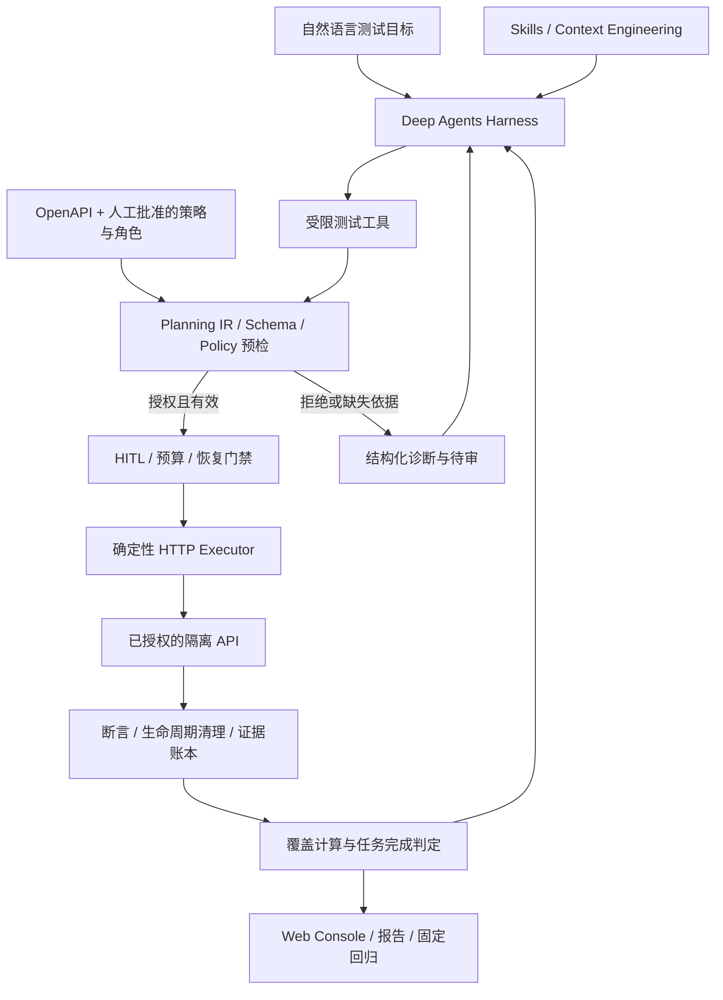

# AgentTest

**An API testing agent built with Deep Agents and a deterministic execution core.**

用自然语言描述要验证的 API 行为，由 Agent 组织跨接口测试，由可信代码决定**能否执行、如何断言、何时算完成**。支持 OpenAPI 契约、资源依赖、负向测试、人工审批、持久化恢复与可追溯证据。

[](https://github.com/mofengyan595/agenttest/actions/workflows/ci.yml)
[](https://github.com/mofengyan595/agenttest/actions/workflows/web.yml)
[](pyproject.toml)
[](src/agenttest/product_agent.py)

[快速开始](#快速开始) · [核心设计](#核心设计) · [实际验证](#实际验证与当前状态) · [接入自己的 API](#接入自己的-api) · [文档导航](#文档导航)

> AgentTest 面向已授权的隔离 API 测试环境。首次接入由操作员确认环境、身份、资源关系和业务规则。

## 看看它能做什么

例如，操作员已批准相关接口、身份与清理策略后，可以提交以下任务。

> 创建一个测试包裹，修改名称，读取并核对修改结果。最后删除这个包裹，确认再次读取返回 404。

Agent 需要串起 `POST → PATCH → GET → DELETE → GET`。执行内核检查各步是否引用同一资源及相应写入权限，并记录断言与清理证明。缺少授权、可信预期或有效来源时，系统会拒绝相应计划或标记待审。

## 核心能力

| 能力 | 已实现的机制 |
| --- | --- |
| **自主测试编排** | Deep Agents 负责工具调用与步骤推进，Skills 和上下文管理约束规划方式 |
| **契约驱动** | 支持 OpenAPI 3.0/3.1 的子集，按已确认的接口、角色和策略设计测试 |
| **跨接口流程** | 前序响应 ID 引用、登录与角色、资源归属、顺序依赖及 CRUD 生命周期 |
| **可信执行与断言** | Planning IR、Schema 与 Policy 预检，受控 HTTP 执行，代码核对状态、字段与业务预期 |
| **安全与人工审批** | 目标与操作白名单，请求与 token 预算，需要审批的写操作走 HITL，未知写入不自动重放 |
| **持久化与恢复** | 可选 SQLite 检查点、HTTP 步骤账本、恢复检查和同一任务身份约束 |
| **证据与回归** | 分别记录义务覆盖、实际 HTTP、断言、失败与清理，合格场景可导出为无需模型的 pytest 回归 |
| **本地 Web Console** | 契约导入、任务提交、进度、报告和已保存测试 |

## 核心设计

Deep Agents 通过受限工具提交计划。可信执行内核依据批准的契约、角色、策略和执行证据作出判断。



1. **规划与授权。** Deep Agents 是唯一的自主 Harness。执行前检查目标和操作白名单、身份、输入来源、调用顺序及断言依据。
2. **执行与清理。** 执行器持有服务端凭据，经预算和审批门禁后发送请求。删除后的清理证明来自同一资源的 `404/410` 回读。
3. **完成与断言。** 批准义务覆盖反映执行范围，断言结果反映响应是否符合预期。覆盖完整的任务仍可能记录真实的 `ASSERTION_FAILED`。

[自主 Harness](src/agenttest/product_agent.py) · [受限工具](src/agenttest/deep_harness/product_tools.py) · [计划构造](src/agenttest/plan_construction.py) · [预检](src/agenttest/product_preconditions.py) · [执行器](src/agenttest/executor.py) · [完成判定](src/agenttest/task_completion.py) · [恢复](src/agenttest/step_recovery.py)

### 五种检查结果

| 结果 | 含义 |
| --- | --- |
| `PASS` | 实际执行的检查满足已确认预期 |
| `ASSERTION_FAILED` | 响应与断言不符，需要结合证据定位 |
| `NEEDS_REVIEW` | 缺少输入、授权、可信预期或计划依据 |
| `TEST_INFRA_ERROR` | 环境、连接或传输故障 |
| `TOOL_ERROR` | 规划或执行工具内部出错 |

## 快速开始

离线 Demo 使用本机模拟数据。需要 Python 3.11、Node.js 22.12+ 和 Git。首次安装依赖需联网，运行 Demo 无需 Docker、模型密钥或外部业务服务。

<details>
<summary><strong>Windows · PowerShell</strong></summary>

```powershell
git clone https://github.com/mofengyan595/agenttest.git
cd agenttest
.\scripts\setup_env.ps1 -Agent
cd web
npm ci
npm run build
cd ..
.\scripts\start_web.ps1 -Demo
```

</details>

<details>
<summary><strong>Linux</strong></summary>

```bash
git clone https://github.com/mofengyan595/agenttest.git
cd agenttest
bash scripts/setup_env.sh --agent
cd web
npm ci
npm run build
cd ..
.venv/bin/python scripts/serve_web_workspace.py --demo
```

</details>

打开 [本地工作台](http://127.0.0.1:18012/)，依次查看项目、测试助手和测试记录。可以加载仓库中的 [工单示例 OpenAPI](examples/trusted-testing/projects/tickets/openapi.json)，选择对应内存模拟目标并确认配置。

已安装 Agent 依赖后，也可以运行 CLI 演示。

```powershell
.\.venv\Scripts\python.exe -m agenttest showcase --case all --runs-dir runs/readme-demo
```

Linux 使用 `.venv/bin/python`。演示包括正常流程、预设断言失败、受控调查、Java 风格 Mock 和 MCP stdio。故障场景中预期看到 `ASSERTION_FAILED`，结果会给出 Run ID 和本地报告位置。

## 接入自己的 API

1. 准备**已授权的本地或隔离环境**和 OpenAPI 3.0/3.1 JSON 或 YAML 契约。
2. 参考 [环境变量模板](.env.example) 创建本机 `.env`，配置 `OPENAI_API_KEY`、`OPENAI_BASE_URL` 和 `AGENTTEST_MODEL`。凭据由服务端使用。
3. 启动正常 Web 服务。Windows 运行 `.\scripts\start_web.ps1`，Linux 运行 `.venv/bin/python scripts/serve_web_workspace.py`。
4. 在项目页面导入契约，确认目标、操作白名单、角色账号、可信输入、请求依赖、业务预期和写入授权。
5. 在测试助手提交自然语言目标，查看实际请求、断言、未完成义务及清理证据。

[通用接入指南](docs/product-intake-guide.md) · [模型配置](docs/model-configuration.md)

## 实际验证与当前状态

| 验证范围 | 证据与结论 |
| --- | --- |
| **离线冻结回归** | P3-B2.8 第三次冻结 **3087 passed、15 skipped、1 xfailed、0 failed**，3103 项均有唯一终态。前两次冻结失败记录保留。[P3-B2.8 报告](docs/deepagents-model-reliability-p3b28.md) |
| **跨平台 CI** | 查看对应提交的 GitHub Actions 作业结果。[Keyless Python checks](https://github.com/mofengyan595/agenttest/actions/workflows/ci.yml) · [Web Console checks](https://github.com/mofengyan595/agenttest/actions/workflows/web.yml) |
| **真实模型稳定性** | P3-B2.8 真实模型验收尚未开始。P3-B2.7 两批独立验收均为 **1/5、NO-GO**，原评分门槛为 4/5。[P3-B2.7 报告](docs/deepagents-hitl-reliability-p3b27.md) |
| **已离线验证** | P3-B2.8 P0 在 Focus 修复反馈中提示保留已验证的合法映射，P1 记录客户端实际观察到的模型调用阶段、取消来源和用量证据。[P3-B2.8 报告](docs/deepagents-model-reliability-p3b28.md) |

P3-B3 尚未启动。

其他历史实验见 [CourseInsight API 联调](docs/courseinsight-colleague-delivery.md) 和 [首次完成率与失败分析](docs/first-completion-delivery.md)。各报告保留其模型、任务集、配置和分母。

## 技术栈

- **Agent** · Deep Agents、LangGraph、LangChain、工具调用、Skills 和上下文管理
- **服务端** · Python 3.11、FastAPI、Pydantic、HTTPX、SQLite
- **Web** · React 19、TypeScript、Vite
- **测试与交付** · pytest、Ruff、GitHub Actions、Playwright，可选 MCP 接口

## 开发与路线图

开发阶段按改动范围运行定向测试，候选版本集中执行冻结回归。

```powershell
.\.venv\Scripts\python.exe scripts/check_dev.py --area product --jobs 3
.\.venv\Scripts\python.exe -m ruff check .
```

在 `web/` 下运行 `npm test` 和 `npm run build`。浏览器 E2E 有额外的环境和服务要求。[开发检查](docs/development-checks.md) · [Web 测试说明](docs/web-console.md)

- [x] 受控规划、OpenAPI / Policy 校验、确定性 HTTP、断言与报告
- [x] Deep Agents Harness、Skills、上下文管理、检查点与步骤恢复、HITL
- [x] 义务覆盖与清理证明、模型反馈诊断、脱敏、离线评测与固定回归基础
- [ ] 真实稳定性发布门槛（当前 **NO-GO**）
- [ ] P3-B3 · Web 长任务、人工审批与断点恢复体验
- [ ] 跨项目评测、多模型对比与产品化

## 文档导航

| 想了解什么 | 从这里开始 |
| --- | --- |
| API 与真实模型配置 | [通用接入](docs/product-intake-guide.md) · [模型配置](docs/model-configuration.md) |
| Deep Agents 与整体架构 | [技术设计](docs/project-technical-summary.md) · [Skills 与上下文](docs/deepagents-skills-context-p3a.md) |
| 断点恢复、审批与可靠性 | [持久化执行](docs/deepagents-durable-execution-p3b1.md) · [P3-B2.5](docs/deepagents-hitl-reliability-p3b25.md) · [P3-B2.6](docs/deepagents-hitl-reliability-p3b26.md) |
| 可复用测试和实验 | [固定 pytest 回归](docs/regression-export.md) · [实验分析](docs/first-completion-delivery.md) |
| Web 与开发进度 | [Web 使用指南](docs/web-intake-guide.md) · [开发进度](docs/progress.md) |
