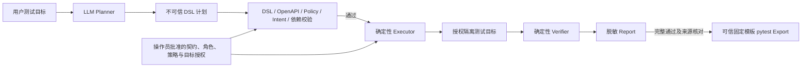

# AgentTest

[](https://github.com/mofengyan595/agenttest/actions/workflows/ci.yml)

AgentTest 是一个基于 Python 的 AI API 测试项目。用户用受支持的自然语言描述测试需求，
LLM 提出结构化测试计划；系统结合 OpenAPI 契约、Policy、Intent 和资源依赖校验计划，
再由确定性 Executor 执行 HTTP 请求与可信断言。模型负责选择业务步骤，执行权限和结果判定由程序控制。

项目支持单接口、跨接口及项目级测试，可查看执行证据与失败原因，并将符合条件的成功场景
导出为无需模型的 pytest 回归用例。主要面向经过授权的隔离测试环境；首次接入仍需审核契约、
角色和业务预期，目前不提供通用生产测试平台或任意项目的可靠性保证。

## 主要功能

- 自然语言入口：从批准的项目目标目录派生任务约束，再由 LLM 提出计划；未知语义或预期待审。
- 计划校验：检查 DSL、OpenAPI、操作白名单、角色、Policy、Intent 及资源生产／消费关系。
- 三层测试：单接口套件、跨接口资源流程、项目已授权核心接口分组；分别记录完整分母和未执行原因。
- 合法计划复用：复用任务内已验证结构，按规则派生合法边界、枚举输入与批准负例，重新校验后执行。
- HTTP 执行：动态 ID 引用、登录或预置 Bearer、JSON 请求、固定 CSV fixture 与有界异步轮询。
  CSV／轮询由专门配置和入口支持，不代表通用自然语言入口能规划任意上传任务。
- 证据与报告：固定断言、失败分类、请求尝试记录、分层校验结果及脱敏 JSON 报告。
- 可选只读调查：显式启用后，在独立限制内选择批准的只读能力，保留原业务判定与独立调查结论。
- pytest 导出：完整通过的普通 JSON 场景可生成固定回归包，保留来源与配置摘要。
- 本地 Web Console：导入契约、编辑目标草稿、筛选历史报告、查看步骤、断言与模型用量。
  默认不执行测试；操作员显式启用任务服务后，`/tasks` 才可对注册项目提交需求、查看进度和导出回归。
- MCP stdio：提供契约查看、计划校验、批准 mini 场景执行和报告读取，复用原执行门禁。
  当前不能通过 MCP 执行任意计划、指定目标 URL 或进行 Java 写入。

## 技术栈

下表版本来自当前依赖声明与锁文件；LangGraph、MCP 为可选依赖，基础执行与测试不依赖它们。

| 技术 | 版本与用途 |
| --- | --- |
| Python | 推荐 3.11；包声明支持 3.11–3.12，安装脚本固定检查 3.11 |
| FastAPI / Pydantic / HTTPX | 锁定 0.143.0 / 2.14.0 / 0.28.1；本地 API、严格数据模型与 HTTP 执行 |
| LangGraph | 1.2.14；受约束规划、校验、执行与有界反馈工作流 |
| MCP Python SDK | 2.3.0，使用 `MCPServer`；stdio 工具封装 |
| OpenAPI | 3.0 / 3.1，JSON / YAML；契约解析与受支持的请求 Schema 校验 |
| SQLite | Python 标准库；仅任务服务的状态、用量和报告引用，不作为业务响应数据库 |
| React / TypeScript / Vite | 锁定 19.3.0 / 5.9.3 / 8.3.4；本地控制台 |
| pytest / Ruff | 锁定 9.1.1 / 0.17.0；离线测试与静态检查 |
| Vitest / Playwright | 锁定 5.0.3 / 1.64.0；前端组件测试与隔离浏览器 E2E |

Python 依赖见 [pyproject.toml](pyproject.toml) 与 [Agent 锁文件](requirements-agent.lock)
（包含基础与 MCP 锁文件）；前端使用 [package-lock.json](web/package-lock.json)。
Schemathesis 仅用于独立可选对照环境，不是产品运行依赖。

## 系统架构



操作员配置是信任根；LLM 输出即使符合 JSON Schema，也不能直接获得 HTTP 执行权限。
Verifier 在 Executor 内逐步执行，图中单列其结果判定职责。可选反馈调查不改变原业务断言，
导出的 Python 来自仓库固定模板，模型计划仅作为数据保存。

## 核心技术实现

### 受约束的 AI 规划

LLM 用来解释支持范围内的需求并选择业务步骤、角色、策略与资源引用。
它没有 Executor、凭据或任意 HTTP 工具的直接访问权。规划上下文只包含筛选后的公共契约、
角色别名和批准策略关系，不包含目标地址、凭据或评测答案。

Pydantic DSL 限制可表达的操作，OpenAPI 校验参数位置与受支持的类型、必填、枚举和边界；
Policy Registry 再检查操作、角色、业务场景、参数及准确的资源来源。
Intent Validator 独立核对需求要求的步骤、顺序、角色与覆盖，不能根据模型计划反向补写目标。
项目级入口从操作员目标目录派生这些约束，不要求每条新需求手写完整步骤。

未知需求、未批准的参数变化或越权操作不会直接执行；缺少可信预期时保留 `NEEDS_REVIEW`。
当前自然语言识别和 Schema 校验都有明确子集，不是通用语义理解或完整 JSON Schema 实现。

### 合法计划复用与确定性派生

同一业务结构的边界测试无需反复交给模型规划。LLM 先提出基础结构，只有通过原有
DSL、OpenAPI、Policy、Intent 和依赖门禁的计划，才能保存为任务内不可变的 `LegalStructure`。
结构绑定项目配置、原始需求与计划指纹，配置或关系变化后不能继续借用旧结构。

确定性规则按契约与批准策略派生正常输入、合法边界／枚举及批准负例。
负例必须有显式批准的变更字段、错误语义和断言；并非发现一个非法值就能发送。
每个派生计划重新检查授权、参数与依赖，不变更操作、角色、引用来源或用户钉定的字面量。
报告保留基础计划链接、变化字段与规则来源，派生本身不调用模型。

复用的是计划结构，每次执行都会新建 run、重新登录或注入凭据，并重新产生动态资源；
不复用旧任务的 ID、认证状态或执行结果。基础计划被拒绝时不自动修复，关联派生标记未执行，
仍留在统计分母中；业务执行中的断言失败也不会触发重规划或写入重放。

### 有界执行与可信证据

Executor 控制请求数、步骤、超时、请求／响应大小和轮询；套件共用父级请求及模型预算，
不会通过拆分子用例刷新额度。资源只能绑定到批准的前序成功响应，凭据由运行时 Vault 管理，
不交给模型，也不作为业务参数引用。写入请求发送前记录 attempt，未知结果不自动重试或恢复。

Verifier 使用批准的状态码、字段关系、终态和条数断言，报告区分 `PASS`、`ASSERTION_FAILED`、
`TEST_INFRA_ERROR`、`TOOL_ERROR`、`NEEDS_REVIEW`。同时分别记录计划合法、策略授权、
意图验证、工作流结束与任务满足；流程结束或安全拦截都不等于业务测试成功。
报告保存脱敏步骤证据、摘要和实际用量，不保存原始模型回复、HTTP 正文或认证秘密。

可选反馈由模型提出调查或结束建议，只能使用操作员批准的只读能力与同 run 资源。
业务结果、模型建议和确定性证据支持检查分别保存；模型不能更改断言或把推测升级为可信结论。

### 无模型回归导出

完整通过且来源一致的普通 JSON 场景，可将计划数据与 manifest 写入新回归包；
pytest 文件逐字来自可信模板。执行时仍需操作员提供契约、目标、策略、凭据和 transport fixture，
重新校验配置与断言，每次创建新资源。CSV、轮询及带读取重试的场景暂不导出。

固定回归无需再调用模型；其 `operator_plan` / `task_satisfied=null` 只表示固定计划的执行结果，
不代表再次成功理解自然语言需求。失败或待审报告不能导出成通过资产。

实现细节见[技术设计](docs/project-technical-summary.md)、[计划复用](docs/plan-reuse-stage2.md)
与[有界反馈](docs/bounded-feedback.md)。旧阶段文档保留当时范围，当前入口以本文和自然语言入口文档为准。

## 快速开始

### 离线 Demo

准备 Python 3.11；首次安装需要包源或预先缓存依赖，安装后 Demo 不需要 API Key、Docker、
外网或真实业务服务。安装脚本会创建或沿用本仓库 `.venv`，安装锁定依赖并运行 pytest、Ruff。
不要复制其他机器的虚拟环境。

Windows PowerShell，在仓库根目录执行：

```powershell
git clone https://github.com/mofengyan595/agenttest.git
Set-Location agenttest
.\scripts\setup_env.ps1 -Agent
.\.venv\Scripts\python.exe -m agenttest showcase --case all --runs-dir runs/readme-demo
```

Linux：

```bash
git clone https://github.com/mofengyan595/agenttest.git
cd agenttest
bash scripts/setup_env.sh --agent
.venv/bin/python -m agenttest showcase --case all --runs-dir runs/readme-demo
```

`-Agent` / `--agent` 安装 LangGraph 和 MCP，使五项完整演示可用。
只安装基础依赖时省略该选项，选择 `--case normal` 或 `--case fault`。
完整演示覆盖正常、故障、只读调查、Java 格式 Mock 与 MCP stdio；其中 Java Mock 不连接 Java 服务。

输出包含 run ID、报告路径和 `verified`。正常场景的业务结果应为 `PASS`；
故障场景应保留 `ASSERTION_FAILED`。`verified: true` 表示演示符合预期，不能把二者都称为业务 PASS。
MCP 报告位于独立子目录，读取位置以输出的 `reports_root` 为准。

### 本地 Web Console

沿用上面的 Python 环境与 `runs/readme-demo` 报告，准备 Node.js 22.12+。
从仓库根目录启动 FastAPI，只监听回环地址：

```powershell
$env:AGENTTEST_RUNS_DIR = 'runs/readme-demo'
.\.venv\Scripts\python.exe -m uvicorn agenttest.main:app --host 127.0.0.1 --port 8000 --no-proxy-headers
```

Linux 对应命令：

```bash
export AGENTTEST_RUNS_DIR=runs/readme-demo
.venv/bin/python -m uvicorn agenttest.main:app --host 127.0.0.1 --port 8000 --no-proxy-headers
```

另开终端进入仓库的 `web/`（PowerShell 使用 `Set-Location web`，Linux 使用 `cd web`）：

```bash
npm ci
npm run dev
```

打开 [本地控制台](http://127.0.0.1:5173)，在历史页选择 Run ID 查看校验、断言与请求尝试。
Vite 默认同源代理到 8000 端口，不需要放宽 CORS。默认服务只提供契约解析与报告查看。
若此前启用过任务服务，先取消 `AGENTTEST_PROJECTS_FILE` 设置再使用此只读路径。

要从 `/tasks` 发起测试，须由操作员批准项目配置并显式启用任务服务，见[配置与授权](docs/nl-entry.md)。
任务元数据使用 SQLite；取消不回滚已发送请求，服务重启不恢复 HTTP 或重放写入。
[模拟模型体验入口](docs/plan-reuse-user-trial.md)可离线查看三层测试和派生结果，不代表真实模型质量。

## 测试与评测结果

最新合法计划复用对照使用六条新原文、每条三轮，两版各 18 次首次尝试；真实模型为 `ecnu-plus`，
业务目标为专用 ASGI 内存服务，没有真实第三方业务请求或数据库写入。
数据属于 `DEVELOPMENT_ONLY / UNREVIEWED` 的小样本开发对照，尚未独立人工审核。

| 指标 | 旧版 | 候选版 |
| --- | ---: | ---: |
| 完整任务 | 2/18 | 9/18 |
| 明确授权且预算足够的任务 | 2/15 | 9/15 |
| 足额项目任务 | 0/6 | 3/6 |
| 批准负例实际执行并正确拒绝 | 64/105 | 85/105 |
| 模型调用（含语义、规划与反馈） | 162 | 50 |

完整任务、项目覆盖与负例执行率均未达到预定质量目标。候选仍存在缺少请求体、依赖／意图不匹配，
以及未知预期澄清和证据不足诊断的失败。规则实际派生并执行 103/129 个用例，另外 26 个因基础计划
失败未执行；这些派生不能计作模型规划成功。安全拒绝也不等于业务完成或模型正确主动弃权。

两版实际完成覆盖不同，项目差异还包含旧版缺少新增正常边界能力，不能全归因于模型改善。
调用减少不能直接证明等覆盖条件下的成本收益；目前没有实际人工节时或真实用户效率提升的验证。
固定 pytest、Schemathesis 数据生成适配与 AgentTest 仅比较批准的共同能力子集，且共用执行／断言引擎；
Agent 子集由完整任务提取，未独立强制子集预算，不是原生工具全能力或独立同预算排名。

[完整结果、分母与原始失败](docs/plan-reuse-final-results.md) ·
[公开真实收据](docs/demo-evidence/plan-reuse-paired-real-v2.json) ·
[成熟工具对照与价值限制](docs/plan-reuse-value-report.md)。历史实验、Token 明细和评分口径保留在原文档中。

仓库测试分别覆盖确定性执行、Fake／Mock 工作流、固定回归与浏览器交互，不能替代真实模型评测。
Python CI 包含 Windows／Linux × base／agent 四组检查；Web CI 在两平台检查类型、组件、构建与 E2E。
本地可运行 `.\.venv\Scripts\python.exe -m pytest -q` 和 `.\.venv\Scripts\python.exe -m ruff check .`；
在 `web/` 运行 `npm test`、`npm run build`。浏览器依赖与 E2E 配置见[Web 文档](docs/web-console.md)。

## 安全与适用范围

- 目标与操作必须事先批准；仅接受回环地址或显式授权的隔离私网 IP，禁用任意 DNS 目标、重定向和环境代理。
- 不执行模型生成的 Python、Shell 或任意代码；模型不能自行指定凭据、任意 URL 或可信断言。
- 写操作需要隔离模式与明确授权；不支持自动修复、未知写入恢复、跨服务回滚或自动清理副作用。
- 未支持的需求与未知预期可以进入 `NEEDS_REVIEW`，不得降低断言或强行判定通过。
- 默认演示离线；真实模型调用及第三方目标执行需要额外授权和本地配置。
- 当前依赖操作员审核配置，没有生产级多租户、完整人工审批或任意项目适配保证。

CourseInsight 只作为独立 Java 测试目标。历史验证固定于 `430c23e`，仅覆盖管理员登录、创建和查询课程；
当前主分支已有后续接口与权限变更，旧适配未重新验证，版本不符时预检会拒绝执行。
仅修改 SHA 不能证明兼容；真实运行须重新审核契约、Policy、Intent、隔离环境及副作用。
详见[历史 Java 接入](docs/stage3a-courseinsight.md)、[真实模型记录](docs/stage4a-results.json)
与[接口差异审查](docs/engineering-review-20261013.md)。

## 项目结构与相关文档

```text
src/agenttest/  # 规划、门禁、计划派生、执行、验证、报告、CLI / API / MCP 与任务服务
web/           # React / TypeScript 本地控制台及前端测试
examples/      # 项目配置样例、合成任务与固定回归包
scripts/       # 环境安装、离线验收、显式启用的实测与评测工具
tests/         # 默认离线的执行、授权、工作流及服务回归测试
docs/          # 技术设计、使用说明、完整评测与历史证据
```

- 系统技术设计：[模块职责与边界](docs/project-technical-summary.md)、[计划复用](docs/plan-reuse-stage2.md)、[证据与有界反馈](docs/bounded-feedback.md)。
- 自然语言与项目接入：[三层入口和任务服务](docs/nl-entry.md)、[项目配置预检](docs/project-inputs.md)、[真实模型配置](docs/model-configuration.md)。
- Web 与 MCP：[控制台使用说明](docs/web-console.md)、[MCP 工具及客户端](docs/mcp-guide.md)。
- 最新评测与工具对照：[完整真实结果](docs/plan-reuse-final-results.md)、[价值与共同子集](docs/plan-reuse-value-report.md)、[待审体验包](docs/plan-reuse-user-trial.md)。
- 回归导出：[导出条件与 runtime fixture](docs/regression-export.md)、[回归样例](examples/regressions/README.md)。
- 历史开发与实验：[进度索引](docs/progress.md)、[演示与证据导航](docs/goal-delivery-guide.md)、[上一轮完整结果](docs/trusted-testing-final-results.md)、[技术选型记录](docs/rag-necessity-20261013.md)。
