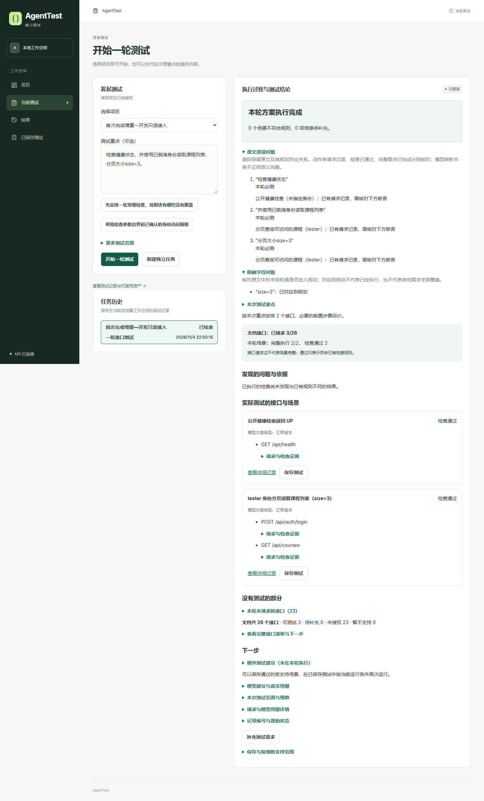
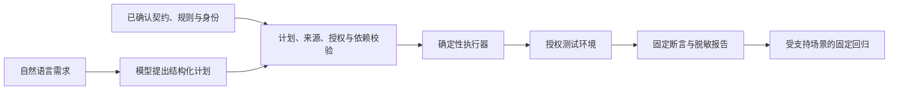

# AgentTest

**用一句话发起 API 测试，让规划、执行和结果都有据可查。**

AgentTest 是一个 Python API 测试平台。接入 OpenAPI 和已确认的业务规则后，用自然语言描述要测的行为，查看实际请求、断言、失败原因及未完成项，并将支持的稳定场景保存为无模型固定回归。

适合需要检查多接口流程、参数边界和身份权限的后端开发者、测试开发者。首次接入仍需核对环境、账号、资源关系和预期；模型不能替你批准未知业务规则。

[快速开始](#快速开始) · [接入自己的项目](#接入自己的项目) · [怎样看结果](#怎样看结果) · [当前证据与限制](#当前证据与限制) · [文档导航](#文档导航)

## 一次实际输出

下面是2026-11-04实际运行 `python -m agenttest showcase --case all` 的摘要。业务目标均为模拟服务：

| 演示 | 实际结果 | 请求数 | 是否符合演示预期 |
| --- | --- | ---: | --- |
| 正常跨接口流程 | PASS | 9 | 是 |
| 预设业务故障 | ASSERTION_FAILED | 4 | 是 |
| 故障后的受控只读调查 | ASSERTION_FAILED | 5 | 是 |
| Java格式Mock | PASS | 3 | 是 |
| MCP stdio | PASS | 9 | 是 |

真实模型调用 **0**，真实Java请求 **0**。`verified: true`表示演示符合预期，故障结果仍是失败，不能称为业务检查全部通过。命令会输出Run ID和本地报告位置；新克隆仓库即可重新生成，无需私有记录。

真实网页测试及首次失败见[CourseInsight上一轮交付](docs/courseinsight-colleague-delivery.md)。固定回归与自然语言理解分开统计。

<details>
<summary>查看当前真实网页：原文对账、实际请求与未完成项</summary>



这是本轮开发阶段的一次正常网页实测：真实模型与原CourseInsight，健康和课程列表2场景、3个HTTP请求、2次模型调用、17,746已知Token、0 UNKNOWN。页面中的3/26是该次实际接口覆盖，不是完整需求完成率，也不计入正式48位置对照。截图已核对，没有凭据或用户业务正文。

</details>

## 快速开始

准备 **Python 3.11**、**Node.js 22.12+** 和Git。首次安装需要包源或已缓存依赖；安装后的离线演示不需要密钥、Docker、外网或真实业务服务。不要复制其他机器的虚拟环境。

Windows PowerShell：

```powershell
git clone https://github.com/mofengyan595/agenttest.git
Set-Location agenttest
.\scripts\setup_env.ps1 -Agent
Set-Location web
npm ci
npm run build
Set-Location ..
.\scripts\start_web.ps1 -Demo
```

Linux：

```bash
git clone https://github.com/mofengyan595/agenttest.git
cd agenttest
bash scripts/setup_env.sh --agent
cd web
npm ci
npm run build
cd ..
.venv/bin/python scripts/serve_web_workspace.py --demo
```

安装脚本创建仓库`.venv`、安装锁定依赖并运行后端检查；Agent选项包含LangGraph和MCP。打开[本地网页](http://127.0.0.1:18012)，体验“项目 → 测试助手 → 测试记录”。模拟模式使用工单、课程两个专用内存目标，不代表真实模型理解能力。

第一次可上传仓库中的`examples/trusted-testing/projects/tickets/openapi.json`，选择“工单 · 内存模拟目标”，核对配置并保存。[模拟网页操作说明](docs/web-intake-guide.md)。

只运行命令行离线演示：

```powershell
.\.venv\Scripts\python.exe -m agenttest showcase --case all --runs-dir runs/readme-demo
```

Linux将解释器替换为`.venv/bin/python`。只安装基础依赖时选择`--case normal`或`--case fault`。

## 接入自己的项目

1. 准备一个允许测试的本地或已授权隔离环境，导出OpenAPI 3.0/3.1 JSON或YAML。
2. 在本机`.env`配置`OPENAI_API_KEY`、`OPENAI_BASE_URL`和`AGENTTEST_MODEL`。不要将真实值写进需求、仓库或截图。
3. 启动真实模式：Windows从根目录运行`.\scripts\start_web.ps1`；Linux运行`.venv/bin/python scripts/serve_web_workspace.py`。**不加Demo参数**；未配置模型时阻止执行，不回退模拟。
4. 在“项目”导入文档，核对允许的操作、身份、输入来源、资源依赖、错误语义和业务断言。凭据由服务端环境变量读取，页面只登记变量名。写入还需明确隔离授权及资源归属。
5. 保存并检查接入，就绪后进入测试助手。例如：“创建一个测试资源，修改名称后读取核对，最后删除同一资源。”实际可执行范围取决于已确认的接口和规则。

日常发起无需手写JSON、DSL或逐步脚本。缺少账号、业务规则或资源归属时，仍需补齐配置。上传和轮询需配置受控文件、等待上限及终态预期。

[通用接入说明](docs/product-intake-guide.md) · [模型配置](docs/model-configuration.md) · [CourseInsight运行条件](docs/courseinsight-colleague-runbook.md)

## 怎样看结果

测试记录展示实际请求的接口、完整执行的场景、检查结果和未执行原因。接口返回200不能证明原文中的字段、身份、顺序和内容都测到了。

| 结果 | 含义 |
| --- | --- |
| PASS | 当前已执行检查符合已确认预期 |
| ASSERTION_FAILED | 响应不符合已确认断言；需结合证据判断是否为业务缺陷 |
| NEEDS_REVIEW | 缺少可靠输入、规则、授权或计划依据 |
| TEST_INFRA_ERROR | 环境或传输失败，不能直接归为业务缺陷 |
| TOOL_ERROR | 计划或执行工具错误 |

明确字段对账区分“已对应到规划”和“已执行”。目前独立提取仅覆盖明确的ASCII字段=标量语法，其他语义仍有漏项风险。流程结束、场景通过、接口覆盖和完整需求完成是不同指标。

支持的稳定场景可保存为固定测试。普通JSON及已核实资源生命周期的部分写场景可无模型重跑，每次准备自己的新资源。CSV、轮询等暂不能全部保存为固定包；配置变化会暂停旧资产。

| 方式 | 模型与目标 | 能说明什么 |
| --- | --- | --- |
| 离线示例 | Fake/模拟模型、内存或Mock目标 | 工程链路符合示例预期 |
| 真实自然语言测试 | 真实模型、已授权测试服务 | 该次需求的规划与执行表现 |
| 固定回归 | 模型禁用、对应批准目标 | 固定步骤符合原断言，不是再次理解自然语言 |

## 模型与程序各做什么



模型负责规划；可信代码负责凭据、请求、预算、断言和证据。不执行模型生成的Python、Shell或任意URL。未知预期不能自动变成断言或写入授权。取消不回滚已发送请求，未知写入不自动重发。

准确依赖见[pyproject.toml](pyproject.toml)、[Agent锁文件](requirements-agent.lock)与[前端锁文件](web/package-lock.json)。LangGraph和MCP为可选依赖，基础检查不依赖密钥或模型。

## 当前证据与限制

- 上一轮CourseInsight冻结首次完整完成 **3/10**，首次实际覆盖 **18/26** 接口；加入另行记录的复验后覆盖 **26/26**。后者仅说明该次特定接口覆盖，不能代替需求完成率或宣传任意项目全部接口可测。[分母、失败、用量及限制](docs/courseinsight-colleague-delivery.md)。
- 本轮首次完成率增量仍在开发，尚未完成新的48位置真实对照，不能宣称可靠性提升。[本轮口径和进度](docs/first-completion-goal.md)。
- 首次接入依赖操作员核对。自然语言理解、Schema、文件和轮询均有支持子集；不保证零配置、生产可用或任意项目适配。
- 不提供跨服务回滚、未知写入恢复或任意资源自动清理。无删除接口的资源记录待清理，不绕过业务限制。
- 超时与缺失用量分别保留，UNKNOWN不估算补齐。规划模型Token不等于被测系统自身AI成本；实际费用需供应商账单证据。

## 文档导航

后端在仓库环境运行`python -m pytest -q`、`python -m ruff check .`；前端在`web/`运行`npm test`、`npm run build`、`npm run test:e2e`。浏览器准备条件见[Web说明](docs/web-console.md)。CI包含Windows/Linux × base/agent及两平台Web检查。

- 开始使用：[通用接入](docs/product-intake-guide.md)、[模拟体验](docs/web-intake-guide.md)、[真实模型配置](docs/model-configuration.md)。
- 结果与回归：[固定回归](docs/regression-export.md)、[回归样例](examples/regressions/README.md)、[CourseInsight交付](docs/courseinsight-colleague-delivery.md)。
- 设计与开发：[技术设计](docs/project-technical-summary.md)、[开发快检](docs/development-checks.md)、[MCP](docs/mcp-guide.md)。
- 验收与历史：[本轮Goal](docs/first-completion-goal.md)、[进度索引](docs/progress.md)、[历史计划复用对照](docs/plan-reuse-final-results.md)。历史分数不重计为当前版本成绩。
