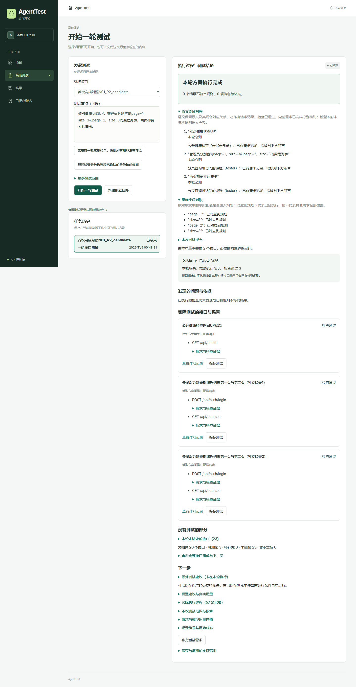
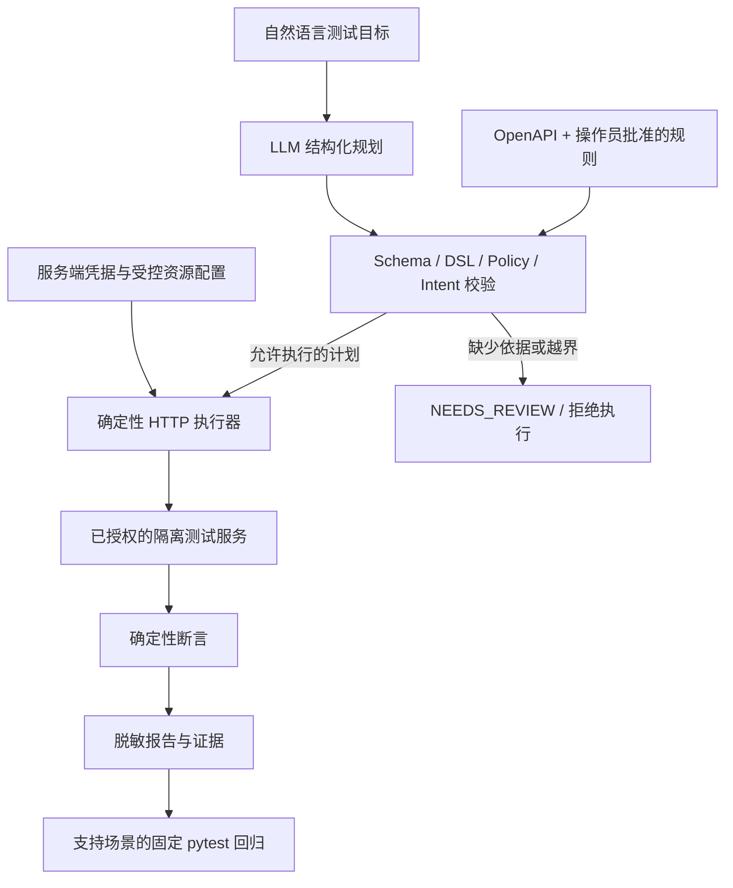

# AgentTest

**基于 LLM 规划与确定性执行的 API 测试 Agent：用自然语言描述业务目标，把测试步骤、请求、断言和未完成项保留为可核对证据。**

传统 API 测试不只是发送 HTTP 请求：跨接口流程需要登录、前序资源 ID、角色与资源归属、异步轮询以及明确的业务预期。LLM 可以辅助提出步骤，但不能独自决定**哪些请求被允许发送、断言什么才算通过**。

AgentTest 将自然语言测试拆分为 **模型规划 → 可信校验 → 受控执行 → 确定性断言 → 脱敏报告**。支持导入 OpenAPI 3.0/3.1 文档、在本地网页发起受支持的测试，并将部分验证通过的稳定场景保存为**不再调用模型的固定回归测试**。

> 适用场景：后端 API 的多接口业务流程、权限和参数边界测试。首次接入需由操作员确认环境、身份、资源关系及业务规则；目前不是零配置、任意系统通用的测试平台。

## 运行效果



图中为 **2026-11-05** 一次真实模型 / 真实 CourseInsight 的测试记录：执行分页与健康检查，共 5 次目标 HTTP、2 次模型调用。它只代表该测试任务，不代表项目整体成功率。相应评估见 [首次完成率与失败分析](docs/first-completion-delivery.md)。

一个受支持的任务示例：

> 创建一个测试资源，修改它的名称，读取并核对修改结果，最后删除同一个资源。

执行器会依据已审核的操作与规则处理认证、前序响应 ID 绑定、请求发送及断言；如果缺少可确认的账号、删除权限或预期，会提示补齐或停止，而不是让模型猜测。

## 核心能力

| 能力 | 说明 |
| --- | --- |
| 自然语言规划 | 根据已导入的 OpenAPI 和已确认业务规则生成受约束的结构化计划 |
| 跨接口依赖 | 支持前序成功响应绑定、认证顺序、不同角色与资源归属校验 |
| 确定性执行 | 由 HTTP 执行器处理凭据、参数、请求数量/超时预算、CSV 上传和有界轮询 |
| 可信断言 | 校验状态码、字段、条数以及批准的业务预期；不把 HTTP 200 直接视为任务完成 |
| 失败可追溯 | 区分断言失败、环境错误、工具错误与缺少依据，并保留脱敏的请求及检查记录 |
| 固定回归 | 将符合条件的完整通过场景导出为 pytest 测试，后续不再消耗规划模型 Token |
| 本地控制台 | 项目接入、测试助手、任务进度、结果详情与已保存测试 |

## 系统架构



核心设计是**将模型建议与执行权限分离**：

1. **Planner** 只从允许的 Operation / Role / Policy 目录中提出计划。结构化输出有助于解析，但不自动赋予业务权限。
2. **Validator** 检查 OpenAPI 参数、已批准策略、身份、调用顺序、资源来源和任务意图；未知业务预期不能自动生成可信断言。
3. **Executor** 持有服务端凭据与目标配置，解析前序成功响应引用，在每次请求前检查预算与授权。不会执行模型产生的 Python、Shell、任意 URL 或文件路径。
4. **Verifier / Report** 执行固定断言，区分通过、失败与未执行。结果有可审计记录，但断言失败不等于已独立确认业务 Bug。
5. **Regression** 仅对满足当前导出约束的完整通过场景生成固定测试；重新运行仍需匹配相同可信配置，不代表模型再次理解了需求。

框架使用 Python、FastAPI、HTTPX、Pydantic；LangGraph 用于可选 Agent 工作流，MCP 提供受限工具入口。前端使用 React 19、TypeScript 和 Vite。

**源码阅读入口：**[Workflow](src/agenttest/workflow.py) · [策略与约束](src/agenttest/policies.py) · [执行器](src/agenttest/executor.py) · [断言器](src/agenttest/verifier.py) · [报告](src/agenttest/report.py)。详细设计见 [技术设计](docs/project-technical-summary.md)。

## 五种结果如何理解

| 结果 | 含义 |
| --- | --- |
| `PASS` | 本次**实际执行**的检查满足已确认预期 |
| `ASSERTION_FAILED` | 断言与响应不符，需要结合证据判断是否为业务缺陷 |
| `NEEDS_REVIEW` | 缺少输入、规则、可信预期、执行授权或计划依据 |
| `TEST_INFRA_ERROR` | 环境、连接或传输故障，不能直接算成业务 Bug |
| `TOOL_ERROR` | 规划/执行工具内部出错 |

接口覆盖、步骤通过、完整需求完成、模型首次规划成功是**不同指标**。AgentTest 会报告不能执行的部分，不把未执行的断言补记为通过。

## 快速开始：无密钥离线演示

环境：**Python 3.11、Node.js 22.12+、Git**。首次安装需要访问包源或已有依赖缓存；安装完成后，模拟演示不需要 Docker、API Key 或真实业务服务。

### Windows PowerShell

```powershell
git clone https://github.com/mofengyan595/agenttest.git
Set-Location agenttest
.\scripts\setup_env.ps1 -Agent
Set-Location web
npm ci
npm run build
Set-Location ..
.\scripts\start_web.ps1 -Demo
```

### Linux

```bash
git clone https://github.com/mofengyan595/agenttest.git
cd agenttest
bash scripts/setup_env.sh --agent
cd web
npm ci
npm run build
cd ..
.venv/bin/python scripts/serve_web_workspace.py --demo
```

打开 <http://127.0.0.1:18012>，按 **项目 → 测试助手 → 测试记录** 体验。可上传示例契约 [`examples/trusted-testing/projects/tickets/openapi.json`](examples/trusted-testing/projects/tickets/openapi.json)，选择“工单 · 内存模拟目标”，确认配置后运行受支持的工单需求。

**离线演示使用模拟规划和内存 / Mock 目标，验证的是工程链路，不代表真实 LLM 理解效果。**

也可从仓库根目录单独运行 CLI showcase：

```powershell
# Windows，安装 -Agent 依赖后
.\.venv\Scripts\python.exe -m agenttest showcase --case all --runs-dir runs/readme-demo
```

Linux 改用 `.venv/bin/python`。离线演示包含正常流程、预设断言故障、受控调查、Java 风格 Mock 与 MCP stdio；结果会给出 Run ID 和本地报告位置。

## 连接真实模型与自己的 API

1. 准备**已授权的本地或隔离测试环境**，导出 OpenAPI 3.0/3.1 JSON/YAML，并确认接口操作及业务规则。
2. 在本机未提交的 `.env` 中配置 `OPENAI_API_KEY`、`OPENAI_BASE_URL` 和 `AGENTTEST_MODEL`；密钥只由服务端使用。
3. 启动正常 Web 服务：Windows 运行 `.\scripts\start_web.ps1`；Linux 运行 `.venv/bin/python scripts/serve_web_workspace.py`。**不要添加 Demo 参数**。
4. 在“项目”导入契约，核对环境、角色账号、操作白名单、资源依赖、输入来源与断言依据；缺少可信配置时先补齐，不把导入 OpenAPI 等同于授权执行。
5. 就绪后在“测试助手”输入自然语言测试目标，查看实际请求、断言及未执行原因。需要写入时，必须使用明确授权的隔离资源。

新业务域需要操作员进行一次契约和策略接入；普通日常测试不需要逐题手写 DSL。CSV 上传、轮询和固定回归均有受支持子集，详情见 [通用接入](docs/product-intake-guide.md)、[模型配置](docs/model-configuration.md) 和 [固定回归](docs/regression-export.md)。

**安全边界**：只允许批准的目标与操作；模型不能扩大白名单或制定新断言；不会自动重放结果不明的写请求。取消任务不能回滚已经发送的业务请求，缺少删除接口时也不会绕过业务规则清理资源。

## 验证证据与已知限制

### 可直接复现的离线工程演示

仓库记录的 2026-11-04 `showcase --case all` 结果如下：

| 案例 | 目标 HTTP 请求 | 结果 |
| --- | ---: | --- |
| 正常跨接口流程 | 9 | `PASS` |
| 预设业务故障 | 4 | `ASSERTION_FAILED`（符合故障演示预期） |
| 故障后的只读调查 | 5 | `ASSERTION_FAILED`（未掩盖原故障） |
| Java 风格 Mock | 3 | `PASS` |
| MCP stdio | 9 | `PASS` |

此次演示使用 **0 次真实模型调用、0 次真实 Java 请求**；“演示符合预期”不等于故障场景业务通过。

### 真实模型 / 真实 API 的历史评估

- 对 CourseInsight 的一轮冻结验收中，首次完整完成 **3/10** 项，首次实际请求覆盖 **18/26** 个接口；加入明确记录的复验后实际覆盖 **26/26**。接口被请求过，不等于所有语义与输入边界被验证。
- 后续用 12 条新需求对基线与候选各执行 2 轮，每版共 24 个测试位置。首次完整完成的结果为基线 **10/24**、候选 **5/24**；候选**没有改善**。部分任务受错误验收配置和登录限流影响，不能据此单独评价某一改动的因果效果。
- 这些是按特定代码、配置和数据冻结的实验，不能当作跨项目通用成功率；旧成绩不随着新版本自动更新。

原始分母、失败位置、用量及环境约束见 [CourseInsight 交付记录](docs/courseinsight-colleague-delivery.md) 和 [首次完成率评估](docs/first-completion-delivery.md)。

**当前限制**：首次接入仍需人工确认；OpenAPI、JSONPath、自然语言意图和 CSV/轮询支持范围有限；不是生产级多租户服务，也不提供跨服务事务回滚、任意目标网络扫描或任意资源自动清理。模型生成计划的正确性需要通过真实任务继续评估。

## 开发检查与目录

```bash
# Python 后端（已激活项目 .venv）
python -m pytest -q
python -m ruff check .

# 前端（web/ 目录）
npm test
npm run build
npm run test:e2e
```

`test:e2e` 有额外浏览器和服务准备条件，按 [Web 测试说明](docs/web-console.md) 执行；不能把未启动环境导致的跳过当作通过。

```text
agenttest/
├── src/agenttest/           规划、契约、策略、执行、断言与报告
├── web/                     React + TypeScript 本地工作台
├── examples/                OpenAPI、受控目标与固定回归样例
├── scripts/                 环境安装、启动和验证命令
├── docs/                    技术设计、接入说明与历史评估
├── tests/                   Python 测试
└── pyproject.toml           核心依赖与可选 Agent / MCP 依赖
```

- [通用项目接入](docs/product-intake-guide.md) · [真实模型配置](docs/model-configuration.md)
- [技术设计与安全边界](docs/project-technical-summary.md) · [固定 pytest 回归](docs/regression-export.md)
- [Web 工作台](docs/web-intake-guide.md) · [开发检查](docs/development-checks.md)
- [CourseInsight 真实联调](docs/courseinsight-colleague-delivery.md) · [完整评估与失败分析](docs/first-completion-delivery.md)
