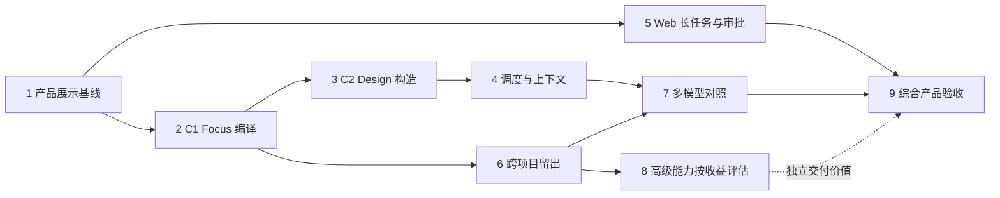

# AgentTest 长期开发路线图

本文件记录长期产品定位、架构决策和交付阶段之间的依赖。当前产品主线包括展示切片、Header 修复、C1 影子编译及默认关闭的 C1.1/C2 候选。C1.2 真实 Focus 配对已停机，验证未完成。契约数据生成已完成一次冻结离线对照，原结果保持 18/20。[开发进度](progress.md) · [契约工具 PoC](contract-tool-reuse-poc.md)

## 产品定位

AgentTest 面向经授权的 API 测试环境，目标是成为通用的 AI API 测试同事。它理解需求，结合 OpenAPI、角色、资源关系和业务规则确定测试范围，设计并执行测试，从观察结果中调整行动、调查失败，生成可信报告并把合格测试沉淀为可复现资产。长期产品包含自主规划、可信执行、跨项目泛化、多模型适配和完整的交互工作台。

项目同时承担三个目标。实际产品要能完成可审计的 API 测试与持续回归；Agent 开发要系统实践工具调用、上下文、Skills、人工介入和评测；工程建设要积累后端的权限、状态、并发、恢复和交付能力。无模型的确定性执行内核和固定回归是产品基础。开放语义理解、探索式测试与证据驱动的自主调整继续发展。[初始任务书](../CODEX_TASK.md) · [项目技术设计](project-technical-summary.md)

## 架构决策与演进

| 历史方案 | 演进原因及当前决策 |
| --- | --- |
| 起初采用 LangGraph 固定流程和确定性 Executor，随后引入受控 Round Supervisor | 早期方案建立了契约、策略、绑定和报告。P0 需要验证模型能否基于执行证据选择下一步，先复用现有能力构成有界决策环。[架构研究](agent-architecture-research-and-roadmap.md) · [LangGraph P0](autonomous-agent-langgraph-p0-20261111.md) |
| P1 把 Deep Agents 作为候选；P2 确立主自主运行时 | P1 的工具选择、成本与覆盖表现有利有弊，先以 ADAPT 保留选择。P2 集成受限工具、运行时门禁及统一完成判定后，采用 Deep Agents 为主自主 Harness，旧 Supervisor 留作兼容与回归。安装或配置不足时仍有确定性入口；显式要求自主运行时缺条件则失败关闭。[P1 对照](deepagents-harness-p1-evaluation.md) · [P2 决策](deepagents-product-runtime-p2.md) |
| 早期中断后暂停，后续引入 Checkpoint、步骤账本和 HITL | LangGraph 保存图状态，AgentTest 步骤账本保存 HTTP 派发及可信回执。审批绑定通过预检的原计划。可信回执可以支持续跑；没有可信回执的写入留待核实。现有证据仅覆盖已验证场景。[步骤恢复](deepagents-step-recovery-p3b11.md) · [后端审批](deepagents-hitl-p3b2.md) |
| 用复杂发布稳定性作为 Web 后续里程碑的共同门槛 | P3-B2 多次局部改善未形成稳定趋势，采用复盘中的 C + D。可唯一确定的范围、结构和义务由可信代码承担，Deep Agents 保留开放判断和自主调查。产品切片可使用独立安全协议，复杂自主发布继续按原门槛研究。[架构复盘](architecture-and-roadmap-review.md) |
| 历史阶段暂缓 RAG、多 Agent、新框架以及部分 Web 或恢复工作 | 这些决定基于当时范围、代价和授权。知识接入先做来源可追溯的业务事实；高级技术按本路线图的收益门槛复评。历史验收、NO-GO 与阶段授权按原范围保留。[早期选型](project-technical-summary.md) · [历史研究](agent-architecture-research-and-roadmap.md) |

长线维持一套架构。Deep Agents、LangChain 和 LangGraph 承担有界模型决策、工具循环和图状态。AgentTest 维护契约、Planning IR、批准策略、编译与 Validator，复用同一个 Executor、权限体系、任务服务、账本和持久化边界。能唯一证明的绑定、调度、审批条件及终态由可信代码决定；开放语义、多个合法方案的权衡、探索和调查交给 Agent。Web、CLI、MCP 适配和固定回归均使用受控能力。[运行时边界](architecture-and-roadmap-review.md#当前调用链) · [MCP 接入](mcp-guide.md)

## 六项长期建设方向

| 方向 | 长期建设内容 | 当前状态及证据边界 |
| --- | --- | --- |
| **1. 稳定性与可靠性** | 提高意图、规划、结构化输出和工具调用质量。改进确定性编译、限定的局部修复、故障隔离、模型服务异常、长任务预算和完成语义。持续完善 HITL、Checkpoint、恢复、清理、可信证据和未知写入防重放。用多种任务与故障验证稳定性。 | 已有可信执行、审批、部分跨进程恢复及 C1.1 离线接管候选。P3-B2.8 复杂发布 0/5、NO-GO，五轮安全审计通过。安全、完整覆盖、业务断言和模型可用性需要分别度量。[C1.1](deterministic-focus-compiler-c11.md) · [P3-B2.8](deepagents-model-reliability-p3b28.md) |
| **2. 通用性与跨项目泛化** | 支持不同 OpenAPI、身份、依赖和生命周期，覆盖功能、权限、异常、跨接口生命周期及探索性任务。接入经确认的业务知识；让独立陌生项目、需求改写和留出集挑战现有规则，避免按项目和历史失败写分支。 | 现有通用契约和批准策略有多个开发域的证据。CourseInsight 首次 3/10 完整、18/26 实测，含修复复验后实际覆盖 26/26；C1 第二契约验证的是离线映射。架构可表达多领域，真实泛化程度仍需独立评测。[真实联调](courseinsight-colleague-delivery.md) · [Eval v2](agent-eval-v2.md) |
| **3. 多模型适配与泛化** | 统一接入与能力描述，探测结构化输出、Tool Calling、上下文和用量证据。按模型能力调整策略，联合衡量质量、Token、延迟与费用。用相同冻结请求跨模型独立对照。 | 保留现有兼容接口与 ecnu-max 运行路径，历史也有其他服务别名记录。缺少可归因的同任务跨模型胜负。优先复用冻结 Focus/Design 请求小样本筛查，模型特例限于适配层的已证实差异。[模型配置](model-configuration.md) · [配对方案](architecture-and-roadmap-review.md#建议的最小配对实验) |
| **4. 回归测试与测试资产** | 从 Agent 测试沉淀已验证计划、版本、依赖、断言依据、覆盖和证据。支持固定 pytest 导出与无模型重复执行，比较历史覆盖和契约变化，评估接入 CI/CD 的维护收益。 | Web 已保存测试、离线重跑和合格 JSON 场景导出已演示。动态 Agent 生成与固定回归的结果、成本和人工审查分别记录。资产版本差异、批量维护以及 CI/CD 工作流仍待验证。[固定回归](regression-export.md) · [演示基线](product-demo-and-delivery-baseline.md) |
| **5. Web 工作台与产品体验** | 管理项目、环境、身份、业务知识与策略。支持多轮交互、长任务状态、实时进度、工具调用和 Trace、批准/拒绝、中断/恢复、失败调查、报告、测试资产、模型配置和预算。持续优化状态表达和交互一致性。 | 已有接入、任务、报告、取消、保存回归与只读恢复资格。后台已有部分审批与恢复能力，完整的原任务审批、恢复操作和 Trace 交互尚待建设。[Web 现状](product-demo-and-delivery-baseline.md#web-现状与本轮修正) · [独立准入方案](architecture-and-roadmap-review.md#建议为-p3-b3-另设安全准入协议) |
| **6. Agent 自主能力与主流技术实践** | 持续完善 Deep Agents Harness、Agent Loop、Skills、Context Engineering、MCP、Planning IR、结构化工具调用、Checkpoint、HITL、Tracing、Observability、Evals、隔离与安全控制。提升在合法候选中自主选路、调查、归纳和停止的质量。 | 带工具循环和 Skills 的运行时已接入，范围、工具和终止有可信门禁。MCP 已有受限对外入口；广泛自主发现和调用外部工具、跨 Agent 协作及通用探索仍待评估。[运行时](deepagents-product-runtime-p2.md) · [Skills 与上下文](deepagents-skills-context-p3a.md) · [MCP](mcp-guide.md) |

## 各阶段共用的工程门槛

- **安全与授权。** 以隔离目标、批准操作、身份、业务预期和预算为边界。Agent 只提交受约束提案或调用注册工具；任何写入由原预检和适用的审批批准。保持凭据隔离、脱敏、网络限制、清理和未知写入防重放。
- **可信完成。** 分别记录任务终止、义务覆盖、业务断言、异常、清理和待审。保留失败、跳过、缺失用量与未测分母。断言预期有可回溯授权，异常原因有独立证据。
- **可复现评测。** 在改动前冻结任务、正反对照、策略、预算、候选身份与评分规则。评测器独立于模型。开发回放、独立人工标注、真实目标验收、固定回归与故障注入各自报告，保留历史首轮和后续复验。
- **可观测性与性能。** 关联任务、调用、审批、HTTP 回执、清理和原报告，能区分模型服务故障、语义/格式错误、预算停止和执行拒绝。比较请求规模、用量、延迟分布、费用和人工介入，UNKNOWN 保留未知；优化以等价义务、质量和授权为前提。
- **模块化交付。** 依次收敛责任边界，优先复用现有执行器、权限、资产和存储。每个里程碑保留可回滚条件、版本与证据，验证范围与改动风险匹配。固定回归资产、Evals、安全和性能在每一阶段积累。[开发检查](development-checks.md) · [评测审核流程](eval-v2-human-review.md)

## 开发阶段与依赖

以下顺序是当前建议，可根据依赖和独立证据调整。已完成的展示基线提供比较起点。C1.1 候选把离线验证推进到实际任务入口。C1.2 已停止，真实合法 Focus 及最终 IR 等价仍缺证据，候选继续默认关闭。Web 状态和交互可在满足自身门禁时先行。泛化及跨模型的留出设计应在实现前冻结，真实测量使用已稳定的比较面。[C1.2 停机复核](deterministic-focus-compiler-c12.md)

### 1. 产品展示基线 · 已完成

- **方向与价值。** 方向 1、4、5。让操作员从契约接入走到结果、失败证据和可重复回归。
- **内容与前置。** 复用已有 Demo、Web、受控 HTTP fixture、导出器、审批和步骤账本。已验证工单接入与双角色四步测试、固定 pytest、隔离生命周期和未知写入恢复边界。
- **验收与停点。** 正常链、故障断言、固定重放、受控审批及恢复各有独立证据，说明从哪里复现。本切片已达停点。后续完整 Web 审批和复杂自主发布另立阶段。[基线交付](product-demo-and-delivery-baseline.md)

### 2. C1 确定性 Focus 编译 · 离线候选保留，真实门槛未满足

- **方向与价值。** 方向 1、2、6。把已证明的范围、批准检查和来源映射交给可信编译，减少模型重复转写并提高可追溯性。
- **内容与前置。** 复用批准快照、来源校验、精确值授权及库存。C1 已离线回放 25 份历史提案，第二契约的正反和变形验证通过。C1.1 候选限定封闭整项目文本，以任务级协议将仍需模型理解的语义与编译映射合入原 IR。候选默认关闭。[C1.1 证据](deterministic-focus-compiler-c11.md)
- **C1.2 实测。** 八个位置实际调用两个。原协议因精确值来源及映射问题被拒，候选触发请求截止且用量未知。两臂均无通过的 Focus。停止分类漏掉了首条来源诊断，实际在第二条后停机。继续开发以独立验证条件为准。本次结果不足以完成 C1 真实验证或自动进入 C2。[配对结果](deterministic-focus-compiler-c12.md)
- **验收与停点。** 实际编码前后可比较，已接管映射无需模型逐项填写；正例语义等价，负例拒绝、待审或回到原路径。冻结授权、完成分母、旧资产和回退行为稳定。若无法证明等价性，保留影子。默认发布、开放文本扩大及纯 UI 来源协议在该切片之外。[C1 证据](deterministic-focus-compiler-c1.md)

### 3. C2 Design 确定性构造与开放输入槽 · 单义务候选已接入，默认关闭

- **方向与价值。** 方向 1、2、4、6。基线、角色、依赖和批准断言能够唯一构造时直接编译，模型填写真正未定的输入或在合法候选中选择。
- **选型结果。** 保留 Deep Agents、统一可信执行与领域工具。Schemathesis 的原冻结 B1 结果为 18/20，保留为离线对照工具。三臂共同遇到的 Header 缺陷已独立修复，B02/B03 定向复验通过，原 PoC 评分保留。[冻结对照](contract-tool-reuse-poc.md) · [Header 修复](negative-request-context-fix.md)
- **已接入。** 已批准、单一基线、带同身份前后只读观察的 POST 缺必填字段检查，可在两个原工具入口跳过内层 Design。两种契约的离线配对均每个位置少一次 Design，继续走原预检、审批、预算、持久化与执行链。项目级开关默认关闭。开放槽、依赖生产者的更新和需人工判断的场景保留原入口。[C2 证据](deterministic-design-compiler-c2.md)
- **验收与停点。** 跨契约对照相同动作、绑定、义务和断言，确认少生成可证明字段。歧义或未批准值待审；一类场景闭环后停止扩张。暂缓通用补丁协议、所有负向形状的一次性改造和执行器重写。[输入槽证据](deepagents-quality-regression-p3a1.md) · [C 的重构切口](architecture-and-roadmap-review.md#c-的最小重构切口)

### 4. Agent 调度、工具与上下文 · 可分切片完善

- **方向与价值。** 方向 1、3、6。减少唯一下一步的模型往返，把上下文和模型轮次留给主动探索、多个合法动作的选择和失败调查。
- **内容与前置。** 现有 Skills、上下文裁剪、工具目录、义务门禁和进度规则已接入。先对照 C1/C2 输出及历史轨迹，在固定或只读路径检验可确定调度；按证据选择上下文投影、报告引用或有界修复。
- **验收与停点。** 对照动作顺序、已测与未测、预算、证据完整性、终止与回退。预先冻结期望质量和开销指标，无收益或行为回归即停止扩大。暂缓第二个自主循环、全量工具搜索和修改原写入语义。[Skills 证据](deepagents-skills-context-p3a.md) · [预算与收敛](deepagents-reliability-p3a3.md)

### 5. Web 长任务、审批与恢复 · 独立产品切片

- **方向与价值。** 方向 1、4、5。让操作者能查看任务证据并理解下一步是在等审批、可安全恢复还是需要核实。
- **内容与前置。** 现有只读恢复资格和后台 HITL 已有分项证据。先做状态、记录和 Trace，再用既有服务端 API 做审批、拒绝、原任务恢复。该切片需要独立冻结环境、所有权、审批绑定与恢复用例，可与编译开发并行。
- **验收与停点。** 验证未授权、并发/重复操作、版本漂移、已知回执和未知写入，逐项核对派发次数及证据。若写入恢复没有通过独立门禁，只放行已通过的状态展示。暂缓完整 P3-B3 承诺、生产部署与泛化未知写入恢复。[后端审批](deepagents-hitl-p3b2.md) · [Web 准入协议](architecture-and-roadmap-review.md#建议为-p3-b3-另设安全准入协议)

### 6. 跨项目泛化与独立留出 · 评测待完善

- **方向与价值。** 方向 1、2、4、6。评判功能、异常、权限、生命周期和探索性目标能否迁移到新契约、新业务及新表达。
- **内容与前置。** 已有多项目开发记录和 Eval v2。可以先冻结人工审阅的陌生项目、结构化业务知识、负控制和独立故障配对；正式比较使用稳定的接入与执行路径，记录初次结果和复验。
- **验收与停点。** 报告各类的分母、安全、完成、覆盖、缺陷检出和环境故障。未满足独立审核或可信业务预期时保留为开发证据。暂缓宣布广泛泛化、自动推导未批准规则和改造靶场迎合评分。[Eval v2](agent-eval-v2.md) · [历史联调](courseinsight-colleague-delivery.md)

### 7. 多模型适配与对照 · 方案已整理

- **方向与价值。** 方向 1、3、6。将核心行为与单一模型服务解耦，识别任务需要的模型能力、延迟及成本。
- **内容与前置。** 保留现有适配与账本，统一协议能力和降级状态。先在授权环境用相同 Focus/Design 请求做小规模配对，冻结模型配置、工具、任务和成本口径；需要更大评价时复用独立留出与稳定调度。
- **下一阶段准入。** 多模型适配和小规模真实对照需另行立项。新的真实实验之前，先修复并离线验证 C1.2 脚本对精确值来源冲突的停机漏判，证明冲突后下一位置不会被预约或派发。[停机复核](deterministic-focus-compiler-c12.md#停止规则复核及阶段结论)
- **验收与停点。** 对照结构、语义、权限、覆盖、超时、延迟和 usage，保留失败及 UNKNOWN。达到冻结预算或有效样本数时收尾，服务与模型因素无法区分时保留未知。暂缓自动换模型、为一个提供方修改核心语义和直接启动全量五轮。[低成本对照](architecture-and-roadmap-review.md#建议的最小配对实验)

### 8. 按收益评估高级 Agent 能力 · 候选

- **方向与价值。** 方向 2、3、5、6。用一项技术解决一个已测量的产品问题，例如大工具目录的选择成本或只读调查上下文拥塞。
- **内容与前置。** 记录瓶颈，测现有受限工具和评测基线，为单个候选冻结收益和安全门槛。候选表见下节，现阶段保持既有运行时。
- **验收与停点。** 只扩大带来可重复质量、效率或体验收益且不破坏授权、证据与维护性的方案。若受限工具或确定性代码已解决问题，归档试验。暂缓以技术名词为目标的架构迁移。

### 9. 综合产品验收、资产与性能 · 持续补齐

- **方向与价值。** 全部方向。把可用的 Agent 工作台、隔离执行、资产复用及成本控制组合成可维护的交付。
- **内容与前置。** 汇合已各自验收的规划、Web、证据和回归切片，比较重复执行、契约变化与长任务开销；按收益选择 CI/CD 小试点。已有固定回归可立即作为集成基线，复杂发布另按研究门槛。
- **验收与停点。** 复现从接入到规划、审批、调查、报告、资产再运行的已支持流程。报告未覆盖领域和实际代价，达到当前交付范围即收尾；缺独立证据的能力维持实验。暂缓无需求的大规模部署、迁移存储和重复内核。[演示基线](product-demo-and-delivery-baseline.md) · [回归资产](regression-export.md)

## 尚待评估的技术

| 候选 | 评估触发及门槛 |
| --- | --- |
| Programmatic Tool Calling | 重复工具往返已成为瓶颈时，比较由可信代码编写的有界编排与现有调度。保留结构化输入、预算和逐次授权，继续禁止执行模型生成的 Python 或 Shell。 |
| 动态工具选择与 Tool Search | 目录规模显著影响相关工具选择时，评估按批准目录检索和上下文收窄。比较合法动作命中率、漏测及成本，工具可见性与派发权限各自核对。 |
| Subagents 与上下文隔离 | 多条独立只读调查或上下文拥塞有明确证据时，比较一主多任务与当前循环。共享总预算、可信证据及权限，限制数据流与委派范围，保留单循环基线。 |
| AG-UI | Web 的跨客户端实时交互、事件同步或人工介入出现具体兼容需求时，先对照现有任务事件、Trace 和恢复状态。验证事件顺序、重连、权限和正常降级。 |
| A2A | 出现真实的外部 Agent 交接需求时，验证身份、委派权限、超时、审批和证据归属。先走受控场景，业务权限继续由 AgentTest 服务端掌握。 |
| 业务知识检索、可观测集成及其他技术 | 只有在现有批准目录、可查报告或本地遥测无法满足实际需求时才试验。知识要有来源、版本和审核，可观测输出遵守脱敏与数据传输授权；比较所得收益与维护、依赖及隐私成本。 |

## 产品主线与高级可靠性研究

两条路线共用项目、Policy、Validator、Executor、任务服务和证据账本。产品主线推进有独立验收条件的编译、交互、报告和回归能力。研究线处理复杂自主发布、多模型比较与泛化问题，以独立冻结任务和预算验证假设。产品切片通过不改变复杂自主发布的准入结果。

**P3-B2.8 原评分保持 0/5、NO-GO，原复杂自主发布门槛为 4/5。** 五轮安全审计、历史 FAIL/NO-GO、原评分和证据全部保留。暂停以连续局部修复、全量冻结回归和五轮发布结果驱动的循环。重新申请复杂发布验收须有明确改进机制、独立受控证据和新授权，采用原任务、评分与门槛。没有稳定改善就归档当前证据，继续安全条件独立的产品工作。[P3-B2.8](deepagents-model-reliability-p3b28.md) · [路线复盘](architecture-and-roadmap-review.md#六剩余开发路线与停止条件)

## 维护方式

开始新开发前查看本文件和进度，选定本轮对应的长期方向及最小可验证里程碑。跨阶段准备以明确依赖和授权为准。重大架构、定位或优先级调整需要更新路线图，并记录证据、原因和对历史方案的处置。`progress.md` 记录实际交付和下一步，阶段报告保留实验设计、原档案和结果，README 提供产品入口。历史报告继续按原时间与版本解读。[开发指导](../AGENTS.md) · [开发进度](progress.md)
