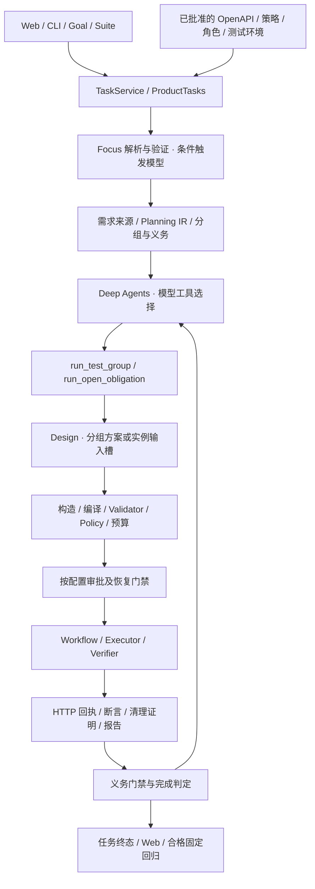

# AgentTest 阶段性架构复盘与开发路线

2026-11-24 · 审查基线 `bec965fba0d7f5c039812cf94d7567b765747af3`

## 结论

**P3-B2.8 保持原评分 0/5、NO-GO。建议暂停以完整五轮验收驱动的局部修复，采用 C + D。** 先让可信代码编译已获批准且可唯一确定的范围、策略、义务和调度。Deep Agents 继续处理开放意图、多个合法方案之间的选择和证据驱动的调查。现有复杂自主发布任务保留为实验，并继续使用原发布门槛。工作台的报告、固定回归和可安全演示的审批状态可以按独立协议推进。

当前系统已经能通过统一的执行内核完成跨接口测试、可信断言、证据归档和合格用例的固定回归。最有说服力的展示是把这条链跑通，并演示系统如何保留一次真实断言失败、拒绝无依据的方案，以及如何从可信回执继续。现阶段，复杂发布任务反复要求模型转写已经确定的事实，并依赖多次模型回合推进已有唯一下一步的流程。这些调用增加了错误面和耗时，尚无稳定的完整交付收益。

本轮依据任务书、README、技术设计、历史进度、P0–P3 阶段记录、当前实现和本地验收档案做只读复盘。README 仍写着 P3-B2.8 真实验收尚未开始。更新的阶段报告、进度和本地原评分审计均确认已结束，CI 回执的 7 个成功作业对应上述提交。离线第三次冻结为 3087 passed、15 skipped、1 xfailed、0 failed；当次冻结与实测 checkout 的差异为三份文档。README、进度以及已有报告均按工作区原样保留。以下路线和停止条件属于建议，需另行决定是否启动。[README](../README.md) · [进度](progress.md) · [P3-B2.8 报告](deepagents-model-reliability-p3b28.md) · 本地原评分（本地归档 `.eduwork/p3b28-acceptance-bec965f/audit.json`） · CI 回执（本地归档 `.eduwork/p3b28-acceptance-bec965f/ci-receipt.json`）

## 一、目标、架构演进与当前职责

最初的交付目标是让测试人员输入自然语言，基于 OpenAPI 和人工批准的业务策略设计跨接口测试，在授权环境执行，产出能解释失败、能够复现的证据与 pytest 回归。最先实现的是人工 DSL 到确定性 HTTP 的离线闭环，随后才接入结构化模型输出、LangGraph、MCP 和隔离业务实例。这个顺序确立了两个一直有效的约束：目标及业务预期由操作员批准，业务结果由执行证据裁决。[初始任务书](../CODEX_TASK.md) · [早期技术设计](project-technical-summary.md)

| 阶段 | 架构变化 | 证据和边界 |
| --- | --- | --- |
| 初期至 P0 前 | 单场景状态图将计划、校验、执行、分析和报告串接。后续增加项目接入、任务服务、输入溯源、批准负向、固定回归与可比较的范围账本。Planning IR 开始分开表达原文子句和请求实例，同一个接口可以有多种角色、不同输入或不同生命周期阶段。 | 原技术设计里的图仍适合解释内核，当前 Web/产品任务在其外还有任务服务与自主编排。早期 Java 三步验收、后来的 CourseInsight 网页联调和当前发布靶场各有自己的验收范围。[技术设计](project-technical-summary.md) · [IR 重构](planning-ir-refactor.md) · [CourseInsight 联调](courseinsight-colleague-delivery.md) |
| 自主 P0 | 在产品固定管线内加入 LangGraph Round Supervisor，用结构化事实选择补测、只读探针、提问或结束。原方案仍走 Validator 和 Executor。 | A/C/D 观察到新增真实证据，B 的自主扩展反而更差。实验有开发重试和扣除口径，难以用一条成功率表示。[P0](autonomous-agent-langgraph-p0-20261111.md) · [当时的架构盘点](agent-architecture-research-and-roadmap.md) |
| Deep Agents P1 | 用同一执行内核做两种循环的 A/B，验证 ecnu-max 原生 tool calling，并验证默认工具的实际封锁。选型结论为 ADAPT，当时将 Deep Agents 作为可选循环。 | Deep Agents 有响应反馈后的动作调整证据，首工具严格命中仅 3/8，部分任务成本和覆盖弱于基线。模型可见工具目录和实际派发权限分别验证。[P1](deepagents-harness-p1-evaluation.md) |
| P2 / P2.1 | P2 将 Deep Agents 设为唯一主自主运行时。Web、CLI、Goal、Suite 的产品流程汇入 `ProductTasks.run`。P2.1 修复 IR 进入门槛、实例身份、批准绑定依赖、删除后回读顺序和完成误判等。 | 固定四目标严格完成 P2 为 0/4、P2.1 最终为 2/4，另有调试成功。P2 的发布轮有 10 个资源泄漏，P2.1 报告所列执行轮清理改善，发布完整性仍未解决。[P2](deepagents-product-runtime-p2.md) · [P2.1](deepagents-reliability-p21.md) |
| P3-A 至 A.4 | 增加原生 Skills、上下文清理、重复读取指针、输入槽 Design、分层预算与账本。逐步将清理和负向副作用观测接回生命周期 IR。 | P3-A 1/4、A.1 3/4，后者发布仍只有 9/31。A.2 同任务 FIXED 3/4、ADAPTIVE 2/4；A.3 冻结 60 轮中两臂各 4/12，原六类 1/18、新六类 0/18。完成语义审计对旧样本的校正与新样本 6/18 各自保留。A.4 获得独立表达的 31/31 单次证据，随后入口验收发布 2/5，仍未达到该批门槛。[P3-A](deepagents-skills-context-p3a.md) · [A.1](deepagents-quality-regression-p3a1.md) · [A.2](deepagents-reliability-p3a2.md) · [A.3](deepagents-reliability-p3a3.md) · [完成语义审计](agenttest-product-semantics-audit.md) · [A.4](planning-ir-lifecycle-reliability.md) · [P3-B 入口批](deepagents-p3b-entry-gate.md) |
| P3-B1 / B1.1 | 原生图 Checkpoint 管理中断边界，任务持久化记录原快照；进一步在 Executor 增加请求意图、响应和证据阶段的 HTTP 步骤账本。 | 有跨进程恢复、可信 POST/DELETE 回执后只执行剩余步骤、假 204 被回读检出的隔离实测。无可信响应的派发停在待审。B1.1 完整发布单次 31/31，真实 503 仍保留。[B1](deepagents-durable-execution-p3b1.md) · [B1.1](deepagents-step-recovery-p3b11.md) |
| P3-B2 至 B2.8 | 在实际请求预检后接入 HITL，增加同计划恢复、未知写入核实、义务门禁、有限修复和遥测。 | 审批、恢复、拒绝与清理有分项证据。整个复杂发布任务仍在 Focus、Design、用量未知与剩余义务推进处多次提前结束，详见第三节。 |

### 当前调用链

- **入口和模型适配。** `ProductTasks.run` 冻结任务及项目版本、建立模型和 HTTP 账本，适用时先跑 Focus，再进入循环。Focus 与 Design 走 `OpenAICompatiblePlanner` 的约束 JSON 路径，由 `BudgetPlanner` 和 `JournalPlanner` 包装。循环走 `EcnuxChatModel` 对接 LangChain 原生工具调用。三类调用均进入任务预算和用量证据，编码、用量解析、超时或取消路径仍各有实现。`AUTO` 在依赖与模型工厂齐备时选 Deep Agents，缺条件时降级 `DETERMINISTIC`；显式请求 Deep Agents 缺条件会失败关闭。这里的 `DETERMINISTIC` 指固定编排，正常产品路径仍可调用已配置的 Focus/Design；展示用的固定测试和离线 Demo 才有明确的无需真实模型路径。Legacy Supervisor 仍是显式兼容分支。[任务服务](../src/agenttest/task_service.py) · [任务主链](../src/agenttest/product_tasks.py#L622) · [引擎选择](../src/agenttest/product_agent.py#L126) · [Planner](../src/agenttest/llm_planner.py#L473) · [ChatModel](../src/agenttest/deep_harness/chat_model.py)
- **Deep Agents Harness。** 承担图内模型轮次、工具调用、Skills、上下文管理和检查点集成。8 个产品工具读契约、已批准策略、范围、覆盖、报告，运行分组、处理候选义务及只读调查；另有受限 `read_file` 加载随包 Skill。运行时同时核对工具目录和实际执行封锁。模型能决定要看什么、选择哪一合法分组与候选、提供设计备注或提出调查思路。`investigate_failure` 本身读取报告及可信解释，模型可在外层组织下一步。模型的结束消息经过义务门禁，必要时由代码列出下一合法分组再回到模型。仓库的 Deep Agents 运行环境锁定 `deepagents==0.7.35`、`langchain==1.4.10`、`langgraph==1.2.20` 和 SQLite checkpointer `3.1.3`。[工具目录](../src/agenttest/product_agent.py#L73) · [调查实现](../src/agenttest/product_agent.py#L1183) · [工具注册与校验](../src/agenttest/product_agent.py#L1313) · [循环终止门禁](../src/agenttest/product_agent.py#L655) · [依赖锁](../requirements-deepagents.lock)
- **确定性内核。** 合同和策略决定合法操作、身份、资源绑定、引用选择器和可用断言；IR 与构造器处理可信前置关系和排序，预检核对字段、业务预期及清理链。Executor 使用 Vault、批准目标、网络与请求预算门禁执行 HTTP，Verifier 按批准依据出结果。对已批准规则，清理需同资源同身份的实际回读等相应证据，DELETE 204 或终态库存归零单独不能证明清理。HTTP 账本记录派发、响应和证据。可信回执可用于续跑；对于未知派发，受控核实只能记录观测到的效果，不能补造原写入结果。`obligation_gate` 和 `task_completion` 用实际执行、未测项、异常与清理证据裁决完成。[编译器](../src/agenttest/planning_compiler.py) · [预检](../src/agenttest/product_preconditions.py) · [安全边界](../src/agenttest/safety.py) · [Executor](../src/agenttest/executor.py) · [Verifier](../src/agenttest/verifier.py) · [步骤账本](../src/agenttest/step_recovery.py) · [完成语义](../src/agenttest/task_completion.py#L840)
- **审批与 Web 缺口。** HITL 默认关闭，开启时依赖持久化 Deep Agents。任务服务已有 review 查询、决定、取消和恢复入口，审批绑定同任务、目标部署、已预检计划、资源及版本。批准后恢复会重建并校验原计划。当前工作台已有项目接入、任务状态、报告、取消和固定回归；前端任务客户端和页面尚无成套的 review 查询、决定、原任务 resume 操作。B3 的产品工作集中在这段用户路径。[审批实现](../src/agenttest/human_review.py) · [持久化](../src/agenttest/product_durability.py) · [任务 API](../src/agenttest/task_api.py#L252) · [前端客户端](../web/src/api/tasks.ts) · [任务页](../web/src/pages/GoalTasks.tsx)

P3-B2 把复杂发布稳定性作为进入 P3-B3 的共同前置条件。后续正式批要求至少 4/5 达到原覆盖、回执和安全口径。Focus 失败会阻断所有派发，Design 失败会阻断整个组或其中的义务，模型网络异常和 UNKNOWN 会终止后续模型调用。一轮里可同时出现多种原因。后台审批分别通过的证据，无法回答“同一个复杂任务能否稳定跑到下一个审批点并最终覆盖完整”，所以总门槛长期未打开。Web 查看可信报告、展示待审原因或管理已存在的审批，与这个端到端稳定性问题的依赖程度不同。

## 二、模型职责审查

### Focus · 从自然语言到受信任范围

| 审查项 | 当前实现与判断 |
| --- | --- |
| 入参与出参 | 输入当前和历史需求、原文原子、可见或不可用的接口、输入槽、批准负向检查、可用角色、预期和来源索引。输出解释、范围模式、按 operation 的选择与输入/检查映射、阻塞标记及 `requirement_map`。解码将 wire 引用还原，核对来源、权限、精确值、待审问题及子句关联，随后生成 Planning IR。 |
| 模型价值 | 将开放表达映射到候选接口和角色，明确“本次执行”“仅咨询”“以后再测”的区别，识别未明确的对象、顺序、负向条件与原文指代；多解时提出澄清。业务规则与身份授权只允许引用已批准依据。 |
| 已由代码掌握 | 原文原子、封闭表达中的整项目变体范围来源、可选检查目录、检查与操作关系、角色就绪、精确值的原文保真、固定义务的缺项见证由代码计算。`missing_requested_checks` 在已识别的受限整项目范围和候选条件满足时已经知道待补的 `operation_id/check_ref/source_ref`。当前仍要求模型逐项提交。如果模型漏掉、将策略默认坏值当作用户明确值，或写了多余范围条款，整份可能被拒。 |
| 重复结构与减负 | 当前一次有界修复要求再次提交完整 Focus wire，`keep_requested_checks` 是反馈约束。可解析草案的局部修补能减少重抄。长期应把唯一可证明的映射在可信端直接构造，从同一目录生成来源凭据，将模型输出压到歧义选择或待审原因。只要还有开放子句，就保持模型/澄清支路。封闭范围才有机会完全省去该阶段调用。 |
| 授权与语义风险 | 只有原文或显式 UI 范围、批准快照、可执行身份与唯一来源全部有见证才可编译。`selected`、`all_ready` 和“这次只做正常路径、异常以后再测”代表不同授权范围。多个同名操作或身份、跨轮撤回、单项否决、精确值和冲突来源必须保持待审或原窄范围。规范化在提案前从事实独立构造，收到模型矛盾时保留拒绝；不得用静默替换把越界提案变为执行权限。 |

**判断。** 在受限、明确的整项目预发布范围内，可从已经证明的意图和批准目录生成完整映射。开放文本的范围意图仍可能需要模型。把这两者共用同一种逐条生成协议，导致“理解整项目”与“正确转写 24 条引用”一同成为整轮门槛。[Focus wire](../src/agenttest/product_focus_wire.py) · [Focus 解码和保留反馈](../src/agenttest/product_focus.py#L531) · [缺项和精确值校验](../src/agenttest/product_checks.py#L177) · [整项目来源归一化](../src/agenttest/task_completion.py#L192) · [一次修复入口](../src/agenttest/product_tasks.py#L777)

### Design · 从已知义务到可预检用例

| 审查项 | 当前实现与判断 |
| --- | --- |
| 入参与出参 | 按组投影操作、Schema、角色、Policy、可信输入、前序关系、负向变体、断言见证、历史上下文、未测义务和剩余预算。一般输出 `TestDesign` 的案例、步骤节点或必要检查条目、问题和未覆盖理由。符合 `instance_inputs` 条件时只输出实例输入槽，再由代码装回结构。 |
| 模型价值 | 选择多个同样获准的合法业务路径；生成契约无法唯一决定、但允许模型填充的业务输入；对含混约束提问；对于有依据的差异和失败提出可验证的候选。OpenAPI 能描述请求形状和声明状态，业务断言、角色权限、外部资源来源或副作用不能从 Schema 自行推定。 |
| 已由代码掌握 | 分组依赖闭包、已批准角色、Policy ID、基线及负向变更、精确输入授权、唯一的前序生产者和选择器、认证注入、同资源清理与断言状态可从已有事实确定或验证。`instance_design` 已缩小部分正向输出。`decode_required_cases`、`decode_fixed_resource_setups`、`construct_design` 已有受信任构造逻辑，但部分分组仍要模型提交案例结构、基线步骤、参数和引用，再分别校验及补齐。 |
| 重复结构与减负 | 按组重新调用时重发一组或剩余义务的结构化方案。若唯一合法结构已可产生，直接构造并预检，模型只填开放槽；没有开放槽时省去 Design。可解析的拒绝用例可尝试只修一个开放输入槽或在批准的候选间择一。无法解析或缺整个基线的输出给不出可信可补对象。 |
| 授权与语义风险 | 按 `operation/role/policy`、实例身份、生命周期和批准来源检查唯一性。负向只允许批准的变更，必须维持合法基线，省略字段与显式空值语义不同。不能用补丁捏造引用、用另一角色或资源继续、变更断言或拼接来源不明的清理。任何会影响待派发请求的变化均重跑全套预检，写入按新摘要重新走相应审批。 |

`planning_engine_choice` 对 IR 有覆盖、问题及请求级负向等适用条件，`instance_inputs` 还要求上下文满足独立限制。当前不能把所有 Design 都算成重复生成，也不能把正向输入槽的已验证能力当作负向全链能力。重构应先找出“批准的事实已经足够构造唯一用例”的子集。[Design 编码和解码](../src/agenttest/product_design.py#L304) · [上下文与审查](../src/agenttest/product_design.py#L540) · [实例输入](../src/agenttest/instance_design.py#L163) · [编译器选择](../src/agenttest/product_tasks.py#L292) · [计划构造](../src/agenttest/plan_construction.py)

### Agent 调度 · 优先级决策与已知下一步

Agent 读取任务、Skills、工具目录、范围、覆盖、预算、组状态、报告与诊断，产出原生 tool call 和必要的设计备注，最终还可输出摘要。探索式调查需要结合证据判断下一条可验证假设、在多条合法路径之间比较价值、决定是否向操作员询问。定期回归和明确发布矩阵里，代码已经计算义务所属组、待测项、资源与清理状态、可用预算、次数与剩余候选。`dispatch_plan` 确定性排序，`_group_admission` 校验候选与实际入口，门禁能给出准确的下一组。可预判动作仍经过读范围、模型选工具、工具内 Design、回报进度、再选动作的往返。P3-B2.8 正式调用中 Agent 40 次、Design 28 次、Focus 8 次。40 次 Agent 包含有价值的调查、读取和结束判断，实际可以省去多少需要逐轨迹对照。

执行确定性队列可消除唯一下一步的模型转述。队列应继续调用既有任务、执行和证据门禁，使用冻结的依赖拓扑、所有权、实时预算与可恢复状态。存在真实顺序选择、潜在副作用、观察结果变化、多个资源身份或清理未决时，队列应只给合法候选或停在待审。当前代码的排序是候选顺序；直接把排序结果变为写入调度会改变执行顺序和操作员可见语义，需按任务类型验证，不能根据“排序稳定”推定“允许派发”。现有 Deep Agents 仍可把同一个受控执行入口作为工具，用在开放调查中。[义务目录与分批](../src/agenttest/product_obligations.py#L61) · [候选与门禁](../src/agenttest/obligation_gate.py#L109) · [分组准入](../src/agenttest/product_agent.py#L756) · [P3-B2.8 调用统计](deepagents-model-reliability-p3b28.md)

### 错误修复 · 按诊断性质决定是否调用模型

| 路径 | 输入、输出与重复 | 适合的处理及风险 |
| --- | --- | --- |
| Focus 格式/映射修复 | 输入完整原任务和候选、分组诊断、应删/应为空字段、保留及缺项映射。输出第二份完整提案。错误位置和合法保留集已经由代码确定。模型的额外价值只在有歧义的选择。 | 对可解析草案考虑稳定键上的原子变更。已证明范围中的映射可由编译器一次生成。缺权限、来源冲突或原文语义未知应待审。禁止对明确原文的值用 `null` 或批准默认值覆盖。 |
| Design 形式拒绝、预检拒绝、剩余义务 | 输入同一或更窄的批次、错误位置、可信引用候选、必要时同一批次的合法基线见证。普通重试提交方案，剩余项路径重做单项 Design；这与通用结构化补丁仍有差别。 | 代码能解释 Schema、路径、候选来源及是否已经派发。模型可修开放槽或在多个批准候选中选择。唯一合法基线更适合直接构造。P3-B2.7 的特殊路径基于同次设计、兄弟已实测、单个剩余义务、未派发、清理已证明等条件，不能推广为“有历史成功方案就重发”。应用变更后重新编译、预检、预算和审批。 |
| 模型服务或用量异常 | 输入 HTTP 状态、客户端阶段、timeout、拒绝/用量证据与剩余预算。现有瞬时网关错误按适用路径有限重试或挂起，UNKNOWN 受账本门禁限制。模型无法从无响应推断服务器处理和费用。 | 用程序决定可重试的状态、退避与限额。保留已知时序和未知项，只有匹配的服务端证据能进一步归因。无需为这一分支调用模型解释。禁止用平均值补 UNKNOWN，禁止把模型调用重试类比为业务写入重试。 |
| 业务断言失败和未知副作用 | 输入可信报告、批准预期、只读观测及关联回执。调查可用模型提出假设、选择下一项获准读取；原断言、分类和清理由账本验证。 | 保留真实 503 与假 204 的断言结果，不因报告意见改期望。未知写核实仅按已批准身份、读操作和绑定执行，结果限定为观察证据。确认不了即保留待审。 |

修复链的放大效应在历史中已有两种可观测表现。Focus 一个字段不符会触发大对象重生成，第二份提案可能丢掉原有效条目。Design 一次引用或 JSON 错误会产生新工具结果、额外 Agent 回合和新 Design，并消耗同一任务的时间、模型预算与进度机会。存在一次失败后修复成功的实例，也有同组多次拒绝后将后续合法组一起留为未测的实例。这个机制说明减调用路径值得验证，尚无法用历史批次推算减少调用后的完成率。[P3-B2.6 引用修复](deepagents-hitl-reliability-p3b26.md) · [同次合法基线见证](../src/agenttest/negative_batch_repair.py) · [重试策略](../src/agenttest/model_retry.py) · [P3-B2.8 真实证据](deepagents-model-reliability-p3b28.md)

## 三、P3-B2 真实验收复盘

### 历次正式结果

义务分母 31 指批准策略范围，24 指批准负向策略。后期原完整评分还检查显式请求级 24/24、预期的异常检出以及执行、审批和清理证据。B2.2 及较早批次按各自报告的覆盖和安全口径引用。正式的 `COMPLETE`、`strict_complete`、`checks_passed` 和原发布评分分别读取。后期部分达标轮实际检出了 503，`complete=true` 而 `strict_complete=false`、`checks_passed=false`。0/0 表示未建立请求级分母；早停轮的 0/31 可按冻结目录和实际零派发计，产品终态账本可能尚未生成。

后期完整发布采用串行、逐轮独立的隔离靶场，冻结配置包含 60 秒模型请求超时、单任务至多 64 次模型调用、650,000 tokens、120 次业务 HTTP、900 秒以及 `createParcel` 的审批触发。报告将健康探针与正式轮的消耗分列。A/B 小样本的用量与耗时应单列，避免混入任务预算和发布评分。[B2.6 批次配置](deepagents-hitl-reliability-p3b26.md) · [B2.8 冻结身份](deepagents-model-reliability-p3b28.md)

| 阶段 / 批次 | 义务与分母 | 原结论及主要证据 |
| --- | --- | --- |
| B2 · HITL 初验 | 同资源审批 3/3；拒绝 0/3；未知 POST 0/3、目标有 1 条实际创建；完整发布 25/31、负向 18/24。 | **NO-GO**。批准可跨进程继续，拒绝零业务请求。未知 POST 安全阻塞；完整发布 70 HTTP、19 模型调用，模型 500 后未完成，9 次创建有清理凭据。[报告](deepagents-hitl-p3b2.md) |
| B2.1 · 恢复与核实 | 账本修复前发布三轮分别 31、31、0/31。最终源码两次为 29、27/31，负向 22、20/24。 | **NO-GO**。有未知 DELETE 读回存在/缺失和正向 POST 关联键证据，原写结果依旧未知。两次满覆盖属于早先源码。最终一轮有注入 500 后同检查点续跑，最后四项负向未测；两轮清理均有凭据。[报告](deepagents-hitl-reliability-p3b21.md) |
| B2.2 · 四个源码批次 | `r` 5/5；`s` 3/5；`t` 0/5（7、0、30、23、28/31）；最终 `u` 2/5（21、31、17、0、31/31）。这里的比率是达到 31/31 的轮数。 | **NO-GO，最终 2/5**。实测到的 503 留有断言证据；报告后续明确 `u4` 在 Focus 阶段结束，零业务请求。20 轮无越权和重复负向派发。最早 5/5 与最终候选源码不同。中途出现 Focus 反馈缺陷、模型生成不足及未知用量。[报告](deepagents-hitl-reliability-p3b22.md) |
| B2.2 · 优化版冻结独立复验 | 31、14、0、31、31/31；负向 24、7、0、24、24/24。 | **NO-GO，覆盖达标 3/5**。候选含冻结回归相关优化。两轮先后在 Design 或 Focus 超时；成功轮存在合法 Design 修复。五轮单列，保留原 `u` 批结果。[报告](deepagents-hitl-reliability-p3b22.md) · 位置归档（本地归档 `.eduwork/p3b22-retest-20261117T052048Z-d4a1f9a3/positions.jsonl`） |
| B2.3 · 调用与引用诊断 | 0、19、21、21、0/31；负向 0、12、14、14、0/24。 | **0/5、NO-GO**。61 次调用中 3 次 `DEADLINE/UNKNOWN`，发生在一次 Focus 和两次 Design；另有来源/值错误、未知请求体字段、JSON 语法错误和 `NO_PROGRESS`。15 次创建均有清理证明。[报告](deepagents-hitl-reliability-p3b23.md) |
| B2.4 · Focus/Design 反馈 | 27、29、0、26、26/31；负向 20、22、0、19、19/24。另有一次启动器在首个探针发送前中止，真实模型调用为 0。 | **0/5、NO-GO**。192 次调用、0 超时、0 UNKNOWN。55 次 Design 出现 14 次 JSON 语法拒绝；31 条负向案例预检拒绝，含 24 条未知字段。48 次创建清理有回读，另 3 次删除后缺回读，报告保留 `CLEANUP_UNPROVEN`，即使库存已归零。[报告](deepagents-hitl-reliability-p3b24.md) |
| B2.5 · 投影、预检与清理 | 21、31、31、31、31/31；负向 14、24、24、24、24/24；请求级 14/24、0/0、24/24、24/24、0/0。 | **原评分 2/5、NO-GO**，虽然 4/5 满批准义务。v2/v5 只在普通需求层提交 response checks，显式负向请求映射为空。112 次调用均用量已知，65 次创建均有清理证明；JSON、案例预检和缺回读三条新增反馈无真实触发。v1 同组反复 `SOURCE_UNKNOWN` 停在 21/31。[报告](deepagents-hitl-reliability-p3b25.md) · 原评分（本地归档 `.eduwork/p3b25-acceptance-ae61d8a/audit.json`） |
| B2.6 · 请求级覆盖门禁及引用反馈 | 31、0、31、31、30/31；请求级 24/24、0/0、24/24、24/24、23/24。 | **原评分 3/5、NO-GO**。三次 Focus 反馈真实补齐 24 条，v2 首次 Focus 超时。v5 有一条负向用例预检拒绝，随后分组准入与建议候选不一致，最终停滞。引用修复这批未触发。[报告](deepagents-hitl-reliability-p3b26.md) · 原评分（本地归档 `.eduwork/p3b26-acceptance-4704664/audit.json`） |
| B2.7 · 同一候选第一批 | 31、21、21、23、17/31；请求级 24、14、14、16、10/24。 | **原评分 1/5、NO-GO**。Focus 修复 3/3，3 次确认超时、4 次 UNKNOWN。一次部分预检见证产生，普通第二次 Design 已完成对应项，新增第三次路径未触发。116 调用、942,732 已知 tokens、306 业务 HTTP，37 次创建均有同身份缺失回读。[报告](deepagents-hitl-reliability-p3b27.md) · 原评分（本地归档 `.eduwork/p3b27-acceptance-f3733c1/audit.json`） |
| B2.7 · 第二批 | 31、0、0、0、19/31；请求级 24/24、0/0、0/0、0/0、12/24。 | **原评分 1/5、NO-GO**。相同源码，Focus 修复 1/4，三个失败轮 HTTP 200 且用量已知；另一次 Design 超时、1 次 UNKNOWN。引用修复一次现场通过；新增第三次路径仍未触发。55 调用、486,848 已知 tokens、142 业务 HTTP、20 次创建均有同身份缺失回读。[报告](deepagents-hitl-reliability-p3b27.md) · 原评分（本地归档 `.eduwork/p3b27-retest-f3733c1/audit.json`） |
| B2.8 · Focus 保留和调用遥测 | 0、21、7、27、8/31；负向 0、14、0、20、1/24；请求级 0/0、14/24、0/24、20/24、1/24。 | **原评分 0/5、NO-GO**。五轮安全审计通过；Focus 修复 2/3、保留项 38/38。Design 拒绝 13，另有 5 条案例预检拒绝。2 次内层请求 deadline，1 次 Agent 连接错误，3 次 UNKNOWN。76 调用、622,580 已知 tokens、153 业务 HTTP，39 匹配 POST、20 次创建均有同身份删除后 404。[报告](deepagents-model-reliability-p3b28.md) · 原评分（本地归档 `.eduwork/p3b28-acceptance-bec965f/audit.json`） |

B2.8 v1 未通过 Focus，零业务请求；v2/v3 为 `PARTIAL / NO_PROGRESS`，其中 v3 的最后一次 Design 还发生 deadline；v4/v5 分别在 Design deadline 和 Agent 连接错误后 `BLOCKED / MODEL_ERROR`。四个进入执行的轮各留下 1 条真实 503 主断言失败，并各有一次实际 503 复核。遥测在 76 条正式调用的 Trace、SQLite 和任务报告间对齐，耐久状态仅有 30 条可逐字段核对的副本。两次早期离线冻结曾因遥测报告对象往返、测试替身兼容分别失败，所需修复已有第三次冻结证据。离线通过提供的是已覆盖机制的证据，真实发布评分仍按原归档计算。B2.8 逐轮记录（本地归档 `.eduwork/p3b28-acceptance-bec965f/positions.jsonl`） · 遥测及安全对账（本地归档 `.eduwork/p3b28-acceptance-bec965f/evidence-verification.json`） · 第三次冻结审计（本地归档 `.eduwork/p3b28-freeze/run-20261124T064454Z/audit-summary.json`）

各阶段历史离线通过数为 B2 2855（另有两项启动器超时，受影响组独立验证 4/4）、B2.1 2867、B2.2 最终源码 2897（使用环境排除参数，优化版复验前的离线冻结为 2898）、B2.3 2913、B2.4 2948、B2.5 3012、B2.6 第二次 3032、B2.7 3049、B2.8 第三次 3087。B2.6 第一次有 46 项失败，B2.8 前两次分别有 31 和 1 项失败，均在原报告保留。测试收集范围与运行环境随阶段变化，计数可以核对交付证据，不能当成发布可靠性的趋势指标。[各阶段离线记录](progress.md)

### 归因与可推广程度

| 类别 | 已确认的实例 | 可推广的能力及证据边界 |
| --- | --- | --- |
| 模型结构化输出 | 缺冒号、额外字段、缺字段、截断或错误 wire，可能在 HTTP 200 且用量已知时发生。B2.4 有 14 次 Design JSON 语法拒绝；B2.5 该类型零触发；B2.8 又出现。 | 严格解码、诊断定位、字段闭集和修复计数可推广。给出更好的错误反馈是否能普遍改善成案率，证据不足。 |
| 模型语义决策 | Focus 误解来源、漏 `RequestedCheck`、将默认负向样本当作用户指定值；Design 引用不存在的步骤、选择不适用字段或缺合法基线。B2.8 v1 保留 14 个合法映射，同时省略另外 10 个需把字段置空的条目。 | 来源保真和候选引用校验有一般性。B2.6 三次补齐、B2.7 一次引用修复和 B2.8 的 38/38 是特定路径的正例。B2.7 同候选两批的 3/3 与 1/4 显示重生成有明显波动。 |
| 模型服务与网络 | B2 模型 500；B2.3 三条确认 deadline；B2.7 同一 `negative_batch_5` 在两批超时；B2.8 两条 `REQUEST_DEADLINE` 和一条 `MODEL_CONNECTION_ERROR`。 | 遥测能区分客户端观察到的路径，能对账已有响应和 UNKNOWN。B2.8 的批次 5 有相同 38,456 B 请求在 9.171 秒收到响应的实例，随后因语法被拒。时限、载荷大小、服务端算力、网络与模型输出失败无法据此单因素归因。 |
| 确定性 Harness 缺陷 | B2 审批记录与原生 interrupt 之间的崩溃窗口，B2.1 异常恢复中探针账本，B2.2 范围反馈丢键/合并缺陷，B2.6 复现的候选与分组派发资格分歧，B2.8 离线报告兼容缺陷。 | 同计划恢复、账本身份、统一准入、脱敏投影与版本兼容具有工程复用价值。B2.7 的第三次单项路径限于有可信见证的一种情形，无后续真实触发证据。B2.8 实测未确认新确定性 Harness 缺陷。 |
| 安全规则正确拒绝 | 越权工具或请求、未批准值、引用不合法、未知写入、丢失回读、审批与计划不一致。B2.4 库存归零的三次删除仍缺清理证据。 | 安全门禁可保护不合格方案。安全拒绝是处理动作，直接诱因可以是模型误解或 Harness 未提供可用候选。分别报告原因与保护结果才能定位改进路线。 |
| 预算与调度 | P3-A.3 曾因保守输入预留在派发前触发 `MODEL_TOKEN_BUDGET`。B2.3/B2.5/B2.8 有 `NO_PROGRESS`，B2.6 有分组次数与候选不同步，B2.8 一次 `GROUP_RUN_LIMIT` 对应当时未被建议的组。UNKNOWN 会阻止后续模型派发。 | 账本与终止是通用保护。无进展码不能单独证明预算太小；需回看此前的生成、预检和真实覆盖变化。B2.8 没有证据支持上调预算、超时或重试上限。 |

业务靶场收到的 `readAvailability` 503 是对预期 200 的真实断言失败。模型服务的 5xx、客户端 deadline 或连接错误属于基础设施证据。两者会在同一轮出现，报告需各自保留。P3-B2.2 早期 5/5、最终 2/5、同版复验 3/5，以及后期 0/5、0/5、2/5、3/5、1/5、1/5、0/5 的序列，包含口径、源码、停止位置与服务条件差异。无论看同版本独立批次还是更晚正式批次，目前都没有稳定上升的证据。最具复用性的收益来自审批、清理、诊断、预算和终止等机制；基于单个拒绝位置反复优化反馈，能修好归档中的一类错误，泛化到新项目与新表达仍待冻结留出样本验证。

## 四、ecnu-max 证据与低成本跨模型方案

### 当前证据

- 已在真实网关验证原生 tool calling，并能提供合法的 Focus、Design 与多步调用。B2.2 早期批次及 B2.5–B2.7 的个别正式轮说明该模型与现有 Harness 可以完成复杂任务。P1 工具选择严格 3/8 与 P3-A.3 的新场景 0/18 提醒，协议兼容与高质量自主选择相互独立。[P1](deepagents-harness-p1-evaluation.md) · [P3-A.3](deepagents-reliability-p3a3.md)
- B2.7 第二批和 B2.8 同时存在 HTTP 200、用量完整却拒绝的提案，以及无完整响应的调用。B2.8 三次短探针均成功且总用量 277 tokens，只验证当时的轻载协议。客户端遥测记录请求派发开始而无响应头、正文阶段或服务端 ID，不能确定网关是否收到请求。ecnu-max 是服务别名，当前档案不足以确认底层权重、限频、排队和计价变化，也没有配对模型证据可以排序。[B2.7 两批](deepagents-hitl-reliability-p3b27.md) · [B2.8 调用遥测](deepagents-model-reliability-p3b28.md)

### 建议的最小配对实验

目标是比较模型在同一输入上的结构、语义和服务表现，并用本地回放估计架构减负的上限。本次只确定方案。未来先准备离线夹具，再独立批准模型 A/B；实验全程没有业务 HTTP、审批执行或整轮发布，输出只进入离线验证。

1. **离线冻结。** 选 `bec965f` 的同一执行候选以及一组历史位置。优先按档案的公开上下文重编码 Focus/Design，核对原请求 SHA-256，记录协议、schema、任务文本、冻结候选、身份别名、角色和策略摘要、预算、诊断及评分用的必要事实。不同版本只用其匹配的编码器做历史复现；跨模型对照统一用同一冻结测试协议的共同有效输入。排除凭据、业务私有正文与不可重建的请求；原始 Agent POST 未归档，不伪造为相同请求。确认对外传输权限，历史档案留在原处。候选生成夹具、评分清单和留出样本分别冻结，参考答案不进入请求。
2. **八个配对位置。** ① B2.8 v3 首次 Focus 完整、合法来源；② v5 首次 Focus 缺 24，保留原首轮输入；③ v2 的修复输入，验证保留 24 且移除范围多余项；④ v1 的 `must_be_null` 修复输入，验证保留、置空及精确值；⑤ v4 的 `negative_batch_5` 首试，HTTP 200 后语法拒绝；⑥ 同一批次可重建的合法 Design 输出对应输入，校验基线、变更与原引用；⑦ 一份 B2.7 真实引用修复或 B2.8 v3 的结构失败 Design 请求，从归档选一份可等价编码的代表，核对来源与用例编译；⑧ 新的模型禁用留出夹具，使用第二种契约、不同操作名与身份、局部 scope 或两个可选生产者，人工冻结正确待审或收窄结果。⑤到⑦可优先用当前候选中可重建的 Design 请求，若历史输入缺字段则预先换成验证同一能力的离线夹具，记下变更。超时请求保存作服务诊断样本，不能当作结构或语义错题标签。
3. **等条件调用。** 将 ecnu-max 与一个能支持所需 JSON Schema、可审计 usage、上下文与输出上限的已授权候选做配对，每臂 8 次，合计最多 16 次正式调用。预先平衡 A→B、B→A 顺序，串行运行，用同一时间窗、同一 deadline、输出上限、可用解码约束和工具关闭设置。模型标识或协议必需字段的差异单独记录，同时冻结模型可见语义负载的摘要和各臂实际 wire 摘要；若无法对齐约束或网关，结果标注为部署组合对照。两臂用同一连接/超时遥测。授权单独设置绝对 token 或费用上限；触发当前 UNKNOWN、敏感输入或预算门禁即停止，余位记 `NOT_ATTEMPTED`，所有失败保留。默认每位置一次调用，历史修复输入作为固定位置，避免动态追加影响比较。
4. **逐项记分。** 分别报告请求发送和已解析响应、JSON/schema 合法、Focus 意图/来源/保留项与新增项、Design 绑定和合法预检、精确负向变更、越界提案、正确待审。单列每臂尝试数、可解析分母、有效语义分母和未尝试数。用同一可信验证器及盲评预期，没有业务派发。记录输入/输出/总 tokens、真实报账与可取得的单价、阶段延迟、deadline/连接异常和 UNKNOWN。样本少时列逐次时长、中位数和最大值，金额缺证据记未知。
5. **决策。** 以安全与语义为前置条件。若某模型只改善 JSON 成型，保留语义缺口。若两个模型都在“重抄已批准映射”失败，优先比较 C 路线的编译结果。若某候选在留出用例维持授权和语义，且配对质量有改善或明显降低代价，仅进入下一小批验证。当前样本足以筛掉不兼容路径，无法估计发布成功率或宣布更换默认模型。在下一次真实模型授权前，可先从现有请求/响应、冻结候选和 MockTransport 做结构与预检回放，量化上下文大小和预计省去的调用位置。

## 五、架构路线比较

实现成本以一名熟悉项目的开发者投入估算，仅用于约束下一阶段范围。离线夹具、UI 演示和真实验收各有独立成本。

| 路线 | 实现与维护成本 | 自主性及泛化 | 可靠性与安全 | 模型成本与 Deep Agents | 展示及学习价值 |
| --- | --- | --- | --- | --- | --- |
| **A · 保留现架构、局部修复** | 单个可复现缺陷成本低，历次兼容、冻结和五轮验收使累计成本高。 | 保有最宽的探索动作。修复通用账本或权限缺陷有迁移性；针对一个错误码或历史输出加提示容易对样本过拟合。 | 能修复有明确因果的 Harness 缺陷，仍有多级生成和重提交。保持现有安全门禁，可继续暴露等待与预算问题。 | 最兼容当前 Harness。长上下文和调用链基本延续。 | 适合已确认的正确性缺陷和可解释的工程案例。作为主线，新增投入很难转化为访客看得到的能力。 |
| **B · Focus / Design Patch-based Repair** | 中等。需版本化补丁协议、稳定主键、基线摘要、修复路径白名单和原子合并。两阶段要分别定义能修的字段与恢复语义。 | 保留模型选择权，缩短同轮的重生成。仅可解析、可定位且有明确信任来源的提案适用。 | 可降低合法条目在第二份输出中丢失的概率。全空或语法破损无法安全定位。合并若放过遗漏、顺序或授权变化会引入新风险，须完整重验。 | 少传、少生成重复字段；一次修复调用和外部模型风险仍在。可置于现有编解码及工具内。 | 能展示约束协议和修复一致性。若修的字段全部由可信事实唯一决定，继续保留独立模型修复协议的收益有限。 |
| **C · 确定性编译范围、策略与义务** | 中高。建议先验证 Focus 与一个 Design 子集，再收敛接口。主要成本是 Authority 与意图边界、旧证据兼容和跨域夹具。 | 收回重复转写与唯一调度。保留多解选路、输入生成、澄清与调查。能力随契约与批准策略迁移，表达超出可证明规则时回到提问。 | 可做同输入可重现的编译和调度，减少生成失败。最大的风险是把有歧义的文本推成权限或错误合并不同实例。需要证据化绑定、原预检和审批。 | 封闭输入且无开放槽时可省 Focus/Design；确定性队列可省多次 Agent 转述。Deep Agents 保留为开放任务的唯一主自主 Harness，两类入口共享内核。 | 突出确定性 Agent 工程、编译、依赖图、权限与证据。能够明确展示模型在不确定环节的收益。 |
| **D · 复杂自主路径实验化，单独推进安全产品功能** | 低至中。需要独立环境和能力选项、前端状态与 E2E 验证，复用任务服务及执行器。 | 实验任务保留原自主程度；日常以明确范围、已审核计划和可重放测试为主，用户更容易预知行为。 | 降低日常操作对模型服务的耦合。边界要用后端和部署能力控制，UI 状态无法提供实际授权。 | 查看报告和既有固定回归无需真实模型。后台审批能力仍按当前配置要求使用原 Deep Agents 持久化路径。 | 能短期交付可操作演示，适合讲清产品价值、幂等与恢复边界。复杂完整发布仍提供研究样本。 |

建议 C 与 D 共用一个执行面。产品入口用明确审核过的范围和计划，研究入口保留 Deep Agents 任务及历史评分。两种入口都遵守同一目标、策略、身份、请求预检和证据规则。A 仅保留给有独立复现与明确后果的正确性缺陷。B 作为候选工具，只有可编辑基线频繁存在、且真正未决字段带来可测收益时才值得实施。

### C 的最小重构切口

1. **先统一批准事实的来源。** 在 `product_checks` / `task_completion` 与 Focus 的接口处，将“当前请求已证明的范围来源 + 冻结批准目录 + 身份及精确值限制”作为输入，输出可追溯 `RequestedCheck` 及明确的未决项。复用现有目录、验证和范围账本。第一批只涵盖显式选择或唯一可解释的封闭范围，不依赖自然语言置信分。对用户明确给值、当前与未来范围并列、权限不可用、来源冲突、同名跨角色等负控制，证明范围不会扩大。
2. **把已唯一确定的方案交给既有编译器。** 正向沿 `instance_inputs`；负向先挑一种“一个批准变更且已有唯一合法基线、绑定及清理”的策略类型。编译同资源及同角色依赖、认证前置和清理关系，只提示真正未赋值的开放槽。生成相同 DSL、校验、预算和证据，不新增独立执行器。新产物标明来源来自可信编译或模型建议，保留原始请求级覆盖语义。`0/0` 不能靠补常数变成 24/24。
3. **将执行顺序与模型策略分开。** 用 `obligation_gate` 现有候选和 `_group_admission` 判断何时存在唯一可执行下一步。先在无副作用的固定流程检验顺序、暂停、终止与恢复，随后才考虑隔离写。待审或预算阻塞必须在原任务上可见。Agent 可在多个合法候选中选择，不给它决定审批、是否重复执行已测策略或推翻终止证据的职责。
4. **保留回滚与观测。** 后续获准后可先做不派发的影子编译，对照操作集合、每个实例的身份、资源来源、变更值、审批摘要、请求顺序及未测义务。兼容旧报告读回和冻结冷复算。生产切换需有明确的版本和能力开关，回滚不能让审批绑定、HTTP 回执或预算失效。清理、HITL 和 Executor 继续共用可信入口。

若 B 有独立收益，优先从 Focus 的 `exact_value/exact_length` 等有限字段试验。补丁以原任务和提案摘要作前置条件，主键用稳定的操作、检查和来源 ID；编辑范围须是拒绝诊断核定的集合。原子合并时保存本来已合法的条目，拒绝冲突、过期和重复补丁，不接收任意 JSON 路径或泛化的“重写方案”指令。Design 若受限于真正开放的输入槽，可复用输入槽协议。仅在预检前处理；遇到授权字段、已派发或待审批的变更，应退出修复路径或创建需重新审批的新候选，并继续对旧快照负责。

## 六、剩余开发路线与停止条件

### 已可展示、日常使用与高级研究

| 范围 | 当前可交付的内容或最需要修的阻塞 |
| --- | --- |
| 已可展示 | 本地 Web 接入 OpenAPI、批准角色和策略、提交目标及查看历史；离线 CLI/Web 演示正向链与故障断言；前序 ID、认证、同资源读写依赖、受控异步轮询、真实 503/假 204 的证据；满足门禁时导出模型禁用 pytest；后台 HITL 同计划续跑和未知写拒绝可用隔离或故障注入证据展示。MCP 是有限能力的适配入口。 |
| 真实联调证据 | CourseInsight 当时的首次冻结 3/10 完整，18/26 接口有实际请求；加上注明的修复复验后实际覆盖 26/26。历史验证也包含无需模型的固定 Web 回归。演示与简历保留分母、时间和隔离条件，侧重跨接口依赖、断言复现与重放防护。[CourseInsight 交付](courseinsight-colleague-delivery.md) · [固定回归](regression-export.md) · [统一演示](unified-acceptance.md) |
| 真正影响日常使用 | 首次接入要逐项确认角色、资源、环境和预期。已经获得权限后的常见小任务仍可能在 Focus 零派发或 Design 阻塞。中断、失败原因、未测与恢复资格需要在同一个界面看懂，审批目前缺完整 Web 交互。建议优先让重复任务可从已审核计划与固定回归发起，并提供可操作的待审与证据入口。 |
| 高级研究与缺失能力 | 复杂发布在陌生项目、不同表达和不稳定网关上连续收敛，多候选调查质量、全任务延迟分布、跨模型以及独立人工/留出评测，均尚无充分证据。生产环境大范围写入、通用未知写自动恢复、跨组织审批与租户体系的准入未建立。 |

核心需重构的边界是 Focus 的“语义与已批准映射”、Design 的“开放槽与已批准结构”、Agent 的“策略选择与唯一可派发动作”。任务服务和账本只做必要接线。已有 Executor、Policy/Validator、报告和恢复状态机承担安全职责，应优先复用。模型适配层的 Focus/Design 与 Agent 遥测接口可在确认有重复兼容成本后收敛；当前遥测足以继续离线定位，不宜把换框架、重写存储和拆第二套 Harness 放进同一里程碑。

### 分阶段决策

| 优先级 | 后续范围（另行授权） | 结束和停损条件 |
| --- | --- | --- |
| 1 · 产品展示切片 | 先用现有能力做一条可重复的演示。准备正常链、失败报告、固定回归和待审案例，随后独立完善任务状态可读性、报告入口以及已保存测试路径。 | 一套本地无模型演示能从接入走到结果和复现，同一案例的报告、状态、证据来源可核对。一旦这条链完整即可结束，无需追加复杂发布验收。 |
| 2 · C 的离线可行性 | 用一周以内的限时原型作为建议投入。只处理一个明确范围编译和一种唯一基线的 Design，复用历史正反样本，并加第二个契约的留出项。先影子输出，按请求/策略/绑定逐项比对。 | 所有预先登记的授权、作用域、字面量保真及绑定负例均拒绝或待审；所有入选正例得到等价、可预检的 DSL 与来源。至少一类重复请求可实际去掉 Focus 或 Design 调用，另一项目仍适用。若需要以靶场名称、固定策略 ID 或单条历史原文为前提，缩小到显式选择入口或停止。 |
| 3 · 独立 Web 审批与恢复切片 | 建议先做状态展示与只读证据，再在专用 Demo/隔离环境启用原任务审批、拒绝、恢复及未知写归档。两段各自验收，产品状态按后端能力启用。 | 通过下述对应协议后结束该切片。若后端无法提供稳定的审批绑定与恢复资格，保留状态展示，待该依赖有可信证据后才启用执行按钮。 |
| 4 · 小型模型对照与研究 | 先离线冻夹具。只有存在真实可区分的选型问题并获授权，才执行第四节上限内的 A/B。复杂自主运行持续显式标为实验。 | 到 16 次或预算、安全、用量边界即结束，写明多数失败来自哪里。若无法区分模型和协议/网关差异，保留不确定结果。符合安全与可重复语义的候选才进入更小的增量验证。 |
| 5 · 可选的复杂自主发布复测 | 仅在新的模型或编译架构有独立证据、并另行批准时冻结一次完整候选，覆盖正式入口和原任务。 | 原 31 项批准义务、24 条负向及请求级覆盖、预期故障检出、HITL、清理证据、原评分器及至少 4/5 的门槛保留。五轮各按原位跑一次，整批固定。仍未达标则归档 NO-GO、维持实验状态。只有下一项能够改变因果机制且有新的受控证据才重新申请；不补位、挑样本或自动递增修复版。 |

优先级 1 可以使用已有 Web 和固定回归，优先级 2 的离线原型与优先级 3 的 Web 状态展示没有共同的真实验收前置。对实习作品，建议以一条可演示的受控测试主链、一个可靠性故障注入案例和一份保留失败的评测报告收尾。后端面试可展开状态机、批准快照与可信回执，Agent 面试可展开歧义处理、结构化工具和证据化决定。研究线继续推进的条件是有具体可证伪的假设和预算。

### 建议为 P3-B3 另设安全准入协议

**建议单独批准一个 Web 切片的准入。** 它验收操作员能否安全查看并操作已经存在的持久任务状态。历史 B3 的完整范围及复杂自主 4/5 发布仍需独立批准。协议应锁定候选提交、浏览器到正常任务 API、隔离目标与权限，不开放生产连接，不新增业务执行或恢复规则。

| 闸门 | 最小用例与证据 |
| --- | --- |
| 状态与所有权 | 无审批配置、排队/运行、等待审批、可恢复、不可恢复、终止、待复核、已完成均有明确显示。任务和报告按所有者读取，写入决定、取消及恢复沿任务 API 的身份/CSRF 校验；直接请求非本人任务应失败。无 UI 按钮或客户端缓存不作为权限依据。当前 review GET 可在中断状态投影/修复服务端复核记录，验证轮询不会触发业务请求或自动批准。 |
| 同计划审批 | UI 展示服务端脱敏的预检步骤、角色和计划引用，按 `review_id/version/allowed_decisions` 操作。批准前业务 HTTP 为 0；拒绝、取消、版本冲突、跨任务、CSRF 失败、重复点击/并发操作均无新增派发。批准与恢复分别调用现有端点，通过同任务、同线程、同计划摘要，目标部署、角色策略、账本和原预算核对后派发一次。计划或配置漂移后刷新服务端状态。 |
| 恢复及未知写 | 可信响应已落盘的正例，恢复只派发剩余步骤。请求已派发而无可信响应、缺原生中断、配置/部署漂移、预算或用量阻塞的反例保持待审或返回冲突。未知写只展示服务端允许的归档或已批准只读核实。核实回执和原写结果分列，在故障注入后对账请求次数、身份、清理和重放计数。 |
| 验收及放行 | 先用无密钥浏览器 E2E 与 Mock/ASGI 故障注入覆盖完整状态机，再在新授权的隔离 Demo 部署复验指定写路径。所有越权、重复写、未知写重放和秘密外显计数必须为零；所有有副作用的正例均有 HITL、HTTP、清理或明确的待审证据。若只通过只读切片，放行只读视图。出现审批绑定错误、服务器端拒绝被 UI 宣称成功或无法对账的派发，即停止放行。 |

该协议复用 B1.1/B2 的证据与 API，控制界面引入的风险和交付粒度。产品方可以先完成报告、历史和模型禁用固定回归的体验，安全路径通过有界验证后再决定是否打开审批功能。复杂自主运行的历史报告、原算法、原评分与 NO-GO 档案保留为独立发布证据。[B1.1 恢复](deepagents-step-recovery-p3b11.md) · [B2 后端审批](deepagents-hitl-p3b2.md) · [恢复与复核服务端](../src/agenttest/task_service.py#L390)

## 本轮状态

本轮仅编写此复盘，核对了当前代码路径、历史报告和本地证据。离线测试数与 CI 结果来自历史冻结及对应提交回执，本轮未运行全量回归，也未调用真实模型、访问真实业务 HTTP、修改评分器或执行 Git 写操作。P3-B2.8 原评分 **0/5、NO-GO**。P3-B2.9 和 P3-B3 均未启动。
