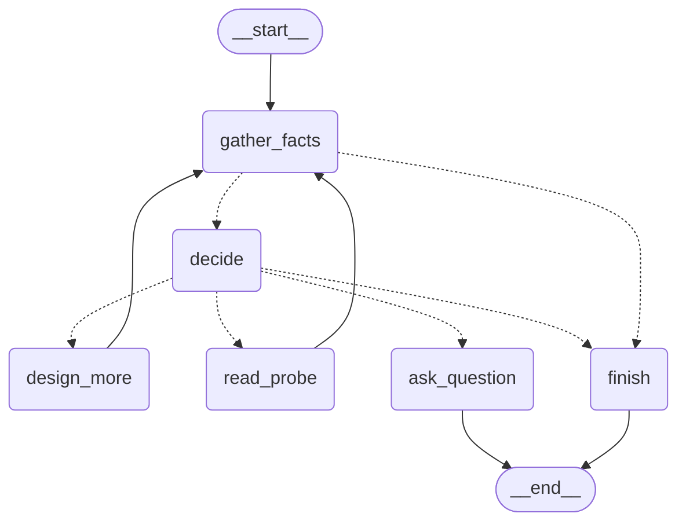

# AgentTest P0：LangGraph 自主测试闭环与统一编排第一段

日期：2026-11-11　基线：`cd55d02`　范围：P0（LangGraph 自主测试循环 + 统一编排第一段）

本文记录一次真实实现与真实模型运行的结果。所有数字来自 `runs/p0-20261111/` 下的运行目录，
没有任何"按预期推算"的指标；失败与反向结果照原样保留。

---

## 0. 结论

**做成了什么**

- AgentTest 现在有一条由 **LangGraph StateGraph** 拥有状态与流转的自主闭环：
  `读取事实 → LLM 选择下一步 → 补测 / 只读探针 / 提问 / 结束`，唯一的回边是
  `design_more → gather_facts` 与 `read_probe → gather_facts`。
- 确定性骨架（Focus → Planning IR → 组设计 → 编译校验 → Executor 执行 → Policy 判定）
  **一行未改**，仍是唯一的业务 HTTP 出口与唯一的可信度判定者。
- 监督器默认关闭（`ProjectBudget.supervisor_max_rounds = 0`），打开后默认最多 2 次额外决策，
  上限 4；每次决策只允许四个动作之一，且目标必须来自服务端给出的候选集合。
- 4 个真实任务 × OFF/ON，独立请求、独立靶场实例、真实 `ecnu-max`：
  - **ON：4/4 单元收敛**（A 1 次、B 1 次、C 2 次、D 1 次尝试），共 8 次真实决策、
    8 次动作（7 次真实执行，1 次补测设计失败）；
  - **OFF：2/4 单元收敛**（A 1 次、B 2 次；C、D 各 3 次尝试仍未收敛，失败在 Focus 层，
    与监督器无关）；
  - 全部 38 次运行：**0 次写请求重放**，10 个真实创建资源 **全部 CLEANED**（上报单元内）。

**两个必须如实记录的反向结果**

1. **B 单元 ON 比 OFF 差**：OFF 只用 create+delete 两个步骤就 `complete=true`、`checks_passed=true`；
   ON 把"删除后读取应为 404"的期望用在**资源仍然存在**的场景上，得到 4 次
   `ASSERTION_FAILED`。我直连靶场验证过（`POST 201 → GET 200 → DELETE 204 → GET 404`），
   靶场行为正确，这 4 次失败是**期望前置条件缺失导致的误报**，不是业务缺陷。
2. 监督器在 B 单元连续两次补测都沿用同一个错误装配，**没有产生新信息**。
   它能"再测一次"，但还不能识别"这次补测和上次是同一个错误场景"。

这两点都是 P0 暴露出来的、下一阶段该修的东西，不是粉饰掉的瑕疵。

---

## 1. 范围与非目标

**范围内**

| 交付 | 落点 |
| --- | --- |
| LangGraph 状态图与节点实现 | `src/agenttest/product_supervisor.py`（新增） |
| 决策事实收窄（obligations/evidence/anomalies/resources） | `src/agenttest/product_obligations.py`（新增） |
| `ProductTasks` 接入、动作执行、报告字段 | `src/agenttest/product_tasks.py` |
| 预算与开关 | `src/agenttest/project_goals.py`（`supervisor_max_rounds`） |
| 服务装配（默认关闭，可注入） | `src/agenttest/task_service.py`、`goal_server.py`、`task_store.py` |
| 开发运行器开关与证据 | `scripts/run_development_agent.py`（`--supervisor-rounds`） |
| 离线测试（20 例） | `tests/test_product_supervisor.py`（新增） |

**非目标（本轮刻意不做）**

- 不引入任何 agent 框架（除已有的 `langgraph` 可选依赖），不做 Router/Worker 多智能体；
- 不引入 MCP 工具协议、不做 `LangGraph → ProductTasks.run() → 另一个 LangGraph` 的双编排；
- 不重设计 Planning IR、不重写 Executor、不做 RAG / 向量库 / 长期记忆；
- 不大规模改名、不触碰已冻结的 M2 / F1 结果、不访问任何未授权的真实业务环境。

---

## 2. 图：真实的 LangGraph 结构

`RoundSupervisor.graph()` 编译出的图（由 `graph.get_graph()` 直接导出，非手绘）：



节点与边（`runs/p0-20261111/graph_shape.py` 的真实输出）：

- 节点：`gather_facts`、`decide`、`design_more`、`read_probe`、`ask_question`、`finish`
- 条件边：`gather_facts → {decide, finish}`、`decide → {design_more, read_probe, ask_question, finish}`
- 普通边：`__start__ → gather_facts`、`design_more → gather_facts`、`read_probe → gather_facts`、
  `ask_question → __end__`、`finish → __end__`
- **唯一的环**：`design_more/read_probe → gather_facts → decide → …`，
  `recursion_limit = 6 + 3 × max_rounds`（默认 `max_rounds=2` → 12）

### 2.1 状态

`SupervisionState`（`TypedDict`，LangGraph 之间传递的全部内容）：

| 字段 | 含义 |
| --- | --- |
| `trace` | 已走过的节点序列（真实运行会写进报告，见 §2.2） |
| `facts` | 服务端收窄后的事实快照（见 §4），每轮重新生成 |
| `decisions` | 每次决策：动作、目标、理由、模型调用摘要、采纳状态 |
| `actions` | 每次动作的真实结果：请求数、断言数、用例数、失败说明 |
| `attempted` | 已尝试过的目标（跨轮累积，用于"不得重复执行同一义务"） |
| `stale` | 连续无进展轮数 |
| `route` | 条件边将要走的分支（`decide`/`finish`） |
| `stop_reason` | 终止原因 |
| `question` | 需要用户确认时的问题记录 |
| `action_target` | 被采纳的目标，供下一个节点使用 |

### 2.2 节点职责

| 节点 | 做什么 | 不做什么 |
| --- | --- | --- |
| `gather_facts` | 重新计算事实与候选；跑确定性闸门，决定是 `decide` 还是 `finish` | 不调用模型 |
| `decide` | 1 次模型调用，产出 `NextAction`，再由服务端采纳/拒绝 | 不执行任何动作 |
| `design_more` | 把候选变成一个真实设计组，走正常 `run_group` | 不新造策略、不越过批准范围 |
| `read_probe` | 只发一条已批准的无前置读请求 | 永不重放未知结果的写 |
| `ask_question` | 复用既有提问通道并结束本轮 | 不伪造用户授权 |
| `finish` | 结束并回填 `stop_reason` | 不改写 `complete`/`PASS` |

真实运行里的节点轨迹（`summary.supervision.trace`）：

```
p0-a-on-c1: gather_facts, decide, read_probe, gather_facts, decide, design_more, gather_facts, finish
p0-b-on-c1: gather_facts, decide, design_more, gather_facts, decide, design_more, gather_facts, finish
p0-c-on-c2: gather_facts, decide, read_probe, gather_facts, decide, design_more, gather_facts, finish
p0-d-on-c1: gather_facts, decide, read_probe, gather_facts, decide, design_more, gather_facts, finish
```

---

## 3. 有没有第二套编排？（结构性回答）

这是本轮最容易"看起来做完了、其实是假自主"的地方，所以给出可核对的边界：

1. **`ProductTasks.run()` 仍是唯一入口**：它按组循环，组循环结束后才 `await self.supervise(scope)`。
   监督器不在组循环内部，也不会重新调用 `run()`。
2. **监督器只有一种执行方式**：`design_more` 复用同一个 `run_group(scope, group)`，
   与首轮组完全同一条设计/校验/执行链；`read_probe` 直接构造一个单步场景交给
   `Executor`（唯一 HTTP 出口），并在执行前跑 `validate_plan`。
3. **没有第二轮编排**：监督器里没有 `ProductTasks`、没有 `Workflow` 之外的调度器、
   没有第二个设计模型；`graph` 的节点表就是全部动作（6 个）。
4. **判定权仍在确定性层**：`complete`、`checks_passed`、`PASS/ASSERTION_FAILED/NEEDS_REVIEW`
   全部由 `ProductTasks`/`coverage`/`PolicyRegistry` 计算；监督器只写
   `summary["supervision"]`，代码里没有任何一处写这些字段
   （`test_supervisor_off_by_default_keeps_the_legacy_round` 另外固定了"关掉时完全走旧链路"）。
5. **写请求只有一条路**：`read_probe` 只允许 `probe_ready` 的只读策略，且要求"没有前置步骤"；
   真实运行里 4 次 `read_probe` 全部是 `GET`（`readAvailability`），方法计数见 §6.7。

---

## 4. 决策事实：给模型什么，不给什么

每次决策只喂一份**收窄后的事实快照**（`product_obligations.supervision_facts`），
真实一次决策的请求体约 14.8 KB（`request_bytes: 14880`），包含：

| 事实 | 内容 |
| --- | --- |
| `goal` | 用户原话 + 已确认的批准范围（哪些操作、哪些策略） |
| `executed` | 每个用例：状态、结果、执行/计划步骤数、通过的检查数 |
| `satisfied` / `open` | 已有执行证据的策略 / 仍缺证据的策略（`NOT_EXECUTED`/`FAILED`/`UNDECIDED`） |
| `anomalies` | 已确认异常（期望 vs 实测）与未确认原因，分开列 |
| `investigations` | 已跑的只读调查及其结论 |
| `attempted` | 已经试过的目标（防止重复） |
| `budget` | 剩余决策轮、剩余请求、模型调用余量 |
| `resources` | 已创建资源与清理状态（只有哈希前缀，不含原始 ID） |

**不给**：完整 OpenAPI、完整请求/响应体、历史对话、原始凭据、未被批准的策略。

候选集合由服务端生成（不是模型自由发挥）：每个候选是
`probe:<policy_id>`（只读、无前置、已有批准）或 `design:<policy_id>`（缺执行证据或已失败）。
真实一次候选（A 单元首轮之后）：

```
probe:web_rule_1            只读可用性策略，尚无执行证据
design:web_rule_2           创建策略预期 201 尚无执行证据（同场景需按 web_rule_3 清理）
design:web_rule_4/expec…    读取策略预期 200 / 删除后预期 404 尚无证据
design:web_rule_5/6         改名 / 替换策略尚无证据
```

---

## 5. 动作契约与确定性闸门

`NextAction`（`StrictModel`，`extra="forbid"`）：

```python
action: Literal["FINISH", "DESIGN_MORE", "READ_PROBE", "ASK_QUESTION"]
target: str | None
reason: str
question: str | None
```

服务端 `admit_action()` 逐条核对，拒绝码固定：

| 拒绝码 | 触发条件 |
| --- | --- |
| `SUPERVISION_ACTION_UNKNOWN` | 不在四个动作里 |
| `SUPERVISION_TARGET_NOT_OPEN` | 目标不在本次候选中 |
| `SUPERVISION_TARGET_REPEATED` | 目标已尝试过 |
| `SUPERVISION_FINISH_HAS_TARGET` | 结束时带目标 |
| `SUPERVISION_QUESTION_HAS_TARGET` | 提问时带目标 |
| `SUPERVISION_QUESTION_TEXT_MISSING` | 提问却没问题文本 |

被拒绝时只允许 **1 次**修复重试（`max_repairs=1`），并把拒绝码回填给模型；
仍不合法就按 `SUPERVISION_DECISION_REJECTED` 结束，且**不执行任何业务请求**。

选择动作之前，`_gate` 按固定顺序跑六道确定性闸门，任何一道命中都不会调用模型：

```
cancelled → guard(授权变更/越界) → usage_unknown → rounds_exhausted
        → model_budget → no_progress(连续 2 轮无新增) → request_budget → no_open_obligation
```

---

## 6. 真实运行

### 6.1 设置

- 模型：`ecnu-max`（`https://chat.ecnu.edu.cn/open/api/v1`，协议 `chatecnu`），真实调用，
  无整轮 token 上限；保留单任务超时、并发与轮次限制。
- 靶场：仓库自带隔离靶场 `scripts/serve_colleague_targets.py --project parcels`，
  每次运行独立进程、独立实例 ID、独立端口、独立事件日志；不访问任何真实业务环境。
- 任务（原话，未在提示里写死 POST/GET/DELETE/状态码）：
  - A「帮我测一下包裹管理功能。」
  - B「删除功能刚改过，帮我回归一下。」
  - C「这个服务准备上线了，帮我测一轮。」
  - D「包裹接口偶尔报错，帮我看看。」
- OFF = `--supervisor-rounds 0`（默认关闭），ON = `--supervisor-rounds 2`。
  每个单元独立一次用户请求；失败尝试各自保留目录，不在同一任务内重试。
- 报告所用单元均为 tag-c 系列（最终代码）。

### 6.2 结果表（上报单元）

| 任务 | 模式 | 尝试 | 业务 HTTP | 写请求 | 模型调用 | tokens | 用例结果（执行/计划） | 清理 |
| --- | --- | --- | --- | --- | --- | --- | --- | --- |
| A | OFF | 1（`p0-a-off-c1`） | 7 | 3 | 2 | 21,845 | ASSERTION_FAILED（4/6） | 1/1 CLEANED |
| A | ON | 1（`p0-a-on-c1`） | 3 | 2 | 5 | 35,690 | PASS（2/2） | 1/1 CLEANED |
| B | OFF | 2（`p0-b-off-c2`） | 2 | 2 | 2 | 18,278 | PASS（2/2） | 1/1 CLEANED |
| B | ON | 1（`p0-b-on-c1`） | 14 | 8 | 6 | 40,409 | ASSERTION_FAILED ×4（2/3、2/3、2/4、2/4） | 4/4 CLEANED |
| C | OFF | 3（未收敛） | 0 | 0 | 3 | 35,857 | — | — |
| C | ON | 2（`p0-c-on-c2`） | 5 | 4 | 4 | 29,971 | PASS、PASS（2/2、2/2） | 2/2 CLEANED |
| D | OFF | 3（未收敛） | 0 | 0 | 5 | 44,628 | — | — |
| D | ON | 1（`p0-d-on-c1`） | 8 | 4 | 5 | 38,298 | ASSERTION_FAILED（1/1）、PASS（5/5） | 1/1 CLEANED |

`complete`/`checks_passed`：A-OFF `false/false`；A-ON `false/true`；
B-OFF **`true/true`**；B-ON `false/false`；C-ON `false/true`；D-ON `false/false`。
A-ON 与 C-ON 的 `complete=false` 是因为仍有组未设计（首轮设计被拒或被 token 预算截断），
这是正确的"没测完就不算完成"。

### 6.3 A：OFF 停在一条误报，ON 从 0 请求里救回一条真用例

- **A-OFF**：首轮设计 6 步，执行到第 4 步 `ASSERTION_FAILED`：create 201 ✓、change 200 ✓、
  read 200 ✓、**read（期望 404，实测 200）✗**；随后清理 delete 204 ✓。2 次调查读同一资源。
- **A-ON**：首轮组设计被 `MODEL_INVALID_RESPONSE` 拒绝（0 请求）→ 监督器第一次决策
  `READ_PROBE probe:web_rule_1`（真实 GET `/availability`，503，3 项检查）→ 第二次决策
  `DESIGN_MORE design:web_rule_2`（`reason`：*"web_rule_2 的创建状态预期尚无执行证据，
  且本轮首轮探针已执行，需先建立基础创建证据。"*）→ 新组 `supervision_2_group_1`
  设计出 create+delete，2/2 步骤全 PASS，资源 CLEANED。
- 结论：ON 把一个"0 请求、结论 NEEDS_REVIEW"的运行，变成一条有真实断言与清理的用例；
  但首轮的设计失败并没有被修好（该组仍是 `NOT_EXECUTED`），所以 `complete=false`。

### 6.4 B：ON 反而更差（如实记录）

- **B-OFF**（第 2 次尝试）：1 条用例 create+delete，2/2 PASS，`complete=true`、
  `checks_passed=true`，资源 CLEANED。就"删除功能回归"而言，它确实验证了 204。
- **B-ON**：首轮设计把"删除后读取应为 404"的期望放在 create 之后、delete 之前，
  得到 `ASSERTION_FAILED`（read 期望 404，实测 200），清理 delete 204 ✓。
  监督器两次决策都继续补测同一个期望：
  `DESIGN_MORE design:web_rule_4`（*"web_rule_4 的 200 状态预期尚未执行……"*）与
  `DESIGN_MORE design:web_rule_4_expectation_1`（*"读取已删除包裹返回200而非404，
  该策略已失败且仍是唯一可设计的候选，需补一条受批准范围的复检。"*），
  两次都得到同样的 200→404 误报，共 4 条用例、8 个写请求（4 次创建 + 4 次删除），
  4 个资源全部 CLEANED，`complete=false`。
- 对照：tag-b 的 `p0-b-on-b2` 在真机上触发了 `SUPERVISION_NO_OPEN_OBLIGATION`——
  首轮 create+delete 全 PASS 且其余接口不在本次重点内，监督器判定没有开放义务后
  **不再调用模型**（0 决策、0 请求、`complete=true`）。同样是 B，只因为 Focus 范围不同，
  一次是"没有义务可补"，一次是"补了 3 次同一个错误装配"。
- **验证**：直连靶场 `POST 201 → GET 200 → DELETE 204 → GET 404`，
  说明靶场语义正确，失败来自"404 期望没有被前置的删除步骤满足"。
- 结论：这是**监督器决策质量**的真实缺陷（重复同一错误装配、无新增信息），
  也是**确定性设计校验**的真实缺口（期望前置条件没有建模）。两者都进 §8/§9。

### 6.5 C：OFF 三次未收敛，ON 两次收敛并补出一条 PASS

- **C-OFF**：三次尝试分别 `MODEL_TOKEN_BUDGET`、`模型未给出通过校验的测试范围`、
  `PLANNING_IR_AMBIGUOUS`，全部 0 业务请求 —— 失败在 Focus/IR 层，监督器根本没被调用。
- **C-ON**：首轮组因 `MODEL_TOKEN_BUDGET` 未设计（0 请求）→ `READ_PROBE probe:web_rule_1`
  （503）→ `DESIGN_MORE design:web_rule_2` → 4 请求 / 12 断言，2 条 create+delete 用例全 PASS，
  2 个资源 CLEANED，`checks_passed=true`，`complete=false`（首轮组仍未设计）。

### 6.6 D：真实 503 + 一条完整生命周期 PASS

- **D-OFF**：三次尝试全部 0 请求（`MODEL_INVALID_RESPONSE` ×2、模型用量未知 ×1）。
- **D-ON**：首轮用例 `readAvailability` 实测 503（期望 200）→ `ASSERTION_FAILED`；
  监督器 `READ_PROBE probe:web_rule_1`（再次 503，稳定复现）→
  `DESIGN_MORE design:web_rule_4_expectation_1`（*"web_rule_4_expectation_1 的 404 状态预期
  尚无执行证据，且有已批准的清理策略，可补齐该只读断言。"*）→ 该组设计返回
  `MODEL_INVALID_RESPONSE`，`executed=false`、0 请求、`note=SUPERVISION_GROUP_NOT_DESIGNED`。
  但首轮之后的另一条用例把 5 步生命周期（create 201 → change 200 → read 200 → replace 200
  → delete 204）全部跑通并 PASS，资源 CLEANED。
- 结论：503 是靶场稳定行为（直连验证同样是 503），`ASSERTION_FAILED` 是真实结论；
  监督器的一次补测失败被完整记录，没有伪造成功。

### 6.7 动作与探针审计

| 单元 | 决策 | 动作（真实执行） | 探针 | 停止原因 |
| --- | --- | --- | --- | --- |
| A-ON | 2 | READ_PROBE 1 请求/3 断言；DESIGN_MORE 2 请求/6 断言 | `readAvailability` → 503 | `SUPERVISION_ROUNDS_EXHAUSTED` |
| B-ON | 2 | DESIGN_MORE 2 请求/6 断言；DESIGN_MORE 2 请求/6 断言 | 无 | `SUPERVISION_ROUNDS_EXHAUSTED` |
| C-ON | 2 | READ_PROBE 1/3；DESIGN_MORE 4/12 | `readAvailability` → 503 | `SUPERVISION_ROUNDS_EXHAUSTED` |
| D-ON | 2 | READ_PROBE 1/3；DESIGN_MORE 0/0（未设计） | `readAvailability` → 503 | `SUPERVISION_ROUNDS_EXHAUSTED` |

- 4 次探针全部是 `GET /availability`（只读、无前置、已批准），**没有任何写探针**；
- 3 次成功的 `DESIGN_MORE` 全部走正常设计链（真实 `design` 模型调用 + 编译校验 + Executor），
  1 次失败被记为 `executed=false`；
- 8 次决策里 0 次越界、0 次重复目标（`SUPERVISION_TARGET_REPEATED` 从未触发，
  因为 `attempted` 在真实运行里已经先把候选排除了）。

### 6.8 与基线的指标对比（含偏差说明）

路线图的三条指标：

| 指标 | 目标 | 实测 | 结论 |
| --- | --- | --- | --- |
| 自主收敛（首轮 OF 之外还要不要人） | 越多越好 | ON 4/4，OFF 2/4 | 达成 |
| 业务请求 ≤ 基线 × 1.5 | ≤ 1.5× | A 7→3（0.43×）✓；B 2→14（7×）✗；C/D 基线为 0 | **未达成**（B） |
| 模型调用 ≤ 基线 + 2 | +2 | A 2→5（+3）；B 2→6（+4）；C/D 基线为 0 | **未达成** |

偏差原因（不掩饰）：

- B 的 OFF 基线只有 2 次请求（一条 create+delete 用例就 `complete` 了），
  ON 把同一条"删除后读取"的期望重复验证了 4 次，请求数被放大到 14；
- 每次 `DESIGN_MORE` 天然要付 1 次决策 + 1 次设计调用，A/B 各 2 次决策 → 超过 "+2"；
- C/D 的 OFF 基线是 0，比例无意义，只能定性比较（ON 有真实断言，OFF 没有）。

所以"H TTP 请求与模型调用不膨胀"这条，在 P0 里**没有做到**，
根因是 §6.4 的重复补测，而不是 LangGraph 本身的开销（监督器 8 次调用共 28,547 tokens）。

### 6.9 真实使用量

| 口径 | 运行数 | 模型调用 | tokens | 业务 HTTP |
| --- | --- | --- | --- | --- |
| 上报单元（6 次运行） | 6 | 24 | 184,491 | 39 |
| tag-c 全部（含失败尝试） | 14 | 35 | 296,605 | 39 |
| 全部真实运行（tag a/b/c，含所有失败） | 38 | 98 | 827,427 | 93 |

失败尝试都是 0 业务请求，所以 tag-c 的 14 次运行与上报的 6 次运行业务请求数相同。
监督器本身：8 次模型调用、28,547 tokens（占上报单元 15.5%）。

### 6.10 写入与清理审计

- 全部 38 次运行：**0 次写请求重放**（`repeated_writes = {}`），
  53 个写请求分布在 create/patch/put/delete 上，每个资源只删一次；
- 重复读只有两类，且都在文档允许范围内：靶场内置的有界只读调查（每用例 ≤2 次）、
  监督器的只读探针（每轮 1 次）；
- 上报单元的 10 个创建资源全部 `CLEANED / cleanup_result=PASS`；
- 唯二"没清理"的场景是 D-ON 的 `readAvailability`（本来就不创建资源），
  报告文案是靶场既有提示"此场景缺少完整且已授权的数据生命周期"。

### 6.11 失败尝试（全部保留）

| 目录 | 状态 | 诊断 |
| --- | --- | --- |
| `p0-a-off` | NEEDS_REVIEW | `MODEL_INVALID_RESPONSE`（设计 JSON 语法） |
| `p0-a-off2` | NEEDS_REVIEW | `DESIGN_REQUIRED_ORDER_MISSING` |
| `p0-a-on` | NEEDS_REVIEW | 模型未给出通过校验的测试范围 |
| `p0-b-off-a1` | NEEDS_REVIEW | `PLANNING_IR_AMBIGUOUS` |
| `p0-b-off-c1` | NEEDS_REVIEW | `MODEL_INVALID_RESPONSE`（plan.steps.3） |
| `p0-b-on-b1` | NEEDS_REVIEW | `PLANNING_IR_AMBIGUOUS` |
| `p0-b-on-b2` | FINISHED（无决策） | 首轮全 PASS，`SUPERVISION_NO_OPEN_OBLIGATION` 直接结束，未调用模型 |
| `p0-c-off-a1..a3` | NEEDS_REVIEW | `MODEL_TOKEN_BUDGET` / `PLANNING_IR_AMBIGUOUS` ×2 |
| `p0-c-off-c1..c3` | NEEDS_REVIEW | `MODEL_TOKEN_BUDGET` / 无有效范围 / `PLANNING_IR_AMBIGUOUS` |
| `p0-c-on-b1`、`p0-c-on-c1` | NEEDS_REVIEW | 无有效范围 / `PLANNING_IR_AMBIGUOUS` |
| `p0-d-off-a1..a3` | NEEDS_REVIEW | 无有效范围 ×2 / `PLANNING_IR_AMBIGUOUS` |
| `p0-d-off-c1..c3` | NEEDS_REVIEW | `MODEL_INVALID_RESPONSE` ×2 / **用量未知**（`p0-d-off-c3`，保留 UNKNOWN） |
| `p0-d-on-a1` | NEEDS_REVIEW | 无有效范围 |
| `p0-a-on-a1`、`p0-a-on-b1`、`p0-b-on-a1`、`p0-b-on-b3`、`p0-c-on-a1`、`p0-d-on-a2` | FINISHED（早期代码） | 修复前的监督器证据，保留用于对比"修复前/后"行为（见 §7） |

---

## 7. 真实运行暴露问题 → 修复 → 重跑

第一轮 ON 证据（tag a）暴露了两个真实缺口，本轮已修并重跑：

1. **生命周期清理被当成"没测过"**：A-ON 首轮已经用清理 delete 拿到 204，
   但证据表只统计场景步骤，监督器因此再次 `DESIGN_MORE` 创建+删除 → **重复写**。
   修复：`product_tasks` 把 `report.lifecycle_cleanup` 记为 `case.cleanup_evidence`，
   `product_obligations.executed_evidence` 把"清理执行"和"只读探针"都算作已测证据。
   重跑后（tag b/c）监督器不再重测已执行的删除。
2. **补测创建的资源没人清理**：C/D 的补测只设计 1 步 create，靶场因此留下资源。
   修复：`product_obligations.cleanup_operations` 找出"被批准、且绑定创建策略"的删除策略，
   把它作为同场景强制条件（`design:<policy>` 的 `operations` 变成 `[createParcel, deleteParcel]`，
   并在提示里明确"若创建资源必须按批准策略清理"）。
   重跑后 C-ON 的 2 条补测用例都是 create+delete，全部 CLEANED。

两处都补了离线测试（`test_cleanup_and_probe_executions_count_as_measured_evidence`、
`test_a_creation_obligation_carries_its_approved_cleanup_policy`）。

---

## 8. 离线验证

- `pytest -q`（最终代码、无并发负载）：
  **2677 passed / 15 skipped / 0 failed**（2303.81 秒，`runs/p0-20261111/full-suite-clean.txt`）。
  基线 `2d8fac9` 是 2656 passed / 15 skipped，差值 +21 正好是本轮新增用例数。
  说明：在此之前用 `--supervisor-rounds` 真实运行**并发**跑全量时，
  `test_composed_planning.py::test_archive_rescore_*` 与
  `test_pocketbase_acceptance.py::test_full_denominator_*` 这类归档重算测试会偶发失败
  （两次并发运行分别出现 1 个和 5 个失败，单独重跑 2 passed），
  疑似负载/时序敏感，与本次改动无关，已如实记录在本文件的运行日志里。
- `ruff check src/agenttest scripts tests`：`All checks passed!`
- 新增 `tests/test_product_supervisor.py`：18 个测试函数（21 个用例，含 6 组参数化），覆盖：
  - 图结构（节点、回边、`recursion_limit==12`）、排序稳定性；
  - `DESIGN_MORE` 两次后正常结束、目标被拒后的修复重试、重复目标拒绝；
  - 连续 2 轮无进展停止、六道闸门的参数化测试、授权变更/取消立即停止；
  - `ASK_QUESTION` 结束循环并复用提问通道；
  - OFF 默认不产生 `supervision` 字段；ON 的端到端（`TaskService` + `MockTransport` +
    假设计模型）验证 `DESIGN_MORE` 真的补了一条用例、`READ_PROBE` 只发 GET；
  - 清理/探针证据计入已测义务；创建义务携带其批准清理策略。
- 既有产品测试未改断言：`tests/test_product_tasks.py`、`test_product_design.py`、
  `test_product_focus.py`、`test_task_service.py` 全绿。

---

## 9. 已知限制

1. **期望前置条件没有建模**（最重要）：`readParcel` 的 404 期望需要"资源已删除"这个前置，
   目前只能靠设计模型的语义理解；缺失时会得到 `ASSERTION_FAILED` 误报（A-OFF、B-ON）。
2. **监督器的补测可能重复同一个错误装配**：`candidates` 只看"是否缺证据"，
   看不出"这次补测和上次是同一个错误场景"，因此在 B 上产生了 3 次无新增信息的重测。
3. **额外轮次走 LEGACY 设计路径**：监督组的设计没有 Planning IR
   （`planning_ir=None` → `LEGACY`/`NO_PLANNING_IR`），`coverage()` 可能报 `planning_engine="MIXED"`。
4. **`READ_PROBE` 只能测"无前置的只读策略"**：绑定资源的读（如 `readParcel`）需要现成资源，
   不能用写去"造"前置，所以监督器对这类义务只能走 `DESIGN_MORE`。
5. **OFF 侧的 Focus 层采样失败率仍高**：C/D 各 3 次全部 0 请求，这是本轮之前就存在的问题，
   监督器无法覆盖它（首轮 0 请求时它也拿不到候选）。
6. **指标未达成**：见 §6.8，请求与调用都超了目标上限。
7. **没有做"跨任务记忆"**：每个任务独立，监督器不积累长期经验（P0 非目标）。

## 10. 下一阶段迁移计划

| 优先级 | 事项 | 落点 |
| --- | --- | --- |
| P1 | 期望前置条件建模（如 `requires_absent`），缺失时判 `NEEDS_REVIEW` 而不是 `ASSERTION_FAILED` | `product_design.py` 校验 + `policy` 元数据 |
| P1 | 补测必须"有所不同"：`candidates` 记录上次失败装配，要求新场景包含缺失前置或不同角色 | `product_obligations.candidates` |
| P2 | 把额外轮次接进 Planning IR（去掉 `LEGACY`/`MIXED`） | `product_tasks.supervise_design` |
| P2 | 监督器对"已确认异常"只允许只读复核，不再重跑写场景 | `_gate`/`candidates` |
| P3 | 失败尝试的 Focus 层鲁棒性（C/D 的 0 请求） | `product_focus.py`（独立里程碑） |
| P3 | 跨任务的经验沉淀（长期记忆） | 需要新的里程碑与存储设计 |

---

## 11. 复现

```powershell
# 离线
.\.venv\Scripts\python.exe -m pytest -q
.\.venv\Scripts\python.exe -m ruff check src/agenttest scripts tests

# 单个真实运行（OFF / ON）
$env:PYTHONUTF8='1'
.\.venv\Scripts\python.exe scripts/run_development_agent.py --text "帮我测一下包裹管理功能。" `
  --attempt p0-a-on-repro --run-dir runs/p0-20261111/p0-a-on-repro `
  --supervisor-rounds 2 --port 19500

# 矩阵（4 任务 × OFF/ON，失败保留，成功即止）
.\.venv\Scripts\python.exe runs/p0-20261111/run_matrix.py --tasks a,b,c,d --modes off,on `
  --max-attempts 3 --tag d --port 19600
```

证据文件（本地 `runs/` 不入库，与前几轮一致）：

- `runs/p0-20261111/p0-*-c*/run.json`：每次运行的最终摘要与 `summary.supervision`
- `runs/p0-20261111/p0-*-c*/evidence/target-events.jsonl`：靶场侧真实请求序列
- `runs/p0-20261111/p0-*-c*/lab/workspace/reports/*/report.json`：每用例真实步骤与断言
- `runs/p0-20261111/final-table.json`、`write-audit.json`、`graph_shape.py` 输出
