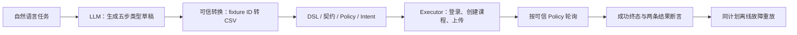

# 从一句需求到异步批处理：真实开发 Demo

这是一条在 `0e684b2` 上执行的历史真实模型 Smoke Test。模型为 ecnu-plus；被测业务是进程内 FastAPI mini target。**DEVELOPMENT_ONLY / UNREVIEWED**，不是独立 benchmark、正式 Eval v2 成绩或 Java 批处理验收。本页阅读和静态示例均不会调用模型。

## 任务与执行链

> 使用 alice 创建课程“批量分析验收”，使用已批准的两行 CSV 测试数据创建批量分析任务，等待任务成功后读取结果，并验证返回两条记录。



LLM 没有执行 HTTP，也没有生成 CSV 内容或 PollPolicy。它选择可见的操作、角色、策略和 fixture 引用，填写课程名、步骤 ID 与资源依赖。可信转换器注入测试数据；Workflow 验证完整目标；Executor 发送请求并轮询；Verifier 判定结果。

## 本次真实生成计划的脱敏结构

以下步骤 ID、依赖和 Selector 来自本次模型输出转换后的 DSL 证据，未从 `examples/batch-draft.json` 拼成答案。原始模型响应未落盘，不能恢复其逐字草稿；此处展示验证后的结构。

| 步骤 ID | Operation / Role / Policy | 参数与批准选项 |
| --- | --- | --- |
| `step_login` | login / alice / batch_login_v1 | 无模型凭据或参数；Vault 注入登录数据 |
| `step_create_course` | createCourse / alice / batch_course_v1 | body.name 对应任务课程名，原证据保留字面值摘要 |
| `step_create_batch` | createBatch / alice / batch_upload_v1 | courseId ← step_create_course 的 `$.courseId`；fixture=`mini_two_rows_v1`，upload=true |
| `step_get_batch` | getBatch / alice / batch_poll_v1 | batchId ← step_create_batch 的 `$.batchId`；poll=true |
| `step_get_batch_results` | getBatchResults / alice / batch_results_v1 | batchId ← 同一 step_create_batch 的 `$.batchId` |

所有步骤 `read_retries=0`。固定 fixture 是两条合成文本，mini 的 CSV 表头为 `text`；模型只收到 ID。可信轮询最多 4 次、间隔 0.01 秒；允许进度 QUEUED/RUNNING，终态 SUCCEEDED/FAILED，最终必须 SUCCEEDED；结果 `$.items` count 必须为 2。执行预算最多 5 步、8 请求、15 秒；模型/Workflow 超时为 30/120 秒。

这些参数是 mini 的批准策略，不是 Java 的推荐生产参数，也不支持任意文件上传。

## 实际请求和校验

正常 run：`aa87baeff37b4914a31412e1cfc92a55`。`dsl_valid`、`policy_authorized`、`intent_verified`、`workflow_completed`、`task_satisfied` 均为 true。

| 顺序 | 请求 | HTTP | 实际结论 |
| --- | --- | --- | --- |
| 1 | POST /api/auth/login | 200 | 已批准登录断言通过，Token 保留在内存 Vault |
| 2 | POST /api/courses | 201 | 课程创建通过，动态 courseId 可用于后续 |
| 3 | POST /api/courses/{courseId}/analysis-batches | 202 | 固定两行 CSV 上传通过，动态 batchId 可用于后续 |
| 4–5 | GET /api/analysis-batches/{batchId} | 200、200 | 2 次轮询结束，最终成功断言与 count=2 通过 |
| 6 | GET /api/analysis-batches/{batchId}/results | 200 | `$.items` 实际 2、预期 2，PASS |

报告按原规则脱敏状态字符串。SUCCEEDED 的依据是批准 `$.state` 等值断言通过，并非从保存的原始响应读出状态；没有原始 HTTP 正文。公开数量证据保留了实际 2。

## 同一计划的两项故障重放

只在正常任务成功后，内存中的同一 Scenario 才传给两个新的 ASGI target；三个报告的 scenario_sha256 一致。重放直接使用 Executor，无新增模型调用，也不标记自然语言任务满足。

| 故障 | 实际报告结果 | 证据 |
| --- | --- | --- |
| terminal | ASSERTION_FAILED | 第四步 `getBatch` 的 `$.state` equals 断言失败；仍是两次 HTTP 200；未执行 getBatchResults，共 5 请求 |
| result_count | ASSERTION_FAILED | 成功终态通过后读取结果；`$.items` count 实际 3、预期 2，共 6 请求 |

故障被发现是 Demo 验收预期；故障运行本身仍为 ASSERTION_FAILED，不能统一记为 PASS。超时/轮询耗尽与终态断言失败也不混为一类。

## 成本、耗时与证据

真实模型仅 1 次，chatecnu 协议，学校固定 Endpoint；无重试、重规划或探针。输入/输出上限 20,000/2,048，总预留 22,048 Token。服务返回 usage：输入 **2,155**、输出 **610**、合计 **2,765**；预检输入上界 8,765 是保守估计，不是实际用量。模型耗时 **13.375 秒**；正常 Workflow **15.657 秒**，后者不包含两项后续离线重放。

Python 3.11.15，进程内 ASGITransport；报告中的 `http://127.0.0.1:8080` 是固定虚拟 origin，本次业务请求没有连接监听端口。唯一真实外部请求为授权的模型 API；真实 Java 请求、数据库写入均为 0。

[静态脱敏证据 JSON](demo-evidence/batch-smoke.json) 包含任务、usage、预算、五步结构、fixture/PollPolicy、逐步 HTTP 状态、断言以及来源文件/报告摘要。它是从私有归档选取的展示副本，不是可执行计划，也不是正式 Eval v2 数据。

本轮整理前已复核原归档 6 个 JSON 文件摘要、3 个报告摘要与执行时源码基线。原始报告在本机忽略目录 `runs/batch-smoke-once-0e684b2`；私有档案、原始模型响应和 `.env` 不随文档发布。展示副本不是整个私有归档的替代备份，哈希不能证明独立审核。

## 不收费的演示方式

直接阅读本页和静态 JSON 即可展示已有真实结果。需要现场展示执行时，沿用已安装 agent extra 的项目环境，创建新的输出目录：

```powershell
.\.venv\Scripts\python.exe scripts/check_batch_workflow.py --output runs/batch-demo-NEW
.\.venv\Scripts\python.exe scripts/check_batch_workflow.py --verify runs/batch-demo-NEW
```

该命令使用手工、FakeLLM 和 MockTransport，验证正常链、故障和安全拒绝，不调用付费模型。应明确告诉观看者：现场运行证明引擎和门禁，真实模型证据来自上面的历史单次归档。无需为演示再次执行 `batch_smoke.py run --real`。

这个样本证明既有 Prompt 引导下的受控计划可以正确表达上传、轮询及动态资源依赖；没有证明任意中文需求泛化、复杂业务探索或 Java 端到端能力。完整设计与评分限制见[batch-natural-language.md](batch-natural-language.md)。
