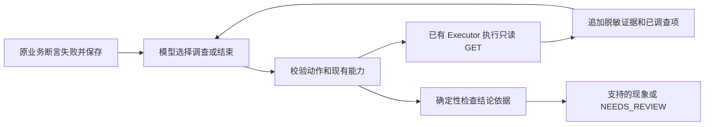

# 有界只读反馈闭环

模型规划后，原 Executor 完成业务测试并先保存不可变结果；只有批准断言失败时，
操作员启用的调查才在同一个活跃 HTTP 会话中运行。实现使用已有 LangGraph、
Pydantic、HTTPX 和 Policy Registry，没有新执行器、依赖或后台恢复。



## 约束与退出

- `InvestigationConfig` 默认关闭；旧单轮模式保持兼容。显式 `feedback` 配置才启用循环。
- 每 run 原规划最多一次，反馈决策最多三次，合计最多四次；只读 HTTP 最多两次。
  最后一个模型位置保留给结论，不能用来追加工具。原目标的总请求预算继续限制调查。
- 工具从操作员能力文件和当前已验证的依赖资源中确定；只接受已认证角色和不透明句柄。
  在选择工具前已验证 GET、策略、操作、参数、资源与无副作用依据；模型仍需通过本地精确匹配。
- 已调查的操作／角色／来源资源／selector 不再提供；即使模型重复或通过能力别名重复，也拒绝。
- 预算、超时、非法动作、工具／基础设施失败、未知模型用量均显式停止；不隐式重试。
- 原业务步骤、判定、断言和授权保持；首个调查请求前取消或报告失败也不能覆盖业务结果。
  不重放写操作，不轮询推进状态，不修改被测系统，不重规划原测试。

报告保留 `feedback` 的决策序号、固定错误码、用量、耗时和结论引用，以及原
`investigations` 的独立请求证据。模型请求前记账，HTTP 前记录 attempt；外部 tracing 关闭。
上下文只含批准工具、HTTP 状态与检查类型／通过状态，没有响应字段值、凭据和内部目标。
模型原始输出不落盘；不支持的模型结论不抄入报告。

## 能支持的结论

当前只确认可观察现象，不推断实现根因：

| 结论 | 必要证据 |
| --- | --- |
| ACCESS_BOUNDARY_VIOLATION | 原批准拒绝读取实际返回成功；同一来源资源的所有者读取通过；同时引用原失败和该调查 |
| PERSISTENT_READBACK_MISMATCH | 同操作、同角色、同一资源复核，HTTP 契约通过且同一个字段检查重复失败；同时引用两份证据 |
| EVIDENCE_INSUFFICIENT | 无法满足以上条件；输出 NEEDS_REVIEW，不把工具成功当作定位成功 |

结论附固定简短依据及本 run 证据 ID。引用必须存在，原始业务结果与调查结论分别评分。
现阶段不支持实现根因归因、多资源任意关联、日志全文工具或跨 run 恢复。

## 使用与复现

现有 `agent`／`agent-demo` 新增 `--feedback-capabilities <操作员文件>`，可与 `--project`
及 `--real --model-env .env` 组合；原目标与隔离写入规则不变。Fake 模式仅做一次批准读取后
明确弃权，不宣称真实模型发现原因。真实 Java／PocketBase 新写入仍需单独授权。

完整开发验收不接触真实业务服务：

```powershell
.\.venv\Scripts\python.exe scripts/check_feedback.py --output runs/feedback-offline-new
.\.venv\Scripts\python.exe scripts/check_feedback.py --verify runs/feedback-offline-new
```

显式增加 `--model-env .env` 才调用现有 ecnu-plus；只有模型请求走外网，业务始终进入
两套一次性 ASGI target。先执行 FC1401–FC1403 三条固定基线，再按同序各规划一次；
最大十二次模型、预留 289,152 Token，单次 60s，单 run 300s、调查 180s，零自动重试。
未知用量或工具／基础设施错误停止后续位置。源代码、任务、能力、模型设置、提示和 Schema
在调用前固定；控制结果、失败、未执行位置和完整分母封印后可离线重新评分。

三条任务分别为课程权限、工单权限、课程名称回读；新名称及 TaskContract，结构复用原
受控业务。仍是 DEVELOPMENT_ONLY／UNREVIEWED；不是独立人审、第三方 HTTP 或数据库写入证据。
取消 Goal 总模型预算不改变该固定排期，不补跑旧任务。

实现前核对了 [LangGraph Graph API](https://docs.langchain.com/oss/python/langgraph/graph-api)
及[供应商接口](https://developer.ecnu.edu.cn/vitepress/llm/api/completions.html)，沿用锁定依赖。
实际验证与准确版本见[Goal 检查点](goal-delivery-20261018.md)。
