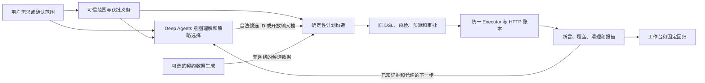

# AgentTest 开源工具复用、架构复杂度与稳定性审查

2026-11-26 · `master`，HEAD `bec965fba0d7f5c039812cf94d7567b765747af3`，审查包含现有工作区的 C1/C1.1 未提交实现。历史指标沿用各自归档身份和口径。

## 结论与选型建议

**保留 Deep Agents 和原可信执行链。下一步只批准一个离线候选：用现有对照环境的 Schemathesis 4.32.4 产生契约数据，通过现有批准策略构造或验证负向候选。** 以当前固定派生器为对照。已批准的固定负例优先直接派生，有待补的合法基线或授权范围内的边界候选才让生成器介入。如果适配无法带来净收益，沿用当前派生器，仍可独立简化领域工具。长期架构采用下文 B 与 C 的组合，借用 A 已经验证的 C1 编译和计划执行能力。

**最值得减少的复杂度来自模型反复转写可信事实，以及 Agent 工具内部再次调用 Design 来组装已知结构。** P3-B2.8 正式运行的 76 次调用包含 8 次 Focus、28 次 Design 和 40 次 Agent。解析、引用和基线预检是独立失败面，网关延迟与连接问题也独立存在。C1.2 缩短了请求体，但没有收到合格的候选提案，无法证明降低了调用次数、延迟、Token 或正式发布失败率。[B2.8 正式结果](deepagents-model-reliability-p3b28.md#五轮原评分与安全证据) · [C1.2 配对](deterministic-focus-compiler-c12.md)

P3-B2.8 保持 **0/5、NO-GO**，原 **4/5** 门槛保留。**C1.2 停机，真实验证未完成，C1.1 默认关闭，C2 生产实现及新增真实模型验收暂停。** 审查范围为代码和归档静态核对、公开资料研究及 PoC 设计。[路线图](ROADMAP.md) · [进度](progress.md) · [前次架构复盘](architecture-and-roadmap-review.md)

## 1. 当前架构与权威边界

| 层 | 当前落点 | 已复用能力与权威来源 |
| --- | --- | --- |
| 入口与任务 | Web、CLI、Goal、Suite 汇入 `ProductTasks`，`TaskService` 和 SQLite 管理任务。MCP 为独立受限适配 | FastAPI、Pydantic、SQLite。项目快照、操作员身份、任务版本、预算及报告所有权由 AgentTest 绑定。[任务编排](../src/agenttest/product_tasks.py) · [任务服务](../src/agenttest/task_service.py) · [MCP 指南](mcp-guide.md) |
| 语义与编译 | Focus 得出范围、原文见证、角色、资源及负向义务。C1.1 在可证明闭集内合入已编译映射。Planning IR 把同一接口的不同实例和依赖分开 | 模型提议，可信任务输入、PolicyRegistry、契约、已批准身份与库存校验。解析、编译、政策授权各有证据。[Focus](../src/agenttest/product_focus.py) · [C1 编译](../src/agenttest/focus_compiler.py) · [IR 编译](../src/agenttest/planning_compiler.py) |
| 自主调度及用例 | Deep Agents 是产品主自主 Harness。Agent 选组或单项目标，组内可能调用 Design。已持有唯一结构的部分正向路径采用 `instance_inputs`，仍可能需要模型选开放槽 | LangChain Tool Calling、上下文编辑和中间件，Deep Agents 原生 Skills，LangGraph 状态。确定性路径与兼容范围保留。P1 对照工具或旧 Supervisor 不能当成现行产品工具。[实际产品 Harness](../src/agenttest/product_agent.py) · [兼容路径](../src/agenttest/product_supervisor.py) |
| 执行及恢复 | 编译到同一 Scenario DSL，经绑定、负向策略、用例/清理预检、原审批与 Executor。报告、资产和固定回归消费同一可信证据 | httpx、pytest、LangGraph SQLite Checkpoint。批准摘要、HTTP 派发/回执、未知写复核、清理及完成判定是 AgentTest 领域职责。[Executor](../src/agenttest/executor.py) · [步骤账本](../src/agenttest/step_recovery.py) · [恢复](../src/agenttest/product_durability.py) · [固定回归](regression-export.md) |

C1 回放 25 份历史 Focus 提案保留原判定。原已接受的 11 份替换映射后 IR 等价，第二契约正例 6/6、负控制 13/13、变形 4/4。C1.1 在真实产品入口的模拟对照检查了请求、IR、归属和分母，并保留观测站原确定性 Design 分支的多身份限制。以上证据说明部分映射可移交编译，实际取消的模型调用是 0。C1.2 的八个离线参考位置均通过，真实候选的可用性仍待验证。[C1](deterministic-focus-compiler-c1.md) · [C1.1](deterministic-focus-compiler-c11.md) · [C1.2](deterministic-focus-compiler-c12.md)

## 2. C1.2 中断时间线与归因

原 Codex 聊天「编写架构复盘与开发路线」的 11 月 24 日 18:43:32–18:52:43 回合留有三个直接记录。第一次 `freeze` 退出 1，评测 fixture 缺 `inventory.operations`，发生在离线参考评分。修正脚手架后同命令退出 0，冻结八个位置。此后 `experiment.py live` 的命令记录为 `completed`、退出 **0**、耗时 **114.744 秒**，标准输出列全八个位置。回合随后以 **You’ve hit your usage limit** 失败，当时的开发工具会话确有额度中断。该事件晚于实验子进程退出。11 月 26 日的后续回合完成归档复核。出处为原聊天回合 `01a20d27-58a8-7533-9caf-17ec44956304`，正式命令条目 `exec-22dbe7f2-08d1-4650-bec9-87c9f87ddceb`。实验脚本（本地归档 `.eduwork/c1.2-focus-pairs/experiment.py`） · 实际审计（本地归档 `.eduwork/c1.2-focus-pairs/live/audit.json`）

| 位置 | 原始记录 | 停止链 |
| --- | --- | --- |
| P1-A | 47,360 B。47 ms 开始派发，42,735 ms 收到 HTTP 200、正文并完成解析与用量验证，42,750 ms 结束。14,432 tokens 已知。JSON/schema 合法，普通范围、匿名身份和四组资源关系符合预期。22 条映射、72 个行内字段，缺 2 条，另有两处精确值欠原文依据及 18 个多余的响应字段需求引用。 | Focus 原校验拒绝，首诊断 `FOCUS_INPUT_TEXT_CHANGED`，另有 `FOCUS_REQUESTED_CHECKS_MISSING`。按冻结来源冲突规则应在此封存下一位。实验统计的 `source_conflict` 未覆盖该类精确值见证冲突，`STOP_CODES` 也漏了此诊断，导致实际未停。 |
| P1-B | 25,431 B，31 ms 开始派发，60,047 ms 结束。无响应头、HTTP 状态、正文或可对端匹配的请求 ID。24 条可信候选见证在模型响应之前已编译，最终 Focus 无选择、无最终映射或 IR。 | 客户端内层 60 秒 `REQUEST_DEADLINE`，外层 Focus 预算为 61 秒。`INCOMPLETE_RESPONSE` 使账本结算为 `UNKNOWN`，脚本实际以 `MODEL_USAGE_UNKNOWN` 停止。保留这条已越过预期停机点的实际调用。 |
| O1-B、O1-A、O2-A、O2-B、P2-B、P2-A | 六条均为 `NOT_ATTEMPTED`。 | 脚本写出余位后正常退出。没有业务 HTTP、Design 或 Deep Agents 模型调用。 |

另用 SQLite 只读模式核对原 `model_usage_journal`，只有 P1-A `KNOWN`、P1-B `UNKNOWN` 两条。A/B 各派发 1/4，完整可评分提案分别为 1/1、0/1，首次 Focus 通过均为 0/1，已知用量 14,432，批次总量和费用未知。有效输入正文下降 46.30%，其余三组比较属于冻结编码。B 的未收到响应属于服务可用性缺证据，不能计算模型语义正确率或候选 IR 等价。A 收据（本地归档 `.eduwork/c1.2-focus-pairs/live/P1-A/result.json`） · B 收据（本地归档 `.eduwork/c1.2-focus-pairs/live/P1-B/result.json`） · 模型账本（本地归档 `.eduwork/c1.2-focus-pairs/live/journal.sqlite3`） · 停机复核（本地归档 `.eduwork/c1.2-focus-pairs/post-run-audit.json`）

| 待区分原因 | 本次判定 |
| --- | --- |
| 开发工具额度耗尽或外部杀进程 | **开发工具额度事件已确认**。原命令退出码 0 且八个位置完整落盘，正式子进程没有被该事件杀停的证据。独立 Work 进程、宿主强杀证据未取得。 |
| 模型 API 额度或限流 | **UNKNOWN**。A 为 200，B 无 HTTP 状态、429、额度拒绝正文或账户时点用量。串行试验只约束本脚本，无法确认令牌的其他使用者。学校公开配额与错误语义仅供对照，不能替代当时账户或服务端证据。[公开配额](https://developer.ecnu.edu.cn/vitepress/llm/limit.html) · [错误状态](https://developer.ecnu.edu.cn/vitepress/llm/error.html) |
| 网关或网络异常 | **UNKNOWN**。B 只能证明本地进入派发。没有可关联的网关访问、上游推理、排队、网络阶段或服务端结算记录，无法定位连接、上传、排队、推理或响应阶段。研发历史探针与其他批次也无法还原本次链路。 |
| AgentTest 内部数值预算 | 无数值耗尽记录。共享上限 8 调用、180,000 tokens，保留 2 次已派发和 14,432 已知 tokens。预算账本因未知用量关闭后续派发，未知总量不补估。 |
| 客户端请求 deadline | **确认**。B 的阶段戳、`DEADLINE` 分类及适配器内外层限时一致。[请求适配器](../src/agenttest/llm_planner.py#L651) · [遥测](../src/agenttest/model_timing.py) |
| 实验停止逻辑缺陷 | **确认**。A 的精确值来源冲突漏分类是 B 多派发的直接原因。初次 freeze 的缺字段属于独立脚手架故障。未来若获准复验，先用离线收据证明 A 时点后续预约和派发均为零，保留历史评分及现行生产规则。[共享来源校验](../src/agenttest/product_checks.py#L268) · 原停机分支（本地归档 `.eduwork/c1.2-focus-pairs/experiment.py#L460`） |

## 3. 历史稳定性根因

观察单位分别为提案、实际调用、执行证据、任务或冻结轮。归因使用第一手提案、诊断、预算/账本、报告与评测输出。一个位置可以同时有前置促因和后续停机事件。原 `complete`、`strict_complete`、`checks_passed`、正式评分分别保留。请求级 0/0 表示未建立分母，业务服务的 503 可造成真实断言失败，模型服务的 5xx 属基础设施证据。

| 层 | 代表证据及直接停止 | 促因、处理及证据上限 |
| --- | --- | --- |
| 模型服务、网络 | B2 一轮实际模型 HTTP 500 后止于 25/31、18/24。B2.3 三次 `DEADLINE/UNKNOWN`。B2.8 v4 最后一次 Design deadline、v5 Agent 连接错误，均 `BLOCKED / MODEL_ERROR`。 | B2.7 两批同名 `negative_batch_5` 首次 Design 各约 60 秒截止。B2.8 对应一条同为 38,456 B 的请求 9.171 秒得到完整回复，随后语法拒绝。同字节数不足以确认载荷完全相同，也不足以归因于载荷。分列服务故障、未知账单和语义错误。[B2](deepagents-hitl-p3b2.md) · [B2.3](deepagents-hitl-reliability-p3b23.md) · B2.8 遥测与逐轮审计（本地归档 `.eduwork/p3b28-acceptance-bec965f/audit.json`） |
| 格式、结构化输出 | B2.4 55 次 Design 中 14 次 JSON 语法拒绝，192 次正式模型调用无超时或 UNKNOWN。B2.8 v2 在组 5 得到三个完整回复，额外字段、语法、语法，最终 `NO_PROGRESS`。 | 网络正常时也可发生。B2.8 记录 13 次 Design 拒绝及另外 5 条案例预检拒绝，不能合并为执行故障。约束解码可减少结构错误，合法 schema 对业务有效性的证明有限。[B2.4](deepagents-hitl-reliability-p3b24.md) · B2.8 v2 模型输出（本地归档 `.eduwork/p3b28-acceptance-bec965f/release-v2/model-outputs.jsonl`） |
| 模型语义 | B2.8 v1 首次 24 条映射中 10 条误填精确值或长度，修复保留合法 14 条，却省略需要显式置空的 10 条，Focus 拒绝，业务 HTTP 为 0。C1.2 A 也是 schema 合法、原文依据失败。 | 可信目录的默认变体和用户原文精确值角色不同。P2.1 发现模型提案的来源、选择器或字面量同批准事实冲突，按拒绝处理。需要选择的内容和可以直接投影的事实应分开。B2.8 v1 输出（本地归档 `.eduwork/p3b28-acceptance-bec965f/release-v1/model-outputs.jsonl`） · [C1 历史回放](../runs/focus-compiler-c1/replay-with-provenance.json) · [P2.1](deepagents-reliability-p21.md) |
| 工具描述及参数 | B2.8 有一次 `GROUP_RUN_LIMIT`，所选组当时不在建议内。动作 ID 要从 scope 复制，预算限制、分组与候选路由、自由文本备注共同影响可执行性。 | 该拒绝符合当时规则，缺证据断定描述文案导致模型误选。两工具可委托到同一组，单项名字容易让调用者误以为只设计一个用例。证据收集工具和真正派发工具应提供可机读状态和允许的下一动作。[工具定义](../src/agenttest/product_agent.py#L1313) · B2.8 汇总（本地归档 `.eduwork/p3b28-acceptance-bec965f/comparison.json`） |
| 工具内部确定性缺陷 | B2.6 v5 有一条案例预检拒绝。其后候选建议与第三次分组准入不一致，止于 30/31、23/24。P2.1 有编译器实例合并、遗漏数据依赖边和拒绝后错误 `complete=True`。 | 前者是收到合法工具 ID 后，工具内与对外资格不一致，属于可独立复现的代码问题。B2.7 统一准入，新增第三次单项修复的实际触发证据仍不足。不要把原始坏提案、预检拒绝和代码缺陷合算。[B2.6](deepagents-hitl-reliability-p3b26.md) · [B2.7](deepagents-hitl-reliability-p3b27.md) · [P2.1](deepagents-reliability-p21.md) |
| Focus/Design 协议 | B2.7 复验 v3 从 24 映射加多余需求句，修成 0 映射。v4 由 23 降至 1。B2.5 v1 同组反复 `SOURCE_UNKNOWN`，停在 21/31。 | 既有合法事实和一个错误共同放在重生成范围内。长协议包含多类细节，编译器能生成部分目录和基线关系。C1 25 份历史上下文可编译全部映射，不能推出其它语言解读已解决。B2.7 原响应（本地归档 `.eduwork/p3b27-retest-f3733c1/release-v3/model-outputs.jsonl`） · [B2.5](deepagents-hitl-reliability-p3b25.md) · [C1](deterministic-focus-compiler-c1.md) |
| Context Engineering | B2.2 反馈投影有丢键/合并问题。B2.7 实测修复产物仍丢条目，B2.8 的保留反馈实测保留 38/38，v1 余 10 项未补。P3-A 四轮都按目标加载 Skill，严格完成仅 1/4。 | 区分入站原始输出、持久化诊断、给模型的投影及重新生成。产品早期大结果截断会丢尾部修复信息，当前保护部分首要键，但预览、分页、刷新和 Skill 仍消耗下一轮上下文。全目录回灌、只给摘要造成证据丢失，均要单独验证。[P3-A Skills](deepagents-skills-context-p3a.md) · [B2.2](deepagents-hitl-reliability-p3b22.md) · [结果裁剪](../src/agenttest/product_agent.py#L167) |
| 调度及预算 | P3-A.3 有输入预留导致派发前 `MODEL_TOKEN_BUDGET`。B2.8 v2/v3 记 `NO_PROGRESS`，v3 较早已有缺字段和语法错误，最后 Design 又遇 deadline/UNKNOWN。 | 无进展是终止机制。v3 的结构失败、末次服务可用性及产品终态同时保留。真实项目预算、模型硬限与工具次数分开诊断。增加预算不会消除重复转写或消化 UNKNOWN。[P3-A.3](deepagents-reliability-p3a3.md) · B2.8 v3 原输出（本地归档 `.eduwork/p3b28-acceptance-bec965f/release-v3/model-outputs.jsonl`） · B2.8 逐轮（本地归档 `.eduwork/p3b28-acceptance-bec965f/positions.jsonl`） |
| 安全门禁正确拒绝 | 未批准精确值、无效角色/来源及未知写入被阻断。B2.4 有三次删除缺同身份回读，库存为零仍留 `CLEANUP_UNPROVEN`。假 204 后同身份 GET 200 是真实断言失败。 | 门禁的拒绝保护可信执行，诱因可来自模型、契约投影或缺事实。批准角色、绑定、清理和运行证据不能用单个状态码或生成器判定替换。[B2.4](deepagents-hitl-reliability-p3b24.md) · [步骤恢复](deepagents-step-recovery-p3b11.md) |
| 持久化及恢复 | B2 有审批记录与 Checkpoint 发布的崩溃窗口，B2.1 对核实探针账本及恢复归属做修复。B1.1 用可信 POST/DELETE 回执恢复剩余步骤，未知派发留待审。 | 图可恢复与对端写入是否成功是两种事实。B2.1 账本修复前 31/31 属早期源码，最终报告为 29、27/31。B2.8 76 条正式调用可在 Trace、SQLite、报告对账，耐久镜像仅 30 条可逐字段核对。[B2 HITL](deepagents-hitl-p3b2.md) · [B2.1](deepagents-hitl-reliability-p3b21.md) · B2.8 对账（本地归档 `.eduwork/p3b28-acceptance-bec965f/evidence-verification.json`） |
| 评测及评分口径 | B2.5 批次 4/5 达 31/31，但其中 v2/v5 显式请求映射 0/0，原评分 2/5。P3-A.3 新样本严格 0/18，后续同证据按修正口径 5/18，新批次 6/18 各自留档。B2.8 冻结回归第二次是测试替身签名不匹配，模拟 503 未派发。 | 执行已批准义务与显式请求义务覆盖分开。C1.2 漏停、B2.4 探针前启动失败、原始采集失败与真实模型/业务能力分开。修复脚手架和修正评分口径均保留原始结果。B2.5 原评分（本地归档 `.eduwork/p3b25-acceptance-ae61d8a/audit.json`） · [完成语义审计](agenttest-product-semantics-audit.md) · B2.8 冻结诊断（本地归档 `.eduwork/p3b28-freeze/run-20261124T052056Z/failure-diagnosis.json`） |

早期独立记录提供交叉验证。P1 工具选择严格 3/8，P2 四类自主目标严格完成 0/4，P2.1 复验 2/4。P3-A.3 60 轮中 FIXED 4/12、ADAPTIVE 4/12、旧 1/18、新 0/18。CourseInsight 首轮完整 3/10、实测 18/26，修复与复验后才到 26/26。更早的 Plan Reuse 真实任务基线 2/18、候选 9/18，基础场景失败可阻断多个派生。B2.2 最终候选 2/5、优化版独立复验 3/5，早期 5/5 属另一个源码批次。B2.3 到 B2.8 正式原评分为 0/5、0/5、2/5、3/5、1/5 和 0/5，B2.7 同候选第二批仍为 1/5。B2.8 原审计的五份 tool_errors 数组均为空。v4/v5 的 OPENAPI_UNKNOWN_BODY_FIELD 分别为 2、3 条，均为派发前案例拒绝。这些证据支持区分坏提案、正常拒绝与工具内部异常。以上范围、版本、样本与分母不同，无法汇总为全项目可靠率。证据支持优先减少重复生成、统一派发资格、保留分层诊断。真实业务预期、跨项目表现及网关问题仍各需独立证据。[P1](deepagents-harness-p1-evaluation.md) · [P2](deepagents-product-runtime-p2.md) · [P3-A.3](deepagents-reliability-p3a3.md) · [真实项目交付](courseinsight-colleague-delivery.md) · [固定计划复用](plan-reuse-final-results.md) · [阶段对照](architecture-and-roadmap-review.md#历次正式结果) · B2.8 原始审计（本地归档 `.eduwork/p3b28-acceptance-bec965f/audit.json`）

## 4. 八个产品工具与内层 Design

依据 `product_agent.build_tools` 的注册和调用链。外层 schema 按字段数计，内层动态 schema 和响应长度另计。各工具使用 `_json` 的 6,000 B 裁剪阈值。超过后保留首要结构化键和预览，拼接后的 JSON 未再严格限长，且首要键未包含通用 `design` 与任意详情。静态视图在同会话里按摘要复用，动态视图按 revision，四个读工具都可用 `refresh=true`。压缩后恢复可能需要额外工具往返。本轮没有重新调用模型测 token。[工具 schema](../src/agenttest/product_agent.py#L1313) · [结果裁剪](../src/agenttest/product_agent.py#L167) · [重复读取](../src/agenttest/product_agent.py#L1130)

| 工具 | 职责、模型参数及上下文 | 实现可靠性、结果及可简化点 |
| --- | --- | --- |
| `get_contract` | 只读目录。0 必填、1 可选 `refresh`。模型主要理解操作 ID、方法、路径、需身份与批准标志。输出按整个契约增长，含目录中标为未批准的操作及项目 target origin。无内层模型或 HTTP。 | 项目快照和审批标志由代码投影，模型无需转写。重复调用返回摘要和刷新提示，过大时只有通用预览，缺操作级查询。优先只在开放选路时返回关联操作摘要，完整契约仍可供人员查阅。执行目标和授权继续由后端绑定。 |
| `get_approved_policies` | 0 必填、1 可选 `refresh`。正常策略列出角色、状态、字段断言、绑定、前置与生命周期，额外列获批缺失断言，常规负向只给计数。无内层模型或 HTTP。目录和绑定多时结果增长。 | 读取冻结 Registry。结果是证据来源，不能让模型复述成更高授权。作为“已批准策略”名称，负向细目不可直接查询，模型需回 scope/candidate 或 Design 获得适用语义。建议按操作/策略查看，给模型简短的可选业务方案及证据引用。 |
| `get_test_scope` | 0 必填、1 可选 `refresh`。返回用户任务、义务、可执行组、候选 ID/精确 tool call、范围外及阻塞操作、预算、终止预览。无内层模型或 HTTP。组和候选较多时裁剪。 | 输出解释力高，当前也含已满足义务和完成状态，与 coverage 重叠。可执行条件由 `_group_admission` 与候选代码判断，派发时实时复验。选择只有一个且目标明确时可由代码排程。多个合法选项才向模型给出各自价值、请求开销、审批和稳定 ID。 |
| `get_test_coverage` | 0 必填、1 可选 `refresh`。返回测量、缺口、异常、资源、诊断、可选候选 ID、状态、预算及证据引用。覆盖主体按计划增长，部分预览有 4/6/12 个条目的上限。无内层模型或 HTTP。 | 依据可信报告及账本，已有的机读终态能支持停止。模型无需重新核分母。与 scope 可共用一个短状态摘要，动作结果携带变更和当前可选项。需要时再取细节，避免固定地“读覆盖再读 scope”。 |
| `run_test_group` | 1 必填 `group_id`，可选 `design_note` ≤300 字符。ID 必须来自 scope。外层 schema 小，实际要理解允许尝试、组/修复机制和备注在内层 prompt 的影响。通常调用 Design，特定确定性路径可无模型。负向组还按剩余策略处理。结果含组/Design 状态、预算、请求差额和至多 8 条用例摘要。 | 业务动作锁、准入、预算、原校验、审批、Executor/清理依次保护。负向第三次修复仅在可信见证和预算适用时提供。区分 `UNKNOWN_GROUP_ID`、`GROUP_RUN_LIMIT`、`BATCH_REQUEST_BUDGET`、Design 拒绝与实际请求异常。返回 `ok=true` 仍可能携带拒绝和零请求。已知组结构及合法基线可由编译器装配，以“要测哪批批准义务”取代让模型在备注里写生命周期。 |
| `run_open_obligation` | 1 必填 `candidate_id`，可选 `design_note` ≤300 字符。候选必须来自当前 scope。 `READ_PROBE` 构造已批准只读用例，无 Design 模型。负向可直接委托所属组，其他补测通过 `supervise_design → run_group`，可嵌套 Design。非委托结果至多 6 条用例摘要，含动作、执行、证据和下一步。 | 每次重算候选，限制补测次数、重复及分组归属。拒绝有 `UNKNOWN_CANDIDATE_ID`、`OBLIGATION_RUN_LIMIT` 或内层诊断。非委托的 `ok` 基于执行和请求证据，语义与前一工具不同。非委托分支取末条 Design 记录，代码未用本次记录增量绑定诊断，且直接取 detail。建议按本动作关联诊断并统一机读状态。读探针、确定性补测和需业务选择的动作共享同一候选语义。[单项入口](../src/agenttest/product_agent.py#L1054) · [只读/补测路由](../src/agenttest/product_tasks.py#L2090) |
| `read_test_report` | 必填 `run_id`，可选 `operation_id`、`step_offset` ≥0、`step_limit` 默认 3、范围 1–5。只读已有报告，无内层模型或新目标请求。输出步骤、断言、创建、清理和后续页。 | 只认本轮可见 run ID，提供 `UNKNOWN_RUN_ID`、`REPORT_UNAVAILABLE`。当前按 operation 过滤，未命中表现为空结果。保留报告颗粒度，按稳定步骤引用给出证据分页。状态简报不用重复整页字段。 |
| `investigate_failure` | 必填 `run_id`，可选 `operation_id`。读取报告中首个匹配失败步骤，用 `explain_failure` 做确定性解释。无内层模型或新目标请求。 | `NO_SUCH_FAILED_STEP`、无失败和读报告失败可区分。工具描述的“只读复核”容易与真正执行 `READ_PROBE` 混淆。产品方法此处是报告解释。同名 P1 工具和另一路 `investigate_product` 的模型选择/实际只读观察需独立归因。建议在工具结果明确 `evidence_source`，给 Agent 认证过的可选观察动作，不自动把推测写成已确认原因。[报告及调查](../src/agenttest/product_agent.py#L1149) · [独立调查路径](../src/agenttest/product_probe.py) |

**Design 成本的关键是内部责任宽于外层动作。** `propose_design` 会组装分组操作闭包、必需用例、允许输入类型及绑定源、批准正常/负向规则、资源生命周期、上下文与预算，调用 `TestDesignModel`。完整 wire 要输出案例、计划步骤、论证或待审处置，以及适用时的实例、引用和覆盖字段。模型拿到一个组 ID 后，仍可能在嵌套请求里重新编排基线和步骤、插入引用、复写负向检查。动态 enum、分组和模型端 schema 能缩小合法面，原回复仍须解码，使用 `construct_design` / `compile_design`、Scenario 和 Executor 校验，合并合法结果后适用写入仍需原审批。一个 B2.8 组的真实请求为 38,456 B。这个值说明实际规模，不能推广为每组均值。[编码和解码](../src/agenttest/product_design.py#L304) · [设计上下文](../src/agenttest/product_design.py#L540) · [计划构造](../src/agenttest/plan_construction.py#L531) · [预算和派发](../src/agenttest/product_tasks.py#L1291)

| 已有事实 | 审查建议 |
| --- | --- |
| 合法基线可唯一取得，负向规则已持有精确变更或受控变体，绑定、身份和清理唯一 | 由原策略派生和编译一次，通过原完整预检。典型是已批准的单字段负向及其固定资源前置。Agent 选测试目标、类型及合法候选，模型无需生成每个请求步骤。 |
| 结构和依赖唯一，但安全业务字面量仍开放 | 复用已有 `instance_inputs` 思路，仅请求明确标注的输入槽。Schema 候选有合法基线时可直接用。业务意义、价值选择及多个合法来源仍由 Agent/操作员决定。 |
| 多个角色、生产者或生命周期都合法且影响证据 | 给出已审查的候选与依据，保留选择、澄清和开放设计能力。候选缺证据时停在待审。作用域、资源 ID、审批、断言不从生成例推导。 |
| 结构不可解析或变更会改变批准摘要 | 只修可定位的开放槽，原完整预检重跑。不可解析时保持拒绝或走显式、计费且有上限的再提议。任何改变待派发写入的计划都保留原批准绑定语义。 |

工具错误建议统一记录阶段与以下事实：提案是否收到及可解析、授权和给定参数是否通过、计划是否通过预检、业务请求是否派发、是否取得可信回执、实际断言与清理结果、有效下一动作。无业务 HTTP 的 `DESIGN_REJECTED`、前置 `INVALID_ARGUMENT`、真实 `TOOL_ERROR` 和执行后的 `ASSERTION_FAILED` 可据此区分。先在文档/离线对照确定映射，保留历史错误码供旧报告读回。

## 5. 成熟工具能力、版本与接入边界

本地“锁定”来自 `pyproject.toml`、各用途 lock 及已安装 wheel 的元数据。下表“上游”是本轮可核验的发布快照，不用于推导环境可以直接升级。AgentTest 支持 Python 3.11/3.12。对照环境与 Base、Agent、Deep Agents、MCP 独立锁集，不混装。Deep Agents 0.7.35 wheel 要求 LangChain ≥1.4.9、core ≥1.7.6，当前两者均满足。旧 agent extra 锁 LangGraph 1.2.14，Deep Agents extra 锁 1.2.20。新版 API 特性先对锁定版验证。[项目依赖](../pyproject.toml) · [Deep Agents 锁](../requirements-deepagents.lock) · [对照锁](../requirements-comparison.lock)

| 组件 | 当前锁定 | 上游发布、许可证、兼容提示 |
| --- | --- | --- |
| Deep Agents / LangChain / LangGraph | 0.7.35 / 1.4.10（core 1.7.7）/ 1.2.20，checkpoint 4.3.1、SQLite 3.1.3 | 上游可见 0.7.42 / 1.5.2 / 1.2.24，MIT，发布包 Python ≥3.11。框架升级需联验工具注册、middleware 执行顺序和 checkpoint 读取。[Deep Agents 发布](https://github.com/langchain-ai/deepagents/releases) · [LangChain 元数据](https://pypi.org/project/langchain/) · [LangGraph 元数据](https://pypi.org/project/langgraph/) |
| Pydantic AI | 无。Pydantic 本体 2.14.0 已锁定 | Pydantic AI 2.75.0，MIT，Python ≥3.11。接入会引入另一套模型适配/Agent 生命周期，Pydantic 校验本身可继续复用。[包元数据](https://pypi.org/project/pydantic-ai/2.75.0/) |
| Schemathesis / Hypothesis / pytest | 4.32.4 / 6.170.8（均对照环境）。pytest 9.1.1 | 上游 Schemathesis 4.34.2（MIT）、Hypothesis 的官方 API 文档 6.170.17（MPL-2.0）、pytest 9.2.0（MIT）。前两者 Python ≥3.11，pytest ≥3.10。锁定版 Schemathesis 允许 Hypothesis ≥6.130.12、<7，PoC 沿用既有已锁组合和公开 Python API。[Schemathesis 发布](https://github.com/schemathesis/schemathesis/releases) · [Hypothesis 元数据](https://pypi.org/project/hypothesis/) · [pytest 元数据](https://pypi.org/project/pytest/) |
| OpenAPI/JSON Schema | openapi-spec-validator 0.9.0、openapi-schema-validator 0.9.0、jsonschema 4.26.0。后两者目前在 dev/对照锁的依赖树中 | 本轮查到的同名稳定包对应 0.9.0（Apache-2.0）、0.9.0（BSD-3-Clause）、4.26.0（MIT）。用原公开 API 并按方言选 3.0、3.1 等 validator，避免把间接依赖当作稳定直接依赖。[文档校验](https://pypi.org/project/openapi-spec-validator/) · [实例校验](https://pypi.org/project/openapi-schema-validator/) · [jsonschema](https://pypi.org/project/jsonschema/) |
| RESTler | 无 | 官方 Releases 页无正式条目，Tags 的最新版本标签为 v9.3.1（MIT，该标签注明 Python 3.12.8）。源码候选应固定 commit/tag，独立 .NET/Python 工具链的适配成本高。[源码、许可证及要求](https://github.com/microsoft/restler-fuzzer) · [官方 Tags](https://github.com/microsoft/restler-fuzzer/tags) |
| LiteLLM / OpenTelemetry / Langfuse | LiteLLM、Langfuse 无。`opentelemetry-api` 1.45.1 为已有间接依赖 | LiteLLM 1.111.0（开源核心 MIT，企业目录另查），OTel API 1.45.2（Apache-2.0），Langfuse SDK 5.2.0（MIT，Python ≥3.11），自托管平台与企业功能看各自目录许可证。[LiteLLM 元数据](https://pypi.org/project/litellm/) · [OTel API](https://pypi.org/project/opentelemetry-api/) · [Langfuse SDK](https://pypi.org/project/langfuse/) · [平台源码](https://github.com/langfuse/langfuse) |
| Temporal / Celery | 无 | Python SDK 1.36.0（MIT）/ 5.7.0（BSD-3-Clause），分别需要 Temporal 服务或消息代理等部署资源。[Temporal SDK](https://pypi.org/project/temporalio/1.36.0/) · [Celery](https://pypi.org/project/celery/5.7.0/) |
| MCP Python SDK / LangChain MCP Adapters | MCP 2.3.0。Adapters 无 | 两者 MIT。上游 SDK 的 PyPI 发布版亦为 2.3.0，Adapters 为 0.3.2。Adapters 主分支声明 `mcp>=1.24.0,<2.0.0`，与项目 v2 不直接兼容。迁移判断还要核对具体 wheel 元数据，不只看协议名和文档示例。[SDK](https://pypi.org/project/mcp/) · [Adapters 发布包](https://pypi.org/project/langchain-mcp-adapters/0.3.2/) · [Adapters 依赖](https://raw.githubusercontent.com/langchain-ai/langchain-mcp-adapters/main/pyproject.toml) |

### Agent 框架

- **Deep Agents。** 原生结果循环、工具集成、文件与技能的按需读取、上下文管理、子代理及可选后端已提供通用 Harness。产品已用 `create_deep_agent`、Skills 配合只读虚拟 backend、工具目录检查和原生 middleware。旧 P1 对照循环及 Supervisor 是需保持资产可比性的兼容面，后续应停止复制新的主循环。产品独有的义务状态、范围、何时终止、允许操作和写入资源回收仍由应用承担。暴露原生文件、委派或广泛工具发现需要独立业务收益和安全验证。[原生 Harness](https://docs.langchain.com/oss/python/deepagents/overview) · [产品接法](../src/agenttest/product_agent.py#L1560)
- **LangChain。** 模型标准接口、工具绑定及 profile 可减少普通供应商的消息/工具协议实现。`ProviderStrategy` 和 `ToolStrategy` 处理不同结构化输出能力，含有限的校验反馈。内置 Retry、调用限额、Context Editing 和 HITL 已有相应抽象，当前产品已复用其中数项。可将通用解析错误映射到原证据模型，但校验路径、来源完整性、UNKNOWN 结算、重试分类和防重复派发继续交给产品。现有 ecnu 兼容适配保留已证实的 schema 编码、参数兼容、字节与阶段证据，普通 provider 接入优先从标准适配评估。通用 SDK 不能直接覆盖这条路径。[结构化输出](https://docs.langchain.com/oss/python/langchain/structured-output) · [内置 Middleware](https://docs.langchain.com/oss/python/langchain/middleware/built-in) · [现有适配](../src/agenttest/deep_harness/chat_model.py)
- **LangGraph。** Checkpoint、thread、interrupt/resume 和持久化流程已经是合适的通用基础。恢复会按图语义重入节点，官方要求 interrupt 前副作用具备幂等性。AgentTest 现有审批签认、原计划身份、实际 HTTP 回执与未知效果核实正好覆盖这一空白。可缩小外层投影与图状态重复，但需要保留用户任务状态、回执账本及崩溃对账能力。[Persistence](https://docs.langchain.com/oss/python/langgraph/persistence) · [Interrupt 规则](https://docs.langchain.com/oss/python/langgraph/interrupts) · [AgentTest 恢复](deepagents-step-recovery-p3b11.md)
- **Pydantic AI。** 支持 Native、Tool、Prompted 输出模式，以类型和 `output_validator` 拦截问题并用 `ModelRetry` 返回反馈，可复用其“结构错误、领域错误、允许修改字段与重试预算分离”的设计。此处采用思想和已有 Pydantic 类型即可。第二套框架会重复 Deep Agents、模型账本和恢复集成，且无法自行证明引用、角色或政策授权。[输出及校验修复](https://pydantic.dev/docs/ai/core-concepts/output/)

### API 测试工具

| 能力 | 能直接复用 | 需要受控适配 / 业务边界 |
| --- | --- | --- |
| OpenAPI 读取与实例校验 | 已使用 spec-validator 验证文档。schema-validator 和 jsonschema 能检查实例与 draft。Schemathesis 可从内存字典加载已知操作 | 先经 AgentTest 有界解析、引用策略、允许媒体、未知字段与序列化约束。用明确的 3.0/3.1 方言及本地 Registry。仅文档合法不代表已批准，不能拉远程 `$ref`。纯 Schema 的整数/浮点表示、`nullable`、显式 null 和字段缺失须同原执行语义核对。[现有契约边界](../src/agenttest/contracts.py) · [请求预检](../src/agenttest/request_validation.py) · [JSON Schema 引用](https://python-jsonschema.readthedocs.io/en/stable/referencing/) |
| 正常/异常数据、边界 | Schemathesis 的公开 `schema[route][method].as_strategy` 提供正向和负向数据，coverage phase 有系统边界。Hypothesis 提供策略组合、生成和缩减 | 允许字段、基线、单一变更、值或方向必须与批准规则一致。原生负例可生成多个变化或落在其他参数。OpenAPI 可校验形状，不能给出认可的 422 业务错误码、写副作用或角色语义。固定变更优先现有 `negative.py`。[生成机制](https://schemathesis.readthedocs.io/en/stable/explanations/data-generation/) · [Python API](https://schemathesis.readthedocs.io/en/stable/reference/python/) · [现有变体](../src/agenttest/negative.py) |
| 状态化与跨接口 | Schemathesis 支持 OpenAPI Links、状态机及部分推断。RESTler 有从 OpenAPI/配置分析生产者消费者与生成顺序的能力。Hypothesis 有规则状态机 | 可阅读候选关系或用作离线对照。关系提示须绑定同实例、角色、批准生产者/选择器、写审批和清理。禁止直接接入上述工具的独立状态执行循环。pytest fixture 适合业务已知路径的固定验证。[Schemathesis 状态机](https://schemathesis.readthedocs.io/en/stable/guides/stateful-testing/) · [RESTler 原论文](https://www.microsoft.com/en-us/research/uploads/prod/2021/03/RESTler.pdf) |
| 多角色认证 | Schemathesis 提供 auth 和配置级覆盖，RESTler 有认证接点，pytest fixture 能参数化角色 | 认证机制不能判断归属、跨用户隔离及允许身份。候选不携带凭证、Cookie、Authorization。角色别名、注入和作用域由 Vault、PolicyRegistry、Executor 决定。按项目审查开放的业务 fixture。 |
| 业务断言和报告 | Schemathesis 有响应状态/内容类型/Schema 等检查和自定义检查。pytest 具备断言、fixture、参数化、JUnit XML。Hypothesis 记录和缩减失败 | 纯契约检查可消费已脱敏的可信响应作辅助提示，业务状态、错误码、数据和清理等仍由批准规则决定。JUnit 是互操作报告，不能取代覆盖账本和 HTTP 证据。原生失败缩减会再次执行测试体。缩减仅限无请求的本地候选或未来另审的安全模式，固定回归保存已批准 DSL、输入指纹与回执。[Schemathesis Checks](https://schemathesis.readthedocs.io/en/stable/reference/checks/) · [Hypothesis API](https://hypothesis.readthedocs.io/en/latest/reference/api.html) · [pytest Fixtures](https://docs.pytest.org/en/stable/how-to/fixtures.html) · [回归导出](regression-export.md) |

**锁定版源码的 Transport 结论。** 核对现有 4.32.4 wheel 的 `schemas.py`、`openapi/loaders.py`、`generation/case.py` 和 `transport/`。从内存构造 schema，然后收集 `Case` 数据不需要 HTTP。相反，`Case.call` 会通过 `before_call` 等 hook 后调用选定 Transport 的 `send`，可传 `requests.Session`，同时存在 ASGI/WSGI 分支。Hook 和会话注入本身无法保证 AgentTest 的审批、请求数、写回执和重放约束。PoC 只走生成 API，严禁进入 `call`、`call_and_validate`、CLI/状态 runner 或加载远程契约。映射 `Case` 的可批准数据到 DSL，再走原预检。若未来考虑响应适配，使用原 Executor 的可信响应投影，白名单挑选不再派发请求的检查。RESTler 的独立执行面及本轮未确认的稳定生成适配协议使它不适合作为产品候选。[Python API](https://schemathesis.readthedocs.io/en/stable/reference/python/) · [Hooks](https://schemathesis.readthedocs.io/en/stable/reference/hooks/) · [锁定版包](https://pypi.org/project/schemathesis/4.32.4/)

仓库已有可复用对照，避免重复做同一实验。历史三组各有 9 项共同批准用例。固定 pytest 和 AgentTest Mock 每种目标状态各派发 9，Schemathesis 适配组各派发 4。其余 5 个生成基线因 `5.0` 等整数表示触发严格类型校验，零 HTTP，原分母保留。9 份原生负例只留档。工具实际适配使用公开生成 API、固定 Hypothesis 设置、禁收缩及 database。固定 8 个负例变更及业务断言均由 AgentTest 提供。错误业务码仍需批准断言检出。这证明生成接缝可行，当前没有证据支持让原生负例替换批准派生器。独立项目复用对照应测“新增哪些可用候选及需要多少适配”。[阶段对照原报告](plan-reuse-stage1.md) · [代码](../scripts/compare_contract_tools.py) · [复用对照](../scripts/compare_plan_reuse_tools.py) · [结果归档](../runs/plan-reuse-tools-development-v3/summary.json)

### 通用工程基础设施

| 候选 | 匹配与采用条件 |
| --- | --- |
| LiteLLM | 供应商映射、usage 规范化、路由/重试和限频适合多供应商网关。当前仅有有限模型对照，若未来普通 provider 接入重复再评估 SDK 层，保留实际每次派发、输入安全和 UNKNOWN。避免代理再试隐藏真实次数或换模型污染冻结归因。本轮暂缓。[源码](https://github.com/BerriAI/litellm) · [重试语义](https://docs.litellm.ai/docs/router/learn/reliability) |
| OpenTelemetry | 标准 span/event、上下游 context 与 OTLP 可作为模型/任务/Executor 的观测导出面。优先复用当前阶段字段和本地 Trace，必要时映射到 SDK。分布式链路和 exporter 尚无接入要求。启用前审查内容属性及敏感值留存，禁止用 trace 抽样代替准确账本。[GenAI 语义约定](https://opentelemetry.io/docs/specs/semconv/gen-ai/) |
| Langfuse | 用于筛选调用、提示词版本、数据集和评测交互，可消费 OTel 导出。当前逐轮结算、原报告和任务 UI 已满足阶段审查。若需要多人共享观察再考虑。使用 SDK 发布版对应的文档，服务端版本、数据隔离及运营成本独立评估。[SDK 源码](https://github.com/langfuse/langfuse-python) |
| Celery / Temporal | Celery 负责分布式队列/确认/重试，Temporal 负责耐久工作流历史、活动和恢复。它们不能证明一个独立目标实际写入的效果。当前 SQLite 任务与 LangGraph 恢复已能支撑开发和受控工作台。多 worker、跨机器队列或跨天调度成为明确瓶颈才比较。继续用原账本处理活动幂等与未知结果。[Celery 确认语义](https://docs.celeryq.dev/en/stable/userguide/tasks.html) · [Temporal 活动](https://docs.temporal.io/activity-definition) |
| MCP Python SDK / LangChain MCP Adapters | 已使用 SDK v2 的 `MCPServer`，当前出口保留现有身份和工具白名单。Adapters 能加载多 server 工具并拦截调用，但目前有 v1 依赖约束。即使后续兼容，也只接固定可信服务器和经审查的操作、参数与响应，保持同一 Executor/权限/账本，暂缓自动发现或广泛入站调用。[AgentTest MCP](mcp-guide.md) · [Adapters 源码](https://github.com/langchain-ai/langchain-mcp-adapters) · [MCP SDK](https://github.com/modelcontextprotocol/python-sdk) |

## 6. Build vs Buy 职责清单

复杂度按状态、规则与入口数量估计。匹配度表示候选对当前职责的覆盖程度。迁移成本考虑旧协议兼容、审阅、新依赖和验证。

| 模块及文件 | 当前职责、复杂度、通用性 | 成熟替代及匹配 | 安全兼容性 | 迁移成本及收益 | 决策 |
| --- | --- | --- | --- | --- | --- |
| [模型适配](../src/agenttest/llm_planner.py)、[ChatModel](../src/agenttest/deep_harness/chat_model.py) | 高。Focus/Design JSON 和 Agent 原生工具的消息编解码、网关差异、预算与遥测，部分通用 | LangChain provider adapter 高匹配普通模型，LiteLLM 匹配供应商映射及路由 | SDK 必须保留每次派发证据、取消/超时、输入保护和 UNKNOWN | 中。减少普通服务封包，ecnu 特性仍需独立核对 | 简化普通模型接入，保留已证实的兼容路径，暂缓代理 |
| [Focus wire](../src/agenttest/product_focus_wire.py)、[来源](../src/agenttest/product_sources.py)、[批准检查](../src/agenttest/product_checks.py) | 高。动态 Schema、候选引用、原文、精确值与角色，格式验证为通用子集 | Pydantic/原生结构化输出匹配格式，来源与业务授权匹配低 | 保持当前子句、角色、批准策略、显式 null 与缺失的真实含义 | 中高。闭集减少批量转写与漏项，兼容旧任务协议 | 保留领域义务，简化模型 wire。C1.1 默认关闭 |
| [Design wire](../src/agenttest/product_design.py)、[开放槽](../src/agenttest/instance_design.py)、[编译器](../src/agenttest/planning_compiler.py) | 高。组内重提议、引用、基线、实例输入和预检，核心是领域编译 | Schemathesis 匹配候选数据，LangChain/Pydantic 匹配通用结构 | 保留选源、身份、同资源、断言与审批摘要 | 中。可缩短模型输出并减少部分 Design 调用点 | 优先验证固定批准变体与开放槽，保留开放 Design |
| [修复反馈](../src/agenttest/model_input.py)、[诊断](../src/agenttest/case_diagnostics.py)、[负向修复](../src/agenttest/negative_batch_repair.py) | 中高。通用字段错误与业务反馈散布在多路径 | LangChain ToolStrategy 或 Pydantic AI 思路，格式匹配中高 | 诊断脱敏，局部输入变更重验，写入计划变化绑定新审批摘要 | 中。减少反复重生成，避免为每类历史输出单写补丁 | 简化，复用现有诊断和开放槽校验 |
| [自主循环及准入](../src/agenttest/product_agent.py)、[义务门禁](../src/agenttest/obligation_gate.py)、[旧 Supervisor](../src/agenttest/product_supervisor.py) | 高。工具循环、确定调度、候选与义务状态，前两项部分通用 | Deep Agents/LangGraph 已高匹配通用循环，middleware 匹配调用限额 | 候选和派发从相同事实判定，停止与预算无模型越权 | 中。减少重复循环和状态往返，兼容旧回归 | 保留单一主 Harness，确定事项由代码排程 |
| [契约和校验](../src/agenttest/contracts.py)、[请求语义](../src/agenttest/request_validation.py) | 中高。有界解析、本地引用、文档和请求实例检查，部分通用 | 已用 spec-validator。schema-validator/jsonschema 高匹配标准关键字 | 保留无远程引用、大小、方言和序列化约束 | 中。可减少自写关键字逻辑，需逐项等价审计 | 复用已有 validator，实例替换暂缓 |
| [测试数据](../src/agenttest/negative.py)、[历史工具对照](../scripts/compare_contract_tools.py) | 中。固定批准派生与合法基线数据，前者领域、后者通用 | Schemathesis/Hypothesis 生成匹配高，批准变体匹配低 | 生成无网络，原规则限定字段、值、角色与预算 | 低至中。复用对照接缝，按可用候选与适配净成本验证 | 受控 PoC，保留固定变更派生 |
| [生命周期与绑定](../src/agenttest/plan_construction.py)、[写效果](../src/agenttest/write_effects.py) | 高。认证前置、同资源同身份、依赖、负向副作用、清理，领域核心 | Schemathesis Links、RESTler 仅通用候选关系，替代匹配低 | 业务规则与真实回读是事实来源，DELETE 204 单独不足以证明清理 | 高替换成本，现有构造可直接减少模型参与 | 保留领域编译 |
| [Executor](../src/agenttest/executor.py)、[Verifier](../src/agenttest/verifier.py)、[回归](../src/agenttest/regression.py)、[保存资产](../src/agenttest/saved_tests.py) | 高。派发、权限、证据、固定回归。网络与测试 runner 通用 | httpx、pytest 已高匹配，第三方检查可补充，独立 executor 匹配低 | 所有授权、请求计量和可信报告从正式入口导出 | 高替换/低增量成本。复用测试 runner 和通用格式 | 保留统一 Executor 和资产协议 |
| [人工审批](../src/agenttest/human_review.py)、[策略](../src/agenttest/policies.py)、[任务所有权与恢复](../src/agenttest/product_durability.py) | 高。业务角色、审批摘要、确认/拒绝/恢复。暂停和调度部分通用 | LangGraph interrupt 已匹配暂停，业务审批匹配低 | 绑定项目、所有者、checkpoint、原预检计划。模型只提交提案 | 高。原生中断可以减外层编排，签认与核实记录保留 | 保留审批与领域证据 |
| [HTTP 步骤账本](../src/agenttest/step_recovery.py)、[任务 SQLite](../src/agenttest/task_store.py) | 高。派发状态、可信回执、原子推进、未知写人工核实，领域核心 | LangGraph、Temporal 匹配流程历史，外部写效果证据匹配低 | 写结果未知先核实。原回执才支持确切续跑 | 高。换引擎无法解决独立系统副作用不确定性 | 保留 |
| [Trace](../src/agenttest/local_trace.py)、[模型遥测](../src/agenttest/model_timing.py)、[用量核对](../src/agenttest/usage_reconciliation.py) | 中高。阶段事件和投影通用，预约/结算属于产品 | OTel 导出、Langfuse UI 匹配高，准确结算匹配低 | 原数据脱敏与准确结算，抽样 Trace 无授权或对账能力 | 低至中。后续可减少跨进程观测建设 | 先统一关联字段，暂缓外部平台 |
| [评测归档与协议](../src/agenttest/eval_v2)、[冻结](../src/agenttest/evaluation_freeze.py)、[冻结回归脚本](../scripts/run_frozen_regression.py) | 高。多个历史驱动、身份、期望、停止与评分，调度/数据集通用 | pytest、观测平台数据集适合脚手架，原评分匹配低 | 样本身份、未尝试分母、旧口径与真实派发授权必须保全 | 中。共用冻结、停机分类与对账可减少重复脚手架 | 保留独立评分，未来统一新实验接缝 |

重复主要发生在批准映射转写、Design 重建已确定结构、读状态后把唯一动作转回模型，以及多段传输/修复反馈的封装。OpenAPI 文档校验、Harness、Checkpoint 和 pytest 已实际复用。批准、实例关系、可信派发及 HTTP 恢复有独立领域价值。

## 7. 三种架构比较

| 维度 | A · 维持当前栈，继续 C1/C2 编译 | B · 保留 Harness/Executor，受控复用契约工具 | C · 收敛规划 wire 为领域动作 |
| --- | --- | --- | --- |
| 模型调用链 | 闭集映射省字段，唯一结构可减 Design。其它工具往返继续 | 纯数据候选由代码生成，只有原 Design 单纯为数据构造时才可能省调用 | 开放意图 → 候选/槽 → 回执，确定性发布矩阵可合并调度，调查保留迭代 |
| 工具与上下文 | 大部分 Focus/Design 协议保留，后续仍需维护动态 schema 和兼容分支 | 生成细节留在工具内部，Agent 看摘要及适用候选，需适配方言和数据类型差异 | Agent 选择目标、测试类型及业务方案，细节按报告或候选引用读取 |
| 重复、维护 | 复用自有编译与变体，仍承担通用数据采样 | 可少写通用生成器，增加版本及验证适配成本 | 统一候选语义及状态，迁移需确保旧报告和任务资产兼容 |
| 跨项目、多模型 | 取决于项目事实，闭集语言覆盖有限。宽协议对弱结构输出模型负担大 | 契约数据跨项目可复用，业务规则须审查，生成独立于模型 | 小协议有利于多模型适配。测试和业务候选仍来自每个项目快照，需新任务等条件对照 |
| 安全、持久化 | 原权限、预检、账本、HITL、恢复均复用 | 第三方只生成或检查可信投影。直接发送、重试和原生状态 runner 不进入产品链 | 每个计划仍绑定原权威和快照，审批与恢复沿用可信证据 |
| 体验、实习学习 | 改动可控，展示 IR、编译和授权工程。内部组状态容易向用户泄露 | 展示契约工程与可解释输入，适配失去净收益可撤 | 展示策略选择、证据调查、顺序编排、审批与恢复，兼顾 Agent 开发和后端工程 |

推荐 B 与 C 共用 A 已验证的编译与执行内核。候选库可以拔除。输入已确认并能唯一推出时由原编译链构造。开放意图、多解或失败调查由 Deep Agents 决定下一步。其选择必须来自批准候选。允许对真正开放的槽提案，缺证据时保留澄清或待审。任务状态、审批、可信回执和固定资产共用原路径。

先用无派发对照核实两条路径的操作、实例、角色、绑定、断言和清理。迁移前再分别核实旧审批、预算、Checkpoint 与报告事件。工具结果给出阶段、义务证据和合法下一动作，保留完整证据按需展开。

## 8. 最小离线 PoC 设计

**仅一个新候选组合：现有对照环境的 Schemathesis 4.32.4 和其已锁 Hypothesis。** 复用当前 Validator 与 Executor。优先判断它能否降低 C2 的正向基线和批准负向变体构造成本。本轮只设计。

| 契约 | 正常和拟冻结批准项 | 拒绝、待审和断言控制 |
| --- | --- | --- |
| A · 留用包裹冻结项目的 OpenAPI 与批准快照 | 原契约为 3.0.3。批准对照使用 createParcel 的数量必填缺失、数量边界、meta 类型不符（web_rule_3_negative_5、_7、_10）和 replaceParcel 的数量必填缺失（web_rule_7_negative_5）。后者核对合法前置的同资源绑定及清理。合法基线与显式 null 分开冻结。 | 冻结六类控制：未批准值、额外变化、无合法生产者、错误角色或目标、缺审批、清理依赖缺失。原断言须分辨正确错误码和同 HTTP 状态但业务码错误。冻结包裹项目（本地归档 `.eduwork/c1.2-focus-pairs/frozen/parcel.project.json`） |
| B · 实施前固定另一份独立的合成 OpenAPI 3.1 留出契约 | 拟用资产登记与查询域。四个批准项为查询 limit 整数越界、登记 title 缺失、登记 notes 的显式 null 和按生产者绑定 ID 的更新 body 单字段越界。由独立夹具冻结 OpenAPI 3.1 的 JSON 类型、预期错误码、角色、候选来源和清理。元数据含本地引用及两个可选生产者。 | 冻结六类控制：无负向批准、同实例绑定有两个获批生产者却缺选择依据、角色越界、未批准字面量、外部引用、不同实例。所有样本都启用网络阻断。待审位置预期无派发。区别于 C1 的观测站回放。 |

实施前冻结契约、策略、标注、必要基线和断言 oracle，记录版本、样本摘要与候选上限。建议每契约 4 个批准位置、6 个拒绝或待审控制，共 20 个主位置。合法基线、响应替身、崩溃及网络哨兵作为其内部对照单列。每个生成位置最多 16 个纯数据候选，固定 seed 和阶段，仅生成，关闭 examples database 和失败收缩。开发生成器不能读取冻结参考答案。每条保留拟用、拒绝、短缺及不支持原因，样本及期望不随运行改写。

| 对照 | 生成、输入绑定与断言 | 模型字段和调用成本怎么量 |
| --- | --- | --- |
| A0 · 当前路径 | 保存的原合法提案或人工冻结的模型替身走原编码、解码与 Validator，另保留原固定派生与可信断言。 | 对照真实编码的 schema 字段、实例和引用字段、请求 UTF-8 字节、Design 调用位置。模型禁用，实际调用计数 0。 |
| C0 · 原固定派生配合领域候选 | 复用现有合法基线、绑定与策略，将唯一可合法复用的结构交给代码。它是识别候选工具净收益的基线。 | 唯一候选不需要套用全 Design。多解仅记录需要选择的候选和字段。 |
| B1 · Schemathesis 候选 + 原派生 | 从已约束的内存契约生成合法请求或边界值。只投影允许的数据槽，保持 path/query/body 原位置、类型和显式 null/省略。固定批准变更仍由原规则构造。原生负例与批准的基线、准确变更及角色完全等价时才能作为候选。禁止采纳生成器的 URL、Cookie、授权头或资源 ID。 | 和 C0 使用同一领域候选接口，分别记录模型仍需的开放槽及选项字段、可省 Design 的位置、字段及字节变化。真实模型调用仍 0，线上成本待后续独立测量。 |

先检查归一化 DSL、同角色同实例绑定、策略 ID、断言、审批摘要与清理依赖，再使用统一 Executor 的无 socket 记录型 Transport 或预录响应验证门禁和 Verifier。生成阶段 0 Executor 请求，整个 PoC 不访问业务网络、不调用真实模型。替身派发按臂计数。控制应证明审批拒绝、预算不足、未知写没有可信回执均不派发或重放，错误业务码依旧判失败。收缩限制在纯本地数据，生成器的 auth、status check 和 state runner 不得引发请求。

**采用门槛。** 两契约共 20 个位置按冻结期望匹配，越权和缺审批均零派发，稳定绑定、断言、清理及旧覆盖口径保真。B1 相对 C0 要有可归因净收益，例如两契约都接管至少一个可用基线或开放边界槽，避免新增 Design 调用点、项目特例和依赖上游私有 API。记录可用候选、拒绝/短缺、字节/字段、替身调用与派发、运行时间及新增规则与适配成本。只能复现固定派生或需要反复为严格类型、资源和角色写特例时，采用 C0。通过只用于下一次技术选型评审。

## 9. 对路线图的影响与交付停点

| 长期方向 | 本次结论 |
| --- | --- |
| 1. 稳定性与可靠性 | C1 影子留存、C1.1 默认关闭、C1.2 未完成。未来有复验授权时先证明漏判停机已在离线消除。C2 可先评审纯构造 PoC，继续分层报告模型、预算、预检、派发与恢复。 |
| 2. 通用性与跨项目泛化 | 保留通用批准规则、身份、资源和生命周期。PoC 比较两个契约与留出反例，真正跨项目表现另做独立验证。 |
| 3. 多模型适配与泛化 | 保留 ecnu 兼容路径。先减少模型可变字段，后续按能力探测、相同冻结输入比较各供应商。保留协议、语义、调用成本和服务质量的独立归因。 |
| 4. 回归测试与测试资产 | 将合格候选按原证据链保存为可信 DSL、固定回归与 pytest 导出。继续建设资产版本、契约变更与 CI/CD，记录生成和固定回归的各自效果。 |
| 5. Web 工作台与产品体验 | 可按独立安全门槛评审长任务状态、原任务审批/拒绝/恢复、证据和资产交互。领域工具的状态给用户呈现目标、授权、执行及失败调查，沿用同一任务服务。 |
| 6. Agent 自主能力与主流技术实践 | 保留 Deep Agents 主自主 Harness，继续 Skills、上下文、MCP、Planning IR、Checkpoint、HITL、Trace 与独立评测。保留模型在开放意图、策略、证据调查与澄清的决策权。 |

本轮只交付审查报告和 PoC 设计。检查了源码、锁定包源码、历史审计及 C1.2 SQLite 账本和原 Codex 命令结果。未取得网关服务端与账户时点证据，P1-B 的上游原因保持 UNKNOWN。C2 生产实现、PoC 执行、真实模型、业务 HTTP、全量回归、五轮验收、评分器修改和 Git 写操作均未发生。待技术选型决策。
