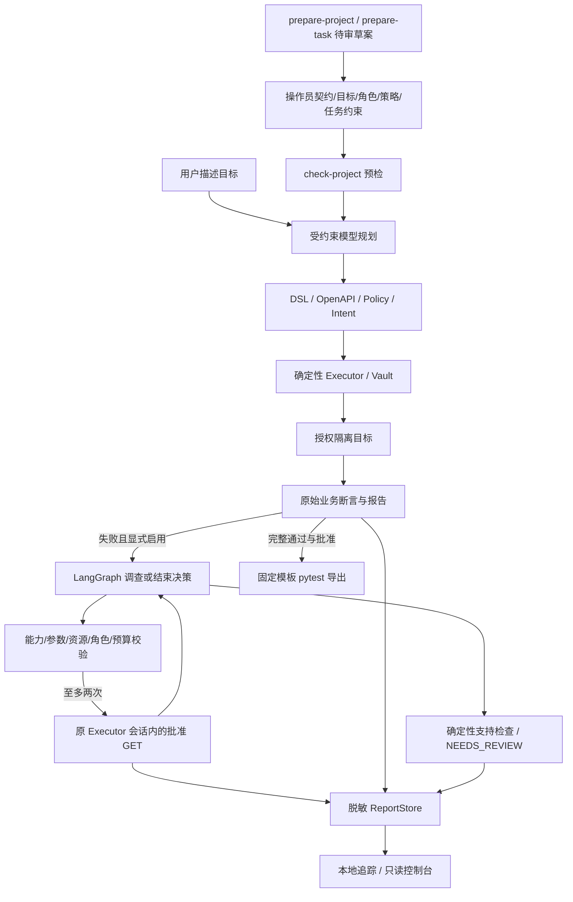

# AgentTest 运行、演示与证据导读

面向后端开发者和测试工程师，在明确授权的隔离环境中，把自然语言目标转换为可审计的跨接口测试，并将完整通过的场景沉淀为无模型回归资产。导入 OpenAPI 只能得到结构信息，业务预期、角色权限和资源关系仍须操作员提供。

## 运行闭环



调查复用原活跃会话，但业务判定与调查结论独立保存；它不会循环重执行业务写入。一次规划及至多三次反馈模型决策，最后一个决策位置保留给结论，最多两次批准的 GET。模型、工具、报告写入和取消都保留固定分类；未知预期不能自动判 PASS。

## 接入与运行

使用 Python 3.11 和已有 `.venv`；从零安装沿用仓库 setup_env.ps1 -Agent 或 Linux setup_env.sh --agent，依赖版本由原锁文件固定。本 Goal 未新增依赖。默认离线，无 Docker、API Key 或外网要求。真实模型仅通过显式 --real 或 --model-env 启用，凭据留在本地 .env/环境变量。

```powershell
# 只读取契约生成待审草案，不访问目标、不调用模型
.\.venv\Scripts\python.exe -m agenttest prepare-project --contract examples/portability/courses/openapi.json --output runs/new-course-project.draft.json
# 已有受信项目预检，不等同目标在线健康检查
.\.venv\Scripts\python.exe -m agenttest check-project --project examples/portability/courses/read.project.json
```

预检需要目标角色配置对应的合成凭据；无需手工创建环境的两域复现使用 `scripts/check_onboarding.py --output runs/<new>`，运行器生成临时内存账户。真实项目必须由操作员自行配置授权目标、角色和批准策略，不从模型接收这些权限。

新增任务使用 `prepare-task --project <checked-project.json> --user-task <目标> --output <new.json>` 自动复用三份摘要。填写和审阅 TaskContract 的 steps/before/required_goals 后才能运行 `agent --project <project.json> --real --model-env .env`。反馈功能需额外指定操作员批准的 `--feedback-capabilities <file>`。通过报告可由 `export-pytest` 或 `agent --export-regression <new-dir>` 导出；导出固定可信模板而非模型生成 Python。

## 五分钟演示脚本

演示按以下内容组织；实际命令耗时受环境影响，不把时间槽当作测得的性能指标。

| 时间槽 | 操作与应展示的证据 |
| --- | --- |
| 0:00–1:00 | `.\.venv\Scripts\python.exe -m agenttest showcase --case normal --runs-dir runs/demo-normal-new`：完整任务 PASS、实际请求及断言；用相同入口 `--case fault`：指定断言失败，不能把演示 verified 当业务 PASS |
| 1:00–2:30 | `.\.venv\Scripts\python.exe scripts/check_feedback.py --typed-inputs --output runs/demo-feedback-new`：固定/Mock 三题，展开报告中的调查选择、GET、证据引用和独立结论。Mock 只验证机制；另展示真实 FE 三题统计 3/3 业务、2/3 结论及保留的漏诊 |
| 2:30–3:15 | 展示 `.\.venv\Scripts\python.exe scripts/check_portability.py --source both --output runs/demo-portability-new` 的执行前拒绝，原始报告零业务请求；不能把计划合法等同任务满足 |
| 3:15–4:15 | `.\.venv\Scripts\python.exe -m pytest examples/regressions -q --basetemp runs/demo-pytest-new`：三份已批准固定回归，无模型；`.\.venv\Scripts\python.exe scripts/check_regression_exports.py --output runs/demo-regression-new` 额外核对正常三通过/故障三失败 |
| 4:15–5:00 | 在已有只读 Console 打开对应 Run ID，分别查看原断言、调查依据、模型用量；说明草案无权执行、正式独立评测尚未完成 |

本机真实模型报告保存在 `runs/goal-feedback-typed-live/reports` 与 `runs/goal-paired-live/reports`，可用本地 API 指向目录进行只读展示。新克隆没有私有报告，使用上述离线报告及提交的脱敏统计。不要将 Mock 响应讲成真实模型结果，也不要为演示补跑已用题提高成绩。

启动控制台：先设置 `AGENTTEST_RUNS_DIR` 指向选定 reports 目录，以 `.\.venv\Scripts\python.exe -m uvicorn agenttest.main:app --host 127.0.0.1 --port 8000 --no-proxy-headers` 启动只读 API；另一终端在 web 运行 npm run dev，浏览 127.0.0.1:5173。安装、生产认证和远程开放不属于演示流程。

## 支持与限制

| 支持 | 限制 |
| --- | --- |
| 通用契约与批准参数/策略、动态资源引用、有限嵌套 JSON body | OpenAPI 子集；并非导入任意项目即自动生成全部业务预期 |
| 隔离目标、凭据 Vault、SSRF/重定向约束、确定性断言 | 不向生产开放任意 URL，不执行模型代码，不重试或恢复未知写入 |
| 有界只读反馈、证据支持检查、原结果不覆盖 | 仅支持访问边界/重复回读症状，不能推断实现根因；工具成功不等于定位成功 |
| 本地脱敏追踪、历史查询与只读页面 | 外部上传关闭，未接入 Langfuse；没有多租户生产审批与浏览器执行 |
| 完整通过场景导出固定 pytest | 失败报告和 NEEDS_REVIEW 不得导出成通过的回归资产 |
| 24 新题三轮开发比较、保留全部失败与分母 | 五个既有模板，未独立人审；没有实测人工节时，不构成正式留出集成绩 |

不新增 Docker、队列、向量库、RAG、多 Agent、自动修复或写恢复。Docker/Langfuse 属于可选项，本次没有用新增组件替代现有交付验证。

## 证据索引

- [Goal 检查点](goal-delivery-20261018.md)：提交、失败、验证与下一步记录。
- [反馈闭环](bounded-feedback.md)与[三题真实结果](demo-evidence/feedback-typed-live-summary.json)：业务 3/3、结论 2/3，不覆盖先前 FC 的规划拒绝。
- [配置与追踪](onboarding-observability.md)、[两域计数](demo-evidence/onboarding-summary.json)：3/4 输入复用、三个摘要自动填入，工时未知。
- [24 题协议](paired-development-protocol.md)：冻结、同断言固定 pytest、故障健康配对、三轮与正式评测边界。
- [独立人审待办](goal-independent-review.md)：空登记包、开发任务排除及真实审核要求。
- [简历和面试](goal-resume-interview.md)：三条简历、三个案例及数字来源。
- [旧统一九项验收](unified-acceptance.md)：仍按原分母运行；新增反馈/接入/追踪另列，不篡改旧成绩。
- 历史 Java/PocketBase/MCP 证据保留原日期及环境，本 Goal 的新业务请求全部为临时 ASGI；未新增真实第三方业务 HTTP 或数据库写入。

完整实验指标、成本与评分解释见 [价值与成本报告](goal-value-report.md)。固定 pytest 对照代码由本轮代理编写，模拟固定测试流程，没有真实独立人工编写或维护计时。
