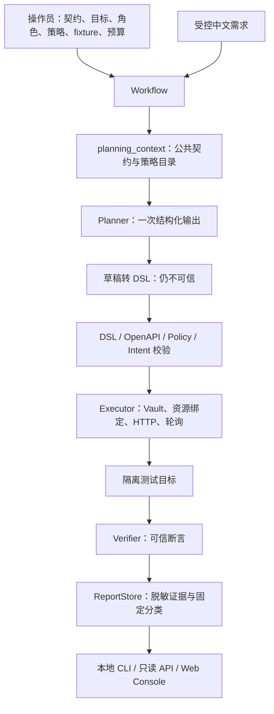

# AgentTest：项目能力与工程决策

核查日期：2026-10-13；收尾基线 `e394dfb`，业务功能沿用 `0e684b2`。本页面向 GitHub 读者和技术面试官，描述已经存在的代码与证据。详细接入判断见[工程审查报告](engineering-review-20261013.md)，真实异步样例见[批处理 Demo](batch-demo.md)，RAG 决策依据见[离线评估](rag-necessity-20261013.md)。

## 项目解决什么问题

API 测试的难点不只是发请求，还包括登录顺序、前后接口的资源依赖、异步任务何时结束，以及用什么依据判定通过。LLM 可以提出步骤，但它的输出可能格式正确、业务目标却错误，也可能多做一次写入。因此 AgentTest 将规划、授权、执行和判定分开。

用户输入受控中文需求，模型选择批准的操作、角色和策略，生成有类型的计划。可信代码验证整个计划后才发送请求；凭据、服务地址、CSV 内容、轮询预算和断言均由操作员配置。它是独立 Python 项目；CourseInsight 是 Java 被测系统，未为迎合测试修改其业务代码。

当前适合展示的是“有限业务范围内可审计的测试 Agent”。新增[配置式跨项目入口及离线验收](portability.md)，但仍不能宣称输入任意需求、导入任意文档就能自动测试任意系统。

## 架构与模块职责

| 模块 | 实际职责 | 边界 |
| --- | --- | --- |
| [contracts.py](../src/agenttest/contracts.py)、[request_validation.py](../src/agenttest/request_validation.py) | OpenAPI 3.0/3.1 JSON/YAML 解析、局部引用展开、请求约束校验 | 拒绝远程引用；请求 Schema 是受支持子集，不完整模拟 Bean Validation |
| [planner_input.py](../src/agenttest/planner_input.py) | 筛选可见 Operation/Role/Policy、参数约束、登录前置关系 | 去除文档自由文本、默认值、账号及目标地址；目录可见不等于授权 |
| [llm_planner.py](../src/agenttest/llm_planner.py)、[batch_plan.py](../src/agenttest/batch_plan.py) | 兼容 Chat Completions、用量/预算核查、严格 PlannerDraft 转 DSL | 通用草稿支持标量参数/引用及嵌套 JSON body，按接口/位置收紧参数名并本地重验；batch 专用草稿增加 fixture 与 poll 策略 ID |
| [generic_references.py](../src/agenttest/generic_references.py) | 从可见策略收集引用候选，并核对每个参数的先前来源策略与字段 | 开放槽位只限制支持的语法；角色、授权、断言和任务满足仍由原引擎判定 |
| [dsl.py](../src/agenttest/dsl.py)、[policies.py](../src/agenttest/policies.py) | 步骤类型、认证顺序、绑定规则、批准断言、可信 CSV 与 PollPolicy | 模型不能新增策略或凭据；只准引用已有策略 ID |
| [intent.py](../src/agenttest/intent.py)、[batch_intent.py](../src/agenttest/batch_intent.py)、[courseinsight_nl.py](../src/agenttest/courseinsight_nl.py) | 检查任务名称、角色、目标、顺序、资源来源与完整路径 | 封闭语法与规则；不支持的说法保守待审，不用模型自评替代 |
| [workflow.py](../src/agenttest/workflow.py) | LangGraph 节点、一次规划/执行、预算、错误分支、最终任务满足标志 | 没有自动修复或重新规划循环 |
| [executor.py](../src/agenttest/executor.py)、[credentials.py](../src/agenttest/credentials.py) | Vault 登录、multipart、前序成功响应绑定、有界轮询、发送前审计 | 不执行模型代码；写入不自动重试，不恢复未知结果的请求 |
| [verifier.py](../src/agenttest/verifier.py)、[report.py](../src/agenttest/report.py) | 状态/字段/条数断言、报告快照、摘要、脱敏与分类 | 无可信预期则待审；断言失败不能直接等同已确认服务 Bug |
| [safety.py](../src/agenttest/safety.py)、[local_access.py](../src/agenttest/local_access.py)、[report_files.py](../src/agenttest/report_files.py) | 固定目标、隔离写入、回环 API、路径/链接防护、报告写入边界 | Target 仅 IP/localhost 或明确批准的隔离私网 IP；阻断重定向和环境代理 |
| [discovery.py](../src/agenttest/discovery.py)、[eval_v2/](../src/agenttest/eval_v2/) | 离线候选发现；独立意图评分、分母、故障配对、审核与归档审计 | 候选不执行；正式评测仍须独立审核，batch 暂无完整评分表达 |
| [investigation.py](../src/agenttest/investigation.py)、[mcp_service.py](../src/agenttest/mcp_service.py) | 单次批准只读调查；五项固定场景 MCP stdio 工具 | 调查当前为 FakeAnalyzer；MCP 不开放任意 DSL、URL 或 Java 写入 |
| [main.py](../src/agenttest/main.py)、[web/](../web/) | 契约导入、报告查询、React/TypeScript 本地只读控制台 | 没有浏览器业务执行、多租户审批或生产部署认证 |

## 一次自然语言任务的完整调用关系

实际图为 `load_contract → plan → validate → execute → analyze_or_finish → report`。校验拒绝跳过 execute，仍保存诊断；setup/verify 没有另建图节点，认证和断言在 Executor 内完成。

1. 入口传入操作员选择的契约、TargetConfig、Registry、预算和 Intent Validator。Workflow 复制目标配置与策略快照，秘密不进入图状态或模型上下文。
2. `load_contract` 解析契约，检查有界任务及已知秘密，构造 Executor。`plan` 通过 `planning_context` 构造公开视图，调用 Planner 一次。
3. 真实 Planner 校验服务响应、usage、严格草稿和重复参数，再转换成 Scenario。batch 转换器按固定 `csv_fixture_id` 注入 CSV，按 `poll_policy_id` 设置是否轮询；没有读取模型给出的路径。
4. `validate` 解析 DSL；`Executor.validate` 先做操作、角色、认证、依赖与请求约束检查，再逐步 `Registry.resolve` 核对场景、角色、封闭参数、准确来源及 Selector。随后 Intent Validator 校验完整任务与计划。校验器只收到副本，不能修补可执行计划。
5. `execute` 在操作员执行前门禁通过后调用同一个 Executor；Executor 再次预检。Vault 注入登录凭据并持有 JWT；消费者只引用前序成功响应。每次发送前保存 attempt ID，检查大小、请求数与超时。
6. 状态轮询先验证允许状态与进度约束，遇到批准终态后执行最终断言。终态 FAILED 可以结束等待，但不能通过 SUCCEEDED 断言。任何失败停止后续业务步骤。
7. `analyze_or_finish` 输出固定结论，不能改断言、重规划或重放写入。只有整个图返回且 Intent 通过、业务 PASS，才发布 `task_satisfied=true`。

`dsl_valid`、`policy_authorized`、`intent_verified`、`workflow_completed`、`task_satisfied` 分别回答结构是否合法、策略是否授权、是否覆盖需求、图是否结束、需求是否完成。显式 `operator_plan` 的 PASS 不声明自然语言满足，`task_satisfied=null`。

## 模型与可信代码的权限

| 模型可以提出 | 可信代码决定 |
| --- | --- |
| 可见目录内的 Operation、Role、Policy 与步骤 ID | 可访问的目标、操作白名单、角色账号和写入授权 |
| 受控课程名与前序步骤引用 | 参数范围、来源策略、Selector、角色关系与认证顺序 |
| batch 的固定 fixture ID、poll 策略 ID | CSV 字节、multipart 字段/文件名、允许状态、次数/间隔与超时 |
| 计划或空步骤弃权 | 可信断言、错误分类、最终 PASS/任务满足 |

结构化输出解决格式问题，不产生业务权限。模型不能提交 reviewed/source、任意请求体、Header、URL、文件路径或代码来替代配置。文件选择与人工审查是现有信任根，尚无多人审批系统。报告不保存原始模型响应、HTTP 正文或认证秘密；哈希能发现改动，不能防御有操作系统写权限的人整体改写证据。

## 可验证的真实实验

不同日期、Prompt、任务集和服务后端不能合并成一个“总体成功率”。学校 `ecnu-plus` 是可变服务别名，temperature=0 也不等于固定权重和结果。

| 证据 | 已观察结果 | 不能推出的结论 |
| --- | --- | --- |
| [2A 首轮](stage2a-evaluation.md) / [第二轮](stage2a-round2-evaluation.md) | 相同 18 条受控课程任务，端到端 13/18 → 16/18；原失败保留 | 多处实现/Prompt 同时变化，不能归因单一优化，也不是广泛泛化 |
| [4A Java](stage4a-results.json) | 1 次模型规划 + 隔离 Java 登录/创建/查询，14 项断言；1,794 Token | 没有验收 Java CSV/异步链或跨用户权限 |
| [4B](stage4b-results.json) | 支持任务成功 1/2，另两条越权需求零请求拒绝；真实计划检出 3/3 已执行缺陷，总覆盖 3/4 | 未执行的归属故障不能计为已检出；门禁拒绝不是模型主动拒绝 |
| [开发 Candidate A/B 摘要](demo-evidence/candidate-ab-summary.json) | 两个已用样本，两组均 2/2；A 3,830、B 6,031 Token，合计 4 次 / 9,861 Token | 没有观察到质量增益；固定 A→B、每组两条，不能宣称显著性或速度改善 |
| [batch 真实 Smoke](batch-demo.md) | 1 次模型调用 / 2,765 Token，五步 PASS；同计划 terminal / result_count 均断言失败 | 只有一种流程、一条需求；DEVELOPMENT_ONLY / UNREVIEWED，无完整 Eval v2 分数 |

batch 的模型耗时 13.375 秒，正常 Workflow 15.657 秒；业务请求 6 次，全部进程内 ASGI，无真实 Java/数据库访问。Prompt 明确给出流程和选择规则；模型完成受约束填充与依赖表达，未验证自主发现接口或开放式规划。故障重放是同计划的确定性验证，不是两次新增模型规划。

## Candidate Discovery 为什么不默认启用

发现器离线读取契约与批准策略，有限搜索标量输入、边界、认证和资源关系，生成稳定候选 ID、缺失依据与静态覆盖。所有候选保持 NEEDS_REVIEW；负例为 STATIC_ONLY_NEGATIVE，没有负例执行授权；缺陷映射为 NOT_MAPPED。示例 19 项、Operation 1/2、Scenario 8/9 均为静态发现口径，执行数为 0。

A 已包含 Operation/Role/Policy、认证顺序、来源 Selector 和 same/different 关系；B 仅追加过滤后的正常候选元数据，仍走同一门禁。开发 A/B 两条都成功，B 输入从 3,109 增至 5,291 Token，未观察到质量收益。[设计与历史结果](candidate-discovery.md)。

离线审计还发现重复登录候选、重复依赖及审计元数据；候选投影只检查角色集合，缺少逐步骤角色对应，反向跨用户链可能显示为同一投影。原 Policy/Intent 仍拦截不合法计划；这是提示质量问题，不能表述为已发生越权。

私有压缩原型可恢复 58 个上下文；36 个开发上下文合计字节减少 23.64%，Fake/Mock 的 144 行结果一致。这只证明格式往返与引擎兼容，不是实测 Token 节省或真实模型收益。原型未接入生产；A 保持默认，B 仅显式实验。暂不投入新的压缩、A/B 或候选架构工作。

## RAG 技术选型记录（No-Go）

考虑 RAG 的原因是：扩展到不同系统时，Schema 往往不能完整表达业务状态、资源关系和接口语义，希望从版本化文档、规范及历史案例中补充规划依据。这是信息需求假设，不是已有收益。

当前 Agent 已从操作员配置取得 Operation/Role/Policy 目录、认证顺序、绑定来源与 Selector，并由可信组件掌握固定 CSV、PollPolicy、断言、目标和执行预算。现有 mini 五步链无需检索即可运行。OpenAPI 描述仍按不可信输入解析；契约结构和文档引用不能扩大执行白名单。

Java 扩展确有额外语义：CSV 的 content/rating 和评分约束、重投失败与终止失败的计数、完成率不等于成功率、结果列表可能含未成功任务，以及 analysis 与 analysis-task 的权限差异。这些信息来自核对版本的源码和业务文档；同时，当前 Java 契约、Policy 和 Intent 尚未覆盖这些操作。检索不能补发授权，也不能代替可信适配。

| 本次 BM25 结果 | 实际观察 |
| --- | --- |
| 语料与标签 | 12 条 DEVELOPMENT_ONLY / UNREVIEWED 问题、27 份文档，26 个关联标签；Golden Labels 未独立人工审核 |
| raw Recall@3/@5 | 33.33% / 33.33% |
| 系统／版本／可见性过滤后 Recall@3/@5 | 37.50% / 63.89%；12 KB notes 预算内 Top 5 实际证据召回 52.78% |
| 请求成本 | A 72,270 字节，B5 182,819 字节，约 2.53 倍；仅粗估 Token，没有实测模型成本 |
| Top 5 污染 | raw 有 24 个跨系统、2 个 PRIVATE、11 个冲突样本命中；过滤后跨系统／PRIVATE 为 0，冲突仍为 7；类别可重叠 |
| 旧版本控制探针 | raw 第 2 位返回旧 DTO，过滤后排除；主问题旧版本命中 0 不证明不存在风险 |

污染数字是各题 Top 5 中的命中次数，同一文档可重复出现，类别也可重叠；故意构造的负例不能用来估计真实环境发生率。

检索文本、历史案例、未审核文档与模型计划均为**非可信证据**，只能辅助提出待审建议。执行依据仍是操作员批准的 TargetConfig／Registry／fixture／预算，以及独立 DSL、Policy、Intent 和执行前检查；检索命中不能产生 reviewed 标记、断言、管理员角色或写入许可。

因此当前选择 **No-RAG**：词法基线有漏检、预算内信息损失与冲突风险，尚无模型规划或端到端收益，已增加上下文成本；有限场景优先直接提供小型版本化资料与可信结构化输入。mini 与 CourseInsight 共享课程业务域，语料规模有限，不能宣称跨业务域泛化。首次评估未运行 Embedding，其协议及成绩保持原字节。

原归档后，用户另行授权的[本地语义检索补充试验](rag-semantic-trial-20261013.md)使用同十二题、同语料的固定量化 ONNX 模型。C scoped Recall@3/@5 为 41.67%/55.56%，预算内 @5 为 51.39%，C5 请求字节为 A 的 2.57 倍；raw PRIVATE／冲突命中为 6／17，过滤后为 0／7。实际固定计划回放保留故障断言和越权拦截，但不证明模型规划收益。8/27 份文档截断，标准库分词子集未经原生一致性验证；结果仍为 DEVELOPMENT_ONLY / UNREVIEWED，参考层仅留在默认关闭的实验目录。

只有在新里程碑中取得独立业务域资料、独立人工审核的新问题与标签，确认静态上下文不足，并以同数据、同权限、同预算对照证明收益大于成本且污染可控，才重新考虑默认启用 RAG。真实调用仍须另行授权；不把本次局部检索改善升级为生产投入或开发向量数据库的理由。

## 已实现、有限支持和未来方案

当前能力、限制与历史真实证据集中见[统一验收与演示](unified-acceptance.md)。一个离线入口复用项目预检、原 showcase、课程／工单、结构化 JSON 和固定 pytest；各项保留自己的分母与故障状态，不合成模型成功率。通用规划现已支持封闭结构化对象／数组 body 和有限小数，仍遵守既有 Schema 子集与来源规则。

新里程碑 [PocketBase 认证与写入](pocketbase-acceptance-20261017.md)使用官方 Go／SQLite 程序及原生集合规则，无自定义业务处理器。两个隔离实例固定六题均通过；同六题三轮真实模型 16/18 完成，两次在创建参数多套 body，被原 OpenAPI 门禁拒绝、零业务请求。18 次调用共 68,800 Token，任务与提示未为通过而修改。只读数据库核对未发现越权改写、错误归属或已删除标题残留，两个进程均已回收。

用户另行授权的[受控目标组合里程碑](composed-workflows.md)新增同目录内的目标选择、偏序校验与 CSV／轮询／断言模板证据。它复用原执行引擎，使用单独的 UNREVIEWED 开发协议；固定计划机制验收不升级为真实模型成绩，正式 Eval v2 的 batch／独立审核限制仍保留。

[真实模型补验](real-model-coverage-20261014.md)已对通用入口四条任务和十二条组合开发任务各调用一次：通用任务 4/4、组合正常任务 2/7 完成；五条拒绝任务主动正确拒绝为 0，仅两条由匹配预期的意图门禁挡住。批处理组合、角色互换和拒绝规划仍有缺口，不能据此保证陌生项目效果。

| 状态 | 能力 |
| --- | --- |
| 已实现且可离线展示 | 安全契约解析、DSL、Registry、Vault、JSON/CSV、有界轮询、动态绑定、确定性断言、报告与故障注入；受控课程/归属/batch NL；Fake/Mock 工作流；MCP stdio；本地只读 Web |
| 有真实小样本证据 | 两轮 mini、Java admin 三步、开发 Candidate A/B、mini batch；通用两域与组合补验；Petclinic 只读及 PocketBase 认证／写入六题三轮 16/18，各批分母独立 |
| 有实现但范围有限 | Schema/JSONPath 子集；封闭中文意图；FakeAnalyzer 调查；来源固定的 Java 三步适配；[固定 pytest 导出](regression-export.md)限完整验证的普通 JSON 计划，配置由操作员提供；Eval v2 正式门禁存在但 C 草案未独立审核 |
| 未实现或未验收 | AgentTest 到 Java 的批处理闭环、任意业务需求的自动语义校验／复杂认证、CSV 导出内容校验、自动清理、写入恢复、独立大样本 benchmark、生产多租户/分布式运行；陌生项目仍需人工契约／策略，PocketBase 跨账号读取规划仅 1/3 完成 |
| 当前不做 | 生产 RAG、向量数据库、多 Agent、自动修复、Kubernetes、继续使用旧题调参；本地 Embedding／参考层仅为独立开发实验，Candidate 压缩保持私有研究证据 |

源码检验与默认测试不需要 Key、Docker 或外网；可选 Agent/MCP 依赖由锁文件固定。业务基线 `0e684b2` 本地历史验收为 984 passed / 13 平台或权限 skip；该 SHA 及 RAG 归档 `e394dfb` 的 Python 四组与 Web 两组 CI 均全部通过。它们属于既有证据，不能冒充本次文档工作重新执行的测试。

## 功能冻结判断

统一验收后的[收尾审查与冻结范围](final-review-20261017.md)保留当前能力与限制，修复交付工具的超时回收边界；后续转入缺陷及兼容性维护，不扩充架构或使用旧题调参。具体检查与最终提交结果见该记录和进度。

**现有本地演示与受控研究功能按上述范围冻结。** 已有契约、规划、安全执行、断言、报告、故障重放、MCP 和只读控制台；RAG 已得到 No-Go 取舍，没有必须新增 Agent 功能才能完成展示的阻塞。收尾审查修复交付工具的超时边界，完成相关回归与统一验收，最终以该提交的全部 CI 成功作为归档验收，不用旧 SHA 的成绩替代。

以下限制继续公开保留，不扩大冻结范围来掩盖：

| 未验收范围 | 仍存在的阻塞 |
| --- | --- |
| 当前版本 Java／Java batch | 审核仍固定旧 SHA；新契约、Policy、Intent、隔离环境、后台任务及副作用回收未验收，不能直接真实执行 |
| 正式独立模型评测 | 人工独立审核／留出与完整 batch 评分表达不足；历史开发集、门禁拒绝和检索命中不计为独立成功率 |
| 跨业务域／RAG 收益 | 仅 12 条未独立审核开发问题，有限课程语料；本地 Embedding 有补充检索成绩，但真实模型规划和端到端 RAG 收益仍未测 |
| 生产交付 | 当前为本地单机研究工具，没有生产多租户审批、第三方复杂流程、自动清理或写入恢复等验收；已有 Petclinic 只读及 PocketBase 限定认证／写入证据 |

Java 扩展、正式 benchmark 和生产验收是另立里程碑的工作，不是当前演示功能冻结前必须补齐的功能。冻结后优先维护缺陷和依赖兼容，不继续旧题调参或追加功能。

## 公开资料与私有运行数据

公开保留 `experiments/rag_necessity/` 中已审核的实验代码、冻结语料／问题／协议、结果和负例，以及本阶段文档、[两份脱敏静态展示副本](demo-evidence/README.md)。实验中的 PRIVATE 文档是明确标注、无真实秘密的合成可见性负例；UNREVIEWED 标签不变。资料获准公开不等于业务预期已获独立审核。

`.env`、真实凭据、原始运行报告／上下文、私有任务、预检与 claim、候选压缩原型、备份、测试临时目录和调试输出继续保存在忽略的 `runs/` 或其他私有目录，不随文档提交。不能因为某次输出脱敏过，就整目录公开。静态副本、来源摘要和历史案例用于说明证据，不是可执行计划或执行授权。

## 面试时怎样讲

“我做的是一个受控 API 测试 Agent。LLM 只生成计划，目标、凭据、测试数据、轮询预算和断言由可信代码掌握。我重点解决了跨接口 ID 传递、异步任务等待、写入不重试，以及计划合法但不满足需求的问题。真实模型已经跑通 mini 的五步批处理；Java 目前只真实验收了三步课程链，批处理接入还需要契约与安全环境适配。”

可以展开三个具体决策：为什么结构化 JSON 之后仍要 Intent/Policy；为什么终态错误与超时属于不同分类；为什么不把结果条数当作 Java 分析成功。保留 B02 认证顺序失败与 Candidate 无增益观察，比只报成功数字更能说明工程判断。

面试前优先熟练解释和演示现有闭环。最小 Java 接入范围、阻塞项及可推迟工作见[本轮工程审查](engineering-review-20261013.md)。
