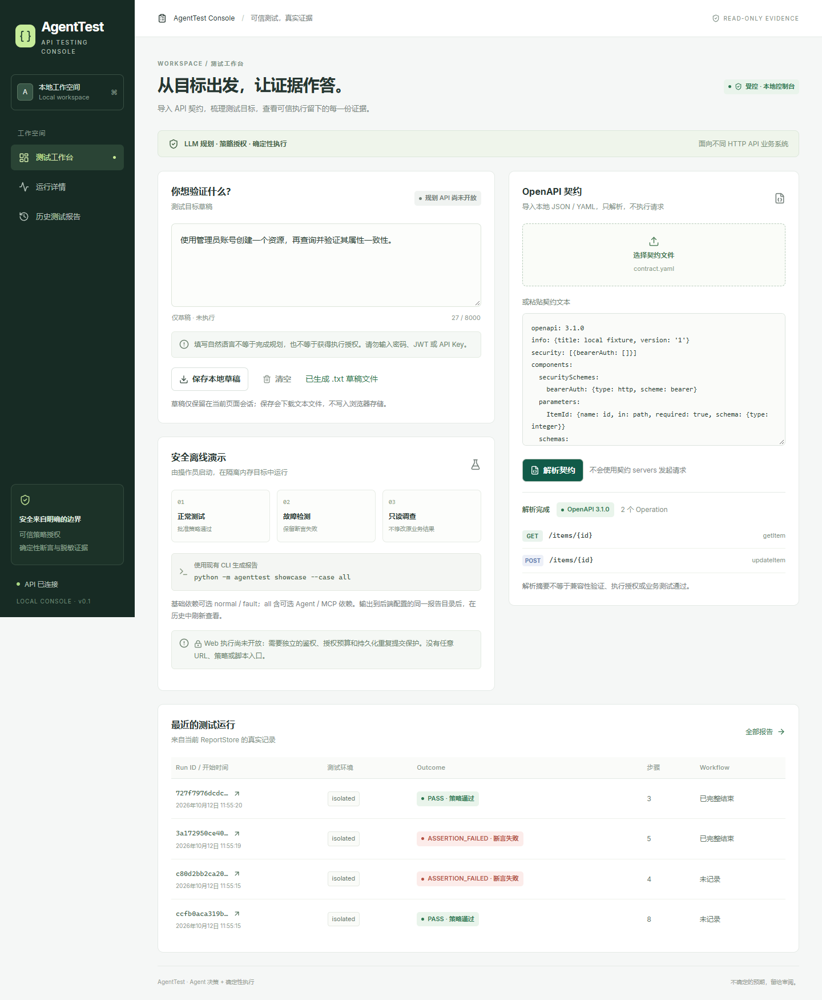
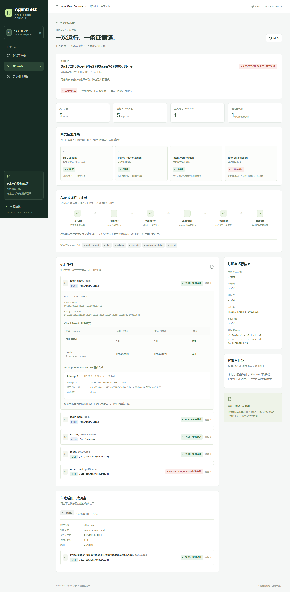

# AgentTest Web Console（2026-10-12）

2026-10-20增量新增[受控任务页与服务](nl-entry.md#cli任务服务与工作台)：`/tasks`可对操作员注册项目
发起需求、查看派生约束/预算/进度、澄清/补充、取消、读取证据与导出固定pytest。
任务服务需显式配置启用，原默认只读运行方式继续可用。下文保留原只读里程碑的结构及验收记录。

这是当前仓库新增的本地 Web 里程碑。复用 FastAPI、ReportStore 和脱敏 RunReport；不重建 Agent，也不修改 Executor、Vault、Policy、Intent Validator、MCP 或冻结评测数据。CourseInsight 只是验证对象之一。

## 页面与架构

- **测试工作台 `/`**：自然语言目标草稿、下载本地 `.txt` 草稿、清空、JSON/YAML 文件上传或文本粘贴、真实 OpenAPI 摘要、最近运行。草稿在页面会话内保留，刷新即消失；不写 localStorage/sessionStorage，不向 API 发送目标草稿。请勿在目标或契约中填写凭据。
- **运行详情 `/runs/:runId`**：五种 Outcome、四层校验、Workflow 完成情况、实际节点、步骤 / AttemptEvidence / CheckResult、独立只读调查、诊断、真实模型用量。`/inspect` 提供 Run ID 查询入口。
- **历史报告 `/runs`**：结果筛选、时间排序、每页 12 条、有界目录总数、无效报告提示、详情跳转。统计范围是服务端配置的一个目录，不递归合并 MCP 等嵌套命名空间。

```text
web/src/pages           React 页面与路由
web/src/components      契约导入、流程、四层校验、步骤证据、通用状态
web/src/api             请求封装、FastAPI 生成类型、旧报告兼容类型
web/src/status.ts       集中解释 Outcome / 三态 / Workflow
FastAPI main.py         health / spec summary / run / bounded run list
report_queries.py       列表投影与公开断言值保护
ReportStore             现有报告存储 + 有界、身份匹配、链接检查
```

技术栈：React 19、TypeScript 5.9、Vite 8、React Router 7、Lucide、原生 CSS。没有复杂状态管理或 UI 框架。Vitest / Testing Library 做组件测试，Playwright 做真实前后端浏览器测试；Prettier 只整理本轮新增前端。

## 安装与启动

Node.js **22.12+**，Python 3.11；仅使用当前项目 `.venv`。首次安装需要包源，安装后前端不加载外部字体、脚本或图像，基础测试和演示无需 API Key / Docker / LLM。

仓库根目录，Windows PowerShell：

```powershell
# Python 首次安装沿用 README / scripts/setup_env.ps1；已有 .venv 不必重复创建。
# normal / fault 只需要基础依赖；all 需要现有 agent,mcp 可选依赖。
.\.venv\Scripts\python.exe -m agenttest showcase --case all --runs-dir runs/web-console
$env:AGENTTEST_RUNS_DIR = 'runs/web-console'
.\.venv\Scripts\python.exe -m uvicorn agenttest.main:app --host 127.0.0.1 --port 8000 --no-proxy-headers
```

另一个终端：

```powershell
Set-Location web
npm ci
npm run dev
# 打开 http://127.0.0.1:5173
```

Linux：使用 `.venv/bin/python`，后端启动前 `export AGENTTEST_RUNS_DIR=runs/web-console`；其余 npm 命令相同。必须从仓库根目录启动后端，或为 AGENTTEST_RUNS_DIR 指定操作员核对过的绝对目录。

默认 `/api` 和 `/health` 通过 Vite 同源代理到 `http://127.0.0.1:8000`，没有放宽 CORS。需要改端口时，在 `web/.env.local` 配置 `AGENTTEST_API_PROXY`；`VITE_API_BASE` 留空。只有部署环境已经正确提供同源反向代理或受限跨域策略时，才配置浏览器可见的 VITE_API_BASE。所有 VITE_* 都是公开构建配置，不能放密钥。

```powershell
npm run typecheck
npm test
npm run build
npm run preview
# 生产构建本地预览 http://127.0.0.1:4173，仍使用同源代理。
```

构建输出在 `web/dist/`，不纳入 Git。此项目没有生产部署、认证或多租户支持。请只监听回环地址；localhost 本身不构成执行授权。本轮没有 Web 执行接口，页面不接受目标 URL、DSL、策略、断言或脚本。

## API 与报告语义

| API | 功能与边界 |
| --- | --- |
| `GET /health` | 真实后端连接状态 |
| `POST /api/spec/summary` | 现有 JSON/YAML 解析；最大 1,000,000 bytes；不连接契约 servers，不代表业务兼容性验证 |
| `GET /api/runs/{run_id}` | 现有脱敏详情；保留旧报告缺失字段，不补造历史校验结论 |
| `GET /api/runs?limit=20&offset=0&outcome=PASS&order=desc` | 新增只读目录查询；limit 1–100、offset 0–2000、Outcome 枚举、asc/desc |

列表最多检查 2,000 个顶层目录项，累计报告字节预算 32 MB；单报告上限 2 MB。超预算返回固定 503，不把部分扫描误报为全量。无效、不完整、身份不匹配、不可读报告跳过并计数。报告只允许 32 位小写十六进制 Run ID，固定 `report.json`，禁止 symlink / Windows reparse point；POSIX 使用目录相对 no-follow 打开，并验证普通文件、Run ID 一致性和实际读取上限。文件系统和报告根目录仍由可信操作员控制，不提供抗恶意本机管理员并发篡改的沙箱承诺。

列表排序使用记录时间，无时间的旧报告显示“未记录”（desc 置后、asc 置前）；步骤或 Outcome 缺失也显示“未记录”，不补造零或 NEEDS_REVIEW。HTTP 预期/实际状态只公开有效 100–599 状态码证据。其他数字断言默认隐藏；必须由操作员通过 `AGENTTEST_PUBLIC_POLICIES` 指定独立审阅的 Registry JSON，核对策略摘要、operation、public_evidence 和字段断言后才公开统计值，敏感 selector 优先隐藏。历史报告自报标记和可解析数字都不授予公开资格。其余字符串/对象断言值再次脱敏。接口返回 Pydantic 校验后的允许字段，不返回文件路径、原始请求或响应正文。前端不显示服务端异常文本、上传内容或网络异常原文，15 秒超时，路由离开取消请求并忽略迟到响应。

API 校验本地 Host（localhost/127.0.0.1/[::1]）、回环 peer、明确本地 Origin 和 Fetch Metadata，拒绝重复 Host/Origin 及 cross-site 请求；不依赖 CORS。默认 Origin 端口 8000/18000/5173/4173，其他完整本地集合用 `create_app(allowed_origins=...)` 显式配置。只允许回环启动并禁用代理头，禁止公网、共享和无认证反向代理部署；应用请求门禁不能替代 socket 绑定或生产认证。报告增加可选 revision，旧报告缺字段仍可读；同 ID 发布竞争显式失败，不能通过重跑业务处理发布错误。完整威胁模型、限制及回归见[审查整改](review-remediation.md)。

四层严格区分：

1. `dsl_valid`：DSL / 契约 / 目标预检。
2. `policy_authorized`：可信 Registry 授权。
3. `intent_verified`：受控自然语言意图覆盖。
4. `task_satisfied`：仅 true 代表经验证的自然语言任务完成；false 未满足；null 不适用/未确认；缺字段未记录。

operator_plan 的 PASS 只表示批准计划通过，意图与任务满足标不适用。Workflow 完整结束不表示业务 PASS。流程图区分蓝色眼睛“已观测”、有明确结论的对勾“已成功”与叉号“已失败”、灰色“未执行/未记录”；旧报告 false 默认值不作为失败证据。Planner 交到 validate 只说明规划返回，不说明计划合法；Validator 使用实际门禁结论/validation_issue；Executor 使用已完成的步骤结论；Verifier 仅表示已记录的 CheckResult，仍在 Executor 内部执行。NEEDS_REVIEW 不归为 HTTP 失败。tool_calls 是 Executor 调用次数，HTTP 尝试另计；Planner / FakeLLM 调用不能冒充收费模型。Token 缺失保持未知，不根据字节数估算。

## 演示与尚未开放能力

CLI 演示复用既有一次性内存 mini target / MockTransport 与固定预算，无真实 Java 请求、收费模型、业务数据库。报告由同一 ReportStore 写入并可查询。故障检测成功的验收含义是原报告保持 ASSERTION_FAILED，而非改成 PASS。

**本轮没有 Web 规划、Web 演示执行或真实业务执行入口。** 原 CLI 函数本身不能提供浏览器鉴权、持久化幂等 claim 和进程级总预算，因此不直接暴露成 POST。未来即使只开放内存演示，也需独立审阅：固定场景、服务端授权、持久化重复提交保护、预算、取消与报告关联；不得把任意 URL/DSL/Policy 透传给既有执行器。

未实现深色主题、全目录递归索引、自动刷新、报告导出原始 HTTP、通用自然语言规划、生产权限与部署。保留当前轻量浅色方案。

## 类型与验收复现

API 变更后，从仓库根目录运行：

```powershell
.\.venv\Scripts\python.exe scripts/export_web_schema.py
Set-Location web
npm run schema
```

`api-schema.json` 来源是实际 FastAPI OpenAPI，`src/api/schema.ts` 自动生成；生成时忽略默认值带来的“必填”推断，避免 exclude_unset 的旧报告字段被错误视为总存在。`types.ts` 仅为三态展示补充兼容。不要手动修改生成类型。

在 web 运行 `npm run test:e2e`，默认自动运行 `scripts/serve_console_e2e.py`：在忽略的 `runs/console-e2e/session-*` 中生成 13 个真实离线 showcase 报告、两个无效/缺文件目录，并省略一份报告的部分历史元数据，启动 127.0.0.1:18000 API 与 5173 Vite，同源代理到一次性 API。实际检查 12/1 分页、前后按钮、筛选分页重置、空筛选、桌面/移动 ID 一致性及缺数据。端口已有服务时失败，不复用未知服务。测试结束自动停止服务；正常退出清理临时报告，Windows 强制终止进程时可能保留忽略目录，不会在下次测试复用。需要现有 agent 可选依赖；Windows 默认本机 Edge，Linux 使用已安装的 Playwright Chromium。没有安装系统浏览器。PLAYWRIGHT_CHANNEL 可选择浏览器；CONSOLE_BASE_URL 可显式选择外部本地测试服务，此时不启动托管服务，并且该服务也必须提供上述隔离夹具，不能指向用户日常报告目录。

浏览器测试不依赖历史报告；截图生成到忽略的 `web/test-results/screenshots/`，不覆盖旧交付证据。测试请求与组件模拟请求分开，组件测试覆盖不是模型或 Java 实测。390px 历史页改为卡片，直接显示 Outcome、环境、步骤及 Workflow。阶段 A 实测截图保存在 `docs/screenshots/followup-2026-10-12/`；验收结果见 [进度](progress.md)。

独立 `.github/workflows/web.yml` 保留 Node 22 + npm ci/typecheck/test/build，新增 Windows/Linux 矩阵、冻结 Python agent 依赖、托管 Chromium E2E 与失败产物上传，不依赖 Python checks Job 结果。修改后的远端 CI 尚未触发或验收，不能用本机 Edge 结果代替 Linux Chromium 成绩。





## 后续扩展点（尚未实现）

- **OpenAPI 候选发现**：CLI 核心已实现，见 [候选发现](candidate-discovery.md)。前端只读列表仍为后续集成，不能从浏览器接受可信 Policy 或执行负例。
- **Agent Eval**：另建新版本套件与独立指标接口，区分 requested/attempted、固定计划/Fake/真实模型；不从运行页 PASS 比例推算历史成绩。
- **RAG**：未来只能作为提供可追溯参考的独立候选信息源，不成为授权、断言或意图门禁的信任根。
- **Observability**：RunReport 以后增加真实节点/端到端耗时和业务/调查分别计数后，前端再显示图表；不根据请求耗时相加伪造节点或端到端耗时。

纯离线 OpenAPI 候选发现 MVP 已实现，Windows Base/Agent 已实测；先补齐 Linux Base/Agent、Linux Chromium 与远端跨平台门禁，再另立 C 系列 Agent Eval v2 标签设计、审阅与冻结，尚不启动真实模型评测。任何 Web 执行或真实任务接入都另立授权与安全验收里程碑。
